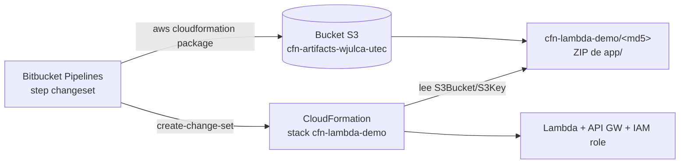
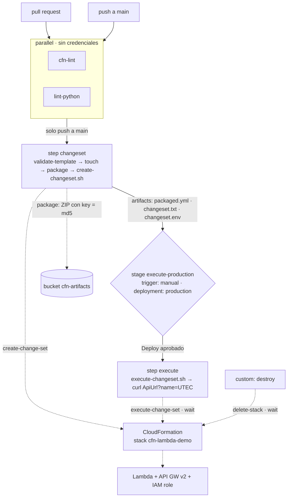

# Laboratorio: CI/CD en Bitbucket Pipelines - Despliegue de Lambda en AWS con CloudFormation

**Duración estimada:** 90–120 min  
**Nivel:** Intermedio  
**Contexto:** Este laboratorio es la versión CloudFormation de `laboratorio_terraform_bitbucket.md`. Misma aplicación (Lambda Python + API Gateway v2), mismo pipeline en **Bitbucket Pipelines**, pero la infraestructura se declara en un **template de CloudFormation** y la despliega el servicio nativo de AWS. Cambian tres cosas importantes: ya no hay `terraform.tfstate` que guardar (el estado vive en el *stack*), el "plan" se llama **change set**, y el bucket S3 ya no es para el estado sino para el **ZIP de la Lambda**. Al final podrás comparar Terraform y CloudFormation sobre exactamente el mismo proyecto.

---

## Objetivos de aprendizaje

- Escribir un handler Lambda en Python puro, ejecutable localmente sin AWS
- Declarar en un template YAML el IAM execution role, la función Lambda y el API Gateway v2 (HTTP API)
- Empaquetar el código con `aws cloudformation package` y entender por qué el `S3Key` funciona como hash del código
- Crear un pipeline Bitbucket con `parallel:` (lint) → `changeset` → `stage` de ejecución con `trigger: manual`
- Usar **change sets** como equivalente de `terraform plan -out` / `terraform apply tfplan`
- Entender qué pasa con el estado cuando lo gestiona CloudFormation: sin backend, sin lock, sin bootstrap de estado
- Comparar el modelo de Terraform (estado propio) con el de CloudFormation (estado gestionado por AWS)

---

## Requisitos previos

✅ Cuenta en Bitbucket ([https://bitbucket.org/](https://bitbucket.org/)) con un repositorio y Pipelines habilitado  
✅ Cuenta AWS propia con permisos para crear CloudFormation, Lambda, IAM, API Gateway y S3  
✅ AWS CLI v2 instalado y configurado localmente ([https://docs.aws.amazon.com/cli/latest/userguide/getting-started-install.html](https://docs.aws.amazon.com/cli/latest/userguide/getting-started-install.html))  
✅ Python 3.12+ instalado localmente  
✅ `cfn-lint` instalado localmente: `pip install cfn-lint`  
✅ Haber completado `laboratorio_terraform_bitbucket.md` para el comparativo

---

## Estructura del proyecto

```
bitbucket_cloudformation_demo/
├── bitbucket-pipelines.yml       # Pipeline de CI/CD
├── template.yml                  # IAM role + Lambda + API Gateway v2 + Outputs
├── scripts/
│   ├── create-changeset.sh       # "plan": crea el change set y deja changeset.txt / changeset.env
│   └── execute-changeset.sh      # "apply": ejecuta el change set revisado y espera al stack
├── .gitignore                    # Excluye packaged.yml, changeset.* y __pycache__
└── app/
    └── handler.py                # Handler Lambda — ejecutable localmente
```

Sin `backend.hcl`, sin `variables.tf`, sin `.terraform/`. A cambio aparece `scripts/`: la AWS CLI no tiene un `plan -out` / `apply tfplan` de una sola línea, y el change set requiere tres llamadas (`create-change-set`, `wait`, `describe-change-set`). Los dos scripts son esa pegamento, y los vas a leer completos en la Parte 6.

> `packaged.yml` es el template con las rutas locales reemplazadas por `S3Bucket`/`S3Key`. Lo genera `aws cloudformation package` en cada ejecución; nunca se commitea.

---

## Parte 1: Terraform frente a CloudFormation

Antes de escribir YAML, estas equivalencias te permiten leer el lab de Terraform y traducirlo mentalmente:

| Concepto | Terraform | CloudFormation |
|---|---|---|
| Archivo principal | `main.tf` (HCL) | `template.yml` (YAML o JSON) |
| Variables de entrada | `variable` + `-var` / `.tfvars` | `Parameters` + `--parameters` / `--parameter-overrides` |
| Salidas | `output` | `Outputs` |
| Referencias entre recursos | `aws_lambda_function.hello.arn` | `!Ref`, `!GetAtt HelloFunction.Arn`, `!Sub` |
| Dónde vive el estado | `terraform.tfstate` en el backend S3 que tú configuras | Dentro del **stack**: AWS lo guarda, tú no lo ves ni lo administras |
| Lock de estado | `.tflock` en S3 (`use_lockfile`) | Implícito: un stack solo admite una operación a la vez |
| Previsualizar cambios | `terraform plan -out=tfplan` | `create-change-set` + `describe-change-set` |
| Aplicar lo revisado | `terraform apply tfplan` | `execute-change-set` |
| Empaquetar la Lambda | `data "archive_file"` + `source_code_hash` | `aws cloudformation package` → ZIP en S3 con `S3Key` = MD5 |
| Lint sin credenciales | `terraform fmt -check` + `validate` | `cfn-lint` |
| Validar contra AWS | — (`validate` es offline) | `aws cloudformation validate-template` (llama a la API) |
| Fallo a mitad del apply | Recursos ya creados quedan creados (estado parcial) | **Rollback automático**: CloudFormation deshace lo creado |
| Destruir | `terraform destroy` | `aws cloudformation delete-stack` |
| Proveedores | AWS, GCP, Azure, Kubernetes… | Solo AWS |

**Reglas de Bitbucket que afectan este pipeline** (las mismas del lab de Terraform):

- Un `stage` agrupa steps **secuenciales**; `trigger: manual` y `deployment:` van en el `stage`, no en el step.
- Los artifacts se guardan 14 días y se descargan automáticamente en los steps posteriores del mismo pipeline. Por eso `changeset.env` llega al step `execute` sin configuración extra.
- Las variables se resuelven con prioridad **Pipeline > Deployment > Repository > Workspace**.

---

## Parte 2: Handler Lambda

El handler es idéntico al del lab de Terraform. La herramienta de infraestructura no cambia el código de la aplicación.

### 2.1 `app/handler.py`

**Archivo: `app/handler.py`**

```python
import json


def lambda_handler(event, context):
    params = event.get("queryStringParameters") or {}
    name = params.get("name", "World")

    return {
        "statusCode": 200,
        "headers": {"Content-Type": "application/json"},
        "body": json.dumps({
            "message": f"Hello, {name}!",
            "source": "Lambda puro en Python",
        }),
    }


if __name__ == "__main__":
    event = {"queryStringParameters": {"name": "UTEC"}}
    print(json.dumps(lambda_handler(event, None), indent=2))
```

### 2.2 Probar localmente

```bash
cd app/
python handler.py
```

```json
{
  "statusCode": 200,
  "headers": {"Content-Type": "application/json"},
  "body": "{\"message\": \"Hello, UTEC!\", \"source\": \"Lambda puro en Python\"}"
}
```

No necesitas AWS, credenciales ni internet. El handler es código Python normal.

> La carpeta `app/` debe contener **solo** `handler.py`. `aws cloudformation package` comprime la carpeta entera, así que cualquier archivo extra (tests, `__pycache__/`) viajaría dentro del ZIP de la Lambda.

---

## Parte 3: El template `template.yml`

### 3.1 Archivo completo

CloudFormation declara exactamente los mismos recursos que Terraform: el IAM role, la función Lambda y los 5 recursos del API Gateway v2. Cambia la sintaxis, no la arquitectura.

**Archivo: `template.yml`**

```yaml
AWSTemplateFormatVersion: '2010-09-09'
Description: Lambda Python + API Gateway v2 (HTTP API), desplegado desde Bitbucket Pipelines

Parameters:
  ProjectName:
    Type: String
    Default: cfn-lambda-demo
    Description: Nombre de la funcion Lambda y prefijo de los demas recursos

Resources:
  # ── IAM execution role ────────────────────────────────────────────────────
  # Serverless Framework lo crea solo; Terraform lo declara en HCL; aqui en YAML.
  LambdaExecutionRole:
    Type: AWS::IAM::Role
    Properties:
      RoleName: !Sub '${ProjectName}-exec-role'
      AssumeRolePolicyDocument:
        Version: '2012-10-17'
        Statement:
          - Effect: Allow
            Principal:
              Service: lambda.amazonaws.com
            Action: sts:AssumeRole
      ManagedPolicyArns:
        - arn:aws:iam::aws:policy/service-role/AWSLambdaBasicExecutionRole

  # ── Lambda Function ───────────────────────────────────────────────────────
  # Code apunta a una carpeta local. "aws cloudformation package" la comprime,
  # la sube al bucket de artefactos y reemplaza esta linea por S3Bucket/S3Key.
  HelloFunction:
    Type: AWS::Lambda::Function
    Properties:
      FunctionName: !Ref ProjectName
      Runtime: python3.12
      Handler: handler.lambda_handler
      Role: !GetAtt LambdaExecutionRole.Arn
      Code: app/
      Tags:
        - Key: ManagedBy
          Value: CloudFormation

  # ── API Gateway v2 (HTTP API) ─────────────────────────────────────────────
  # Mismos 5 recursos que en Terraform; cambia la sintaxis, no la arquitectura.
  HttpApi:
    Type: AWS::ApiGatewayV2::Api
    Properties:
      Name: !Sub '${ProjectName}-api'
      ProtocolType: HTTP

  HttpApiIntegration:
    Type: AWS::ApiGatewayV2::Integration
    Properties:
      ApiId: !Ref HttpApi
      IntegrationType: AWS_PROXY
      IntegrationUri: !GetAtt HelloFunction.Arn
      PayloadFormatVersion: '2.0'

  HttpApiRoute:
    Type: AWS::ApiGatewayV2::Route
    Properties:
      ApiId: !Ref HttpApi
      RouteKey: GET /hello
      Target: !Sub 'integrations/${HttpApiIntegration}'

  HttpApiStage:
    Type: AWS::ApiGatewayV2::Stage
    Properties:
      ApiId: !Ref HttpApi
      StageName: $default
      AutoDeploy: true

  ApiInvokePermission:
    Type: AWS::Lambda::Permission
    Properties:
      Action: lambda:InvokeFunction
      FunctionName: !Ref HelloFunction
      Principal: apigateway.amazonaws.com
      SourceArn: !Sub 'arn:aws:execute-api:${AWS::Region}:${AWS::AccountId}:${HttpApi}/*/*'

Outputs:
  ApiUrl:
    Description: URL del endpoint en API Gateway v2
    Value: !Sub '${HttpApi.ApiEndpoint}/hello'
  FunctionName:
    Description: Nombre de la funcion Lambda
    Value: !Ref HelloFunction
```

### 3.2 Recurso por recurso, frente a Terraform

| Recurso CloudFormation | Recurso Terraform equivalente | Nota |
|---|---|---|
| `LambdaExecutionRole` (`AWS::IAM::Role`) | `aws_iam_role.lambda_exec` + `aws_iam_role_policy_attachment.lambda_logs` | Un solo recurso: `ManagedPolicyArns` adjunta la política inline |
| `HelloFunction` (`AWS::Lambda::Function`) | `data.archive_file` + `aws_lambda_function.hello` | `Code: app/` lo resuelve `package`, no el servicio |
| `HttpApi` (`AWS::ApiGatewayV2::Api`) | `aws_apigatewayv2_api.hello` | 1 de 5 |
| `HttpApiIntegration` | `aws_apigatewayv2_integration.hello` | 2 de 5 |
| `HttpApiRoute` | `aws_apigatewayv2_route.hello` | 3 de 5 |
| `HttpApiStage` | `aws_apigatewayv2_stage.hello` | 4 de 5 |
| `ApiInvokePermission` (`AWS::Lambda::Permission`) | `aws_lambda_permission.apigw` | 5 de 5 |
| `Outputs.ApiUrl` | `output "api_url"` | `${HttpApi.ApiEndpoint}` dentro de `!Sub` equivale a `!GetAtt HttpApi.ApiEndpoint` |

**Tres cosas que no existen en el HCL:**

- **`Parameters.ProjectName`**: hace el papel de `variable "project_name"`. Se sobreescribe con `--parameters ParameterKey=ProjectName,ParameterValue=otro` en `create-change-set`.
- **`RoleName` explícito**: CloudFormation puede inventar el nombre del rol (y entonces bastaría `CAPABILITY_IAM`). Al fijarlo nosotros, como hace Terraform con `name`, el stack exige **`CAPABILITY_NAMED_IAM`**: una confirmación explícita de que sabes que estás creando recursos IAM con nombre. Lo verás en los scripts.
- **No hay `backend`**: CloudFormation guarda el estado del stack. No existe un archivo que configurar, proteger ni bloquear.

### 3.3 Funciones intrínsecas que usa el template

| Función | Qué hace | Equivalente HCL |
|---|---|---|
| `!Ref HttpApi` | ID del recurso (o valor del parámetro) | `aws_apigatewayv2_api.hello.id` / `var.x` |
| `!GetAtt HelloFunction.Arn` | Atributo de un recurso | `aws_lambda_function.hello.arn` |
| `!Sub '${ProjectName}-api'` | Interpolación de strings | `"${var.project_name}-api"` |
| `${AWS::Region}`, `${AWS::AccountId}` | Pseudo-parámetros | `data.aws_region`, `data.aws_caller_identity` |

CloudFormation deduce el orden de creación a partir de estas referencias, igual que Terraform construye su grafo. `ApiInvokePermission` se crea después de `HelloFunction` y `HttpApi` porque los referencia; no hace falta `DependsOn`.

---

## Parte 4: Bucket de artefactos — el ZIP fuera del repositorio

### 4.1 Por qué sigue haciendo falta un bucket

En el lab de Terraform el bucket guardaba el **estado**. Aquí el estado lo guarda CloudFormation, pero el servicio no puede leer archivos de tu laptop ni del contenedor de Bitbucket: el código de la Lambda tiene que estar en S3 para que `AWS::Lambda::Function` lo encuentre. Esa es la única razón del bucket.



`aws cloudformation package` hace tres cosas: comprime la carpeta `app/`, calcula el MD5 del ZIP y lo sube a `s3://<bucket>/<prefijo>/<md5>` **solo si no existe ya**. Luego escribe `packaged.yml`, una copia del template donde `Code: app/` se convirtió en:

```yaml
      Code:
        S3Bucket: cfn-artifacts-wjulca-utec
        S3Key: cfn-lambda-demo/7a1f3c2e9b8d4f6a0c5e1b2d3f4a5b6c
```

> **Alternativa sin bucket:** `Code.ZipFile` permite embeber el código Python directamente en el YAML (así lo hace `guia_cloudformation.md`). Tiene un límite de 4096 bytes, no admite dependencias y el handler deja de ser un `.py` que puedas ejecutar o lintear. Para un pipeline real, `package` es el camino.

### 4.2 Convención de nombre del bucket

`cfn-artifacts-<usuario>-utec`, donde `<usuario>` es tu **usuario de Bitbucket** en minúsculas. Los nombres de bucket S3 son globales en todo AWS: si dos alumnos usan el mismo nombre, el segundo recibe `BucketAlreadyExists`.

| Usuario de Bitbucket | Nombre del bucket |
|---|---|
| `wjulca` | `cfn-artifacts-wjulca-utec` |
| `maria.perez` | `cfn-artifacts-maria-perez-utec` |
| `Juan_Lopez` | `cfn-artifacts-juan-lopez-utec` |

Reglas de S3: solo minúsculas, números y guiones; sin `_`, sin `.` seguidos, sin mayúsculas; entre 3 y 63 caracteres.

```bash
aws s3api head-bucket --bucket cfn-artifacts-<usuario>-utec
# "Not Found"  → libre, puedes crearlo
# "Forbidden"  → ya existe en otra cuenta, agrega un sufijo: cfn-artifacts-<usuario>-utec-2026
# sin salida   → ya es tuyo
```

### 4.3 Crear el bucket (bootstrap manual)

Igual que en Terraform, el bucket se crea una sola vez, a mano. La diferencia: si lo pierdes, no pierdes el estado; solo tienes que volver a empaquetar.

**Opción A — AWS CLI:**

```bash
BUCKET="cfn-artifacts-<usuario>-utec"     # p. ej. cfn-artifacts-wjulca-utec

aws s3api create-bucket --bucket "$BUCKET" --region us-east-1
aws s3api put-public-access-block --bucket "$BUCKET" \
  --public-access-block-configuration \
  BlockPublicAcls=true,IgnorePublicAcls=true,BlockPublicPolicy=true,RestrictPublicBuckets=true
```

> Si usas otra región distinta de `us-east-1`, agrega `--create-bucket-configuration LocationConstraint=<region>` al primer comando. El bucket **debe estar en la misma región que el stack**: Lambda no acepta código desde otra región.

No hace falta versionado: cada ZIP distinto ya tiene su propia key (el MD5).

**Opción B — Consola AWS:**

1. **S3 → Create bucket**, nombre `cfn-artifacts-<usuario>-utec`, región `us-east-1`
2. Deja **Block all public access** activado
3. **Create bucket**

### 4.4 Validación local antes del pipeline

```bash
cfn-lint -t template.yml --ignore-checks W3002          # sin credenciales: valida contra el esquema de recursos
aws cloudformation validate-template --template-body file://template.yml   # con credenciales: valida contra la API
```

`cfn-lint` conoce todos los tipos de recurso y sus propiedades. Prueba a escribir `Runtime: python3.99` o `Handlr:` y verás un error `E3030` / `E3002` antes de tocar AWS. El warning `W3002` ("This code may only work with 'package' cli command") es el aviso de que `Code: app/` no es válido para CloudFormation puro; lo silenciamos porque es exactamente lo que queremos.

> **Cuidado con el orden de los flags:** `--ignore-checks` acepta varios códigos, así que `cfn-lint --ignore-checks W3002 template.yml` interpreta `template.yml` como un código más y se queda esperando el template por stdin. Pasa siempre el template con `-t`.

`validate-template` sí llama a AWS. Devuelve, entre otras cosas, las *capabilities* que el stack va a exigir:

```json
"Capabilities": ["CAPABILITY_NAMED_IAM"],
"CapabilitiesReason": "The following resource(s) require capabilities: [AWS::IAM::Role]"
```

Si quieres probar el ciclo completo desde tu laptop antes de configurar Bitbucket:

```bash
aws cloudformation package --template-file template.yml \
  --s3-bucket cfn-artifacts-<usuario>-utec --s3-prefix cfn-lambda-demo \
  --output-template-file packaged.yml
cat packaged.yml | grep -A2 "Code:"        # verás S3Bucket / S3Key en lugar de app/

aws cloudformation deploy --template-file packaged.yml \
  --stack-name cfn-lambda-demo --capabilities CAPABILITY_NAMED_IAM

aws cloudformation describe-stacks --stack-name cfn-lambda-demo \
  --query 'Stacks[0].Outputs' --output table
```

`deploy` es el atajo de la CLI: crea el change set, lo ejecuta y espera, todo en un comando. En el pipeline **no** lo usamos porque queremos separar la revisión de la ejecución; la Parte 7.3 explica la diferencia.

```bash
# Al terminar el laboratorio
aws cloudformation delete-stack --stack-name cfn-lambda-demo
aws cloudformation wait stack-delete-complete --stack-name cfn-lambda-demo
```

---

## Parte 5: Credenciales en Bitbucket

### 5.1 Crear el usuario IAM

1. Ve a **AWS Console → IAM → Users → Create user**
2. Nómbralo `bitbucket-ci-cloudformation` → **Next**
3. Selecciona **Attach policies directly** y agrega:
   - `AWSCloudFormationFullAccess` (crear stacks y change sets)
   - `AWSLambda_FullAccess`
   - `IAMFullAccess` (necesario para crear el execution role)
   - `AmazonAPIGatewayAdministrator` (necesario para crear el API Gateway v2)
   - `AmazonS3FullAccess` (necesario para subir el ZIP al bucket de artefactos)
4. **Create user**

> **Por qué el usuario necesita permisos de Lambda, IAM y API Gateway si quien crea los recursos es CloudFormation:** por defecto CloudFormation actúa **con las credenciales de quien lanza la operación**. Si el usuario no puede crear un rol, el stack falla con `AccessDenied` y hace rollback. La alternativa profesional es un **service role** (`--role-arn`): CloudFormation asume ese rol para crear los recursos y el usuario del pipeline solo necesita `cloudformation:*` e `iam:PassRole` sobre ese rol. Queda como ejercicio al final.
>
> `AmazonS3FullAccess` también es excesivo. La política inline acotada al bucket:
>
> ```json
> {
>   "Version": "2012-10-17",
>   "Statement": [
>     { "Effect": "Allow", "Action": "s3:ListBucket",
>       "Resource": "arn:aws:s3:::cfn-artifacts-<usuario>-utec" },
>     { "Effect": "Allow", "Action": ["s3:GetObject", "s3:PutObject"],
>       "Resource": "arn:aws:s3:::cfn-artifacts-<usuario>-utec/*" }
>   ]
> }
> ```
>
> Fíjate que aquí **no** hace falta `s3:DeleteObject`: no hay `.tflock` que borrar. `package` solo lee (`HeadObject`) y escribe.

### 5.2 Generar las credenciales

1. Abre el usuario `bitbucket-ci-cloudformation` → pestaña **Security credentials**
2. **Access keys → Create access key → Command Line Interface (CLI)**
3. Copia `Access key ID` y `Secret access key` — **solo se muestran una vez**

### 5.3 Repository variables

El razonamiento es el mismo del lab de Terraform: el step `changeset` también habla con AWS (`validate-template`, `package`, `create-change-set`) y no es un deployment, así que las credenciales van como **Repository variables**, no como Deployment variables.

**Repository settings → Pipelines → Repository variables:**

| Variable                | Valor                                  | Secured |
|-------------------------|----------------------------------------|---------|
| `AWS_ACCESS_KEY_ID`     | Access key del usuario IAM             | Sí      |
| `AWS_SECRET_ACCESS_KEY` | Secret key del usuario IAM             | Sí      |
| `AWS_DEFAULT_REGION`    | `us-east-1`                            | No      |
| `ARTIFACTS_BUCKET`      | `cfn-artifacts-<usuario>-utec`         | No      |
| `STACK_NAME`            | `cfn-lambda-demo`                      | No      |

`ARTIFACTS_BUCKET` y `STACK_NAME` no son secretos; van como variables para no repetirlos en cinco steps y para que el mismo YAML sirva a todos los alumnos sin editarlo.

**Repository settings → Pipelines → Deployments:** verifica que exista el entorno `production`. Se usa para que la ejecución del change set aparezca en **Deployments** y para colgar el `trigger: manual` del stage.

---

## Parte 6: Pipeline completo `bitbucket-pipelines.yml`

### 6.1 Diseño

```
pull request     ──► [cfn-lint ‖ lint-python]
push a main      ──► [cfn-lint ‖ lint-python] ──► changeset ──► stage execute (manual, deployment: production)
custom: destroy  ──► delete-stack (lanzado desde la UI)
```

### 6.2 Archivo completo

**Archivo: `bitbucket-pipelines.yml`**

```yaml
# Bitbucket Pipelines: Lambda Python + API Gateway v2 con CloudFormation
#
# Variables necesarias (Repository settings → Pipelines → Repository variables):
#   AWS_ACCESS_KEY_ID (secured), AWS_SECRET_ACCESS_KEY (secured), AWS_DEFAULT_REGION,
#   ARTIFACTS_BUCKET (bucket S3 para el ZIP de la Lambda), STACK_NAME (p. ej. cfn-lambda-demo)
# Estado: lo guarda CloudFormation en el stack. No hay tfstate ni backend que configurar.

image: amazon/aws-cli:2.31.24

definitions:
  steps:
    # ── Lint del template (no necesita credenciales: valida contra el esquema local) ──
    - step: &cfn-lint
        name: cfn-lint
        image: python:3.12-slim
        caches:
          - pip
        script:
          - pip install cfn-lint==1.57.2
          - cfn-lint --version
          # W3002: "Code: app/" solo funciona con 'aws cloudformation package'. Es intencional.
          - cfn-lint -t template.yml --ignore-checks W3002

    # ── Lint del handler Python + ejecución local ────────────────────────────
    - step: &lint-python
        name: lint-python
        image: python:3.12-slim
        caches:
          - pip
        script:
          - pip install flake8
          - flake8 app/ --max-line-length=100 --statistics
          - python app/handler.py

    # ── Change set: valida contra la API, empaqueta el código y crea el "plan" ─
    - step: &changeset
        name: changeset
        script:
          - aws --version
          # validate-template llama a la API de CloudFormation: necesita credenciales
          - aws cloudformation validate-template --template-body file://template.yml
          # mtime fijo → ZIP idéntico si el código no cambió → mismo S3Key → sin redeploy
          - find app -type f -exec touch -t 200001010000 {} +
          - aws cloudformation package --template-file template.yml --s3-bucket "$ARTIFACTS_BUCKET" --s3-prefix "$STACK_NAME" --output-template-file packaged.yml
          - sh scripts/create-changeset.sh "$STACK_NAME" packaged.yml "pipeline-$BITBUCKET_BUILD_NUMBER"
        artifacts:
          - packaged.yml                # template con S3Bucket/S3Key ya resueltos
          - changeset.txt               # tabla de cambios para revisar antes de aprobar
          - changeset.env               # CREATE/UPDATE + si hubo cambios

    # ── Execute: aplica exactamente el change set revisado ───────────────────
    - step: &execute
        name: execute
        script:
          - sh scripts/execute-changeset.sh "$STACK_NAME" "pipeline-$BITBUCKET_BUILD_NUMBER"
          # Smoke test contra el endpoint real (la imagen amazon/aws-cli trae curl)
          - export API_URL=$(aws cloudformation describe-stacks --stack-name "$STACK_NAME" --query "Stacks[0].Outputs[?OutputKey=='ApiUrl'].OutputValue" --output text)
          - echo "$API_URL"
          - curl -sf --retry 5 --retry-delay 3 --retry-all-errors "$API_URL?name=UTEC" -o hello-aws.json && cat hello-aws.json
          - grep -q "Hello, UTEC!" hello-aws.json
        artifacts:
          - hello-aws.json

    # ── Destroy: borra el stack completo (Lambda, API, rol). No borra el bucket ─
    - step: &destroy
        name: destroy
        script:
          - aws cloudformation delete-stack --stack-name "$STACK_NAME"
          - aws cloudformation wait stack-delete-complete --stack-name "$STACK_NAME"
          - echo "Stack $STACK_NAME eliminado"

pipelines:
  # Los PR solo validan, nunca tocan AWS
  pull-requests:
    '**':
      - parallel:
          - step: *cfn-lint
          - step: *lint-python

  branches:
    main:
      - parallel:
          - step: *cfn-lint
          - step: *lint-python
      - step: *changeset
      - stage:
          name: execute-production
          deployment: production
          trigger: manual
          steps:
            - step: *execute

  # Pipeline manual (Pipelines → Run pipeline → Custom) para limpiar AWS al terminar el laboratorio
  custom:
    destroy:
      - step:
          <<: *destroy
          deployment: production
```

### 6.3 Los dos scripts

**Archivo: `scripts/create-changeset.sh`**

```sh
#!/bin/sh
# Crea un change set (el "terraform plan -out" de CloudFormation) y deja dos archivos:
#   changeset.txt  -> tabla legible con los cambios (o NO_CHANGES)
#   changeset.env  -> CHANGE_SET_TYPE y HAS_CHANGES, que lee execute-changeset.sh
# Uso: sh scripts/create-changeset.sh <stack-name> <template-file> <change-set-name>
set -eu

STACK_NAME="$1"
TEMPLATE_FILE="$2"
CHANGE_SET_NAME="$3"

# CREATE si el stack no existe (o quedo en REVIEW_IN_PROGRESS por un change set nunca ejecutado).
# UPDATE si ya existe. ROLLBACK_COMPLETE no admite updates: hay que borrar el stack primero.
STACK_STATUS=$(aws cloudformation describe-stacks --stack-name "$STACK_NAME" \
  --query 'Stacks[0].StackStatus' --output text 2>/dev/null || echo "NONE")

case "$STACK_STATUS" in
  NONE|REVIEW_IN_PROGRESS) CHANGE_SET_TYPE=CREATE ;;
  ROLLBACK_COMPLETE)
    echo "El stack $STACK_NAME esta en ROLLBACK_COMPLETE (su primera creacion fallo)."
    echo "Borralo y vuelve a lanzar el pipeline: aws cloudformation delete-stack --stack-name $STACK_NAME"
    exit 1 ;;
  *) CHANGE_SET_TYPE=UPDATE ;;
esac

echo "Stack $STACK_NAME: estado $STACK_STATUS -> change set $CHANGE_SET_NAME de tipo $CHANGE_SET_TYPE"

aws cloudformation create-change-set \
  --stack-name "$STACK_NAME" \
  --change-set-name "$CHANGE_SET_NAME" \
  --change-set-type "$CHANGE_SET_TYPE" \
  --template-body "file://$TEMPLATE_FILE" \
  --capabilities CAPABILITY_NAMED_IAM \
  --tags Key=ManagedBy,Value=CloudFormation \
  --query 'Id' --output text

# El waiter devuelve error si el change set termina en FAILED; el motivo se revisa abajo.
aws cloudformation wait change-set-create-complete \
  --stack-name "$STACK_NAME" --change-set-name "$CHANGE_SET_NAME" || true

CS_STATUS=$(aws cloudformation describe-change-set --stack-name "$STACK_NAME" \
  --change-set-name "$CHANGE_SET_NAME" --query 'Status' --output text)

if [ "$CS_STATUS" = "FAILED" ]; then
  REASON=$(aws cloudformation describe-change-set --stack-name "$STACK_NAME" \
    --change-set-name "$CHANGE_SET_NAME" --query 'StatusReason' --output text)
  aws cloudformation delete-change-set --stack-name "$STACK_NAME" --change-set-name "$CHANGE_SET_NAME"
  case "$REASON" in
    *"didn't contain changes"*|*"No updates are to be performed"*)
      echo "Sin cambios: el stack ya coincide con el template."
      echo "NO_CHANGES" > changeset.txt
      printf 'CHANGE_SET_TYPE=%s\nHAS_CHANGES=false\n' "$CHANGE_SET_TYPE" > changeset.env
      exit 0 ;;
    *)
      echo "Change set FAILED: $REASON"
      exit 1 ;;
  esac
fi

aws cloudformation describe-change-set --stack-name "$STACK_NAME" --change-set-name "$CHANGE_SET_NAME" \
  --query 'Changes[].ResourceChange.[Action,LogicalResourceId,ResourceType,Replacement]' \
  --output table | tee changeset.txt
printf 'CHANGE_SET_TYPE=%s\nHAS_CHANGES=true\n' "$CHANGE_SET_TYPE" > changeset.env
```

**Archivo: `scripts/execute-changeset.sh`**

```sh
#!/bin/sh
# Ejecuta el change set ya revisado (el "terraform apply tfplan" de CloudFormation),
# espera a que el stack termine y muestra los Outputs. Si falla, lista los eventos FAILED.
# Uso: sh scripts/execute-changeset.sh <stack-name> <change-set-name>
set -eu

STACK_NAME="$1"
CHANGE_SET_NAME="$2"

# changeset.env llega como artifact del step anterior
. ./changeset.env

if [ "$HAS_CHANGES" = "false" ]; then
  echo "Nada que aplicar: el change set no tenia cambios."
  exit 0
fi

aws cloudformation execute-change-set --stack-name "$STACK_NAME" --change-set-name "$CHANGE_SET_NAME"

if [ "$CHANGE_SET_TYPE" = "CREATE" ]; then
  WAITER=stack-create-complete
else
  WAITER=stack-update-complete
fi

if ! aws cloudformation wait "$WAITER" --stack-name "$STACK_NAME"; then
  echo "El stack termino en error. Eventos FAILED (el primero suele ser la causa raiz):"
  aws cloudformation describe-stack-events --stack-name "$STACK_NAME" \
    --query "StackEvents[?contains(ResourceStatus, 'FAILED')].[Timestamp,LogicalResourceId,ResourceStatusReason]" \
    --output table
  exit 1
fi

aws cloudformation describe-stacks --stack-name "$STACK_NAME" \
  --query 'Stacks[0].Outputs[].[OutputKey,OutputValue]' --output table
```

**Archivo: `.gitignore`**

```
packaged.yml
changeset.txt
changeset.env
hello-aws.json
__pycache__/
```

### 6.4 Explicación bloque por bloque

#### `image: amazon/aws-cli:2.31.24`

Imagen oficial de la AWS CLI v2, basada en Amazon Linux 2023. Trae `aws`, `sh`, `curl` y `find`, así que no hay que instalar nada para el smoke test. Los steps de lint sobrescriben la imagen con `python:3.12-slim` porque `cfn-lint` y `flake8` se instalan con `pip`, y la AWS CLI no expone su Python interno.

#### `cfn-lint` sin credenciales

`cfn-lint` valida el template contra el esquema oficial de tipos de recurso que lleva incorporado: propiedades inexistentes, tipos incorrectos, `!GetAtt` a atributos que no existen, runtimes de Lambda deprecados. No llama a AWS, por eso corre también en pull requests. Su código de salida es una máscara de bits: `2` errores, `4` warnings, `8` informativos. Un warning sin ignorar (`rc=4`) hace fallar el step, que es lo que queremos para todo menos `W3002`.

#### `validate-template` dentro de `changeset`

A diferencia de `terraform validate`, `aws cloudformation validate-template` es una llamada a la API: necesita credenciales y región. Por eso no está en el bloque `parallel` sino al inicio del step `changeset`, que ya corre con las Repository variables.

#### `touch` antes de `package`

`package` comprime `app/` con las fechas de modificación reales de los archivos, y esas fechas cambian en cada clone que hace Bitbucket. Resultado sin el `touch`: un MD5 distinto en cada build, una `S3Key` nueva, y CloudFormation marcaría `Modify HelloFunction` aunque no hayas tocado el código. Fijar el mtime a una fecha constante hace el ZIP determinista: mismo código → mismo MD5 → `package` dice `File with same data already exists at ..., skipping upload` → el change set no incluye la Lambda. Es el equivalente manual del `source_code_hash` de Terraform. La Parte 7.1 lo desarrolla.

#### `changeset` y los artifacts

`create-changeset.sh` deja `changeset.txt` (tabla de cambios, para revisar en la pestaña **Artifacts** antes de aprobar) y `changeset.env` (si el change set fue `CREATE` o `UPDATE`, y si tiene cambios). `execute-changeset.sh` lee el segundo para saber qué *waiter* usar y si hay algo que ejecutar. `packaged.yml` va como artifact solo para inspección: el change set ya contiene el template.

Fíjate en lo que **no** viaja como artifact: el ZIP. `package` lo subió a S3 y el template ya apunta allí. En Terraform el `lambda.zip` tenía que pasar del step `plan` al `apply` porque Terraform lo sube durante el apply.

#### El nombre del change set

`pipeline-$BITBUCKET_BUILD_NUMBER` es único por ejecución y lo conocen los dos steps sin pasarse nada: el step `execute` reconstruye el mismo nombre. Así el `execute-change-set` ejecuta **exactamente** lo que se creó en este pipeline, no lo que haya en el stack. Si alguien ejecuta un change set viejo de otro pipeline, CloudFormation lo rechaza: `ChangeSetNotFound` o `Cannot execute change set in state OBSOLETE`.

#### `stage` de execute

Mismas tres reglas de Bitbucket que en Terraform: `trigger: manual` y `deployment: production` en el **stage**, sin `parallel:` dentro. El botón **Deploy** aparece cuando `changeset` termina; antes de pulsarlo, descarga `changeset.txt`.

#### `custom: destroy`

`delete-stack` borra todos los recursos del stack en orden inverso de dependencias y espera con `wait stack-delete-complete`. No borra el bucket de artefactos (no es parte del stack) ni el log group `/aws/lambda/cfn-lambda-demo` (lo creó Lambda al primer invoke, no CloudFormation).

### 6.5 Flujo visual del pipeline



Lectura: los PR terminan en el bloque `parallel`; solo un push a `main` sigue a `changeset`. Las líneas punteadas son llamadas a AWS: el ZIP va al bucket en `package`, el change set se crea y ejecuta contra el stack, y es CloudFormation quien crea los recursos.

### 6.6 Validar el YAML y los scripts antes del push

```bash
python3 -c "import yaml; yaml.safe_load(open('bitbucket-pipelines.yml')); print('OK')"
sh -n scripts/create-changeset.sh && sh -n scripts/execute-changeset.sh && echo "scripts OK"
```

Las reglas propias de Bitbucket (steps dentro de stages, triggers, etc.) las valida el **validador oficial**: [https://bitbucket-pipelines.atlassian.io/validator](https://bitbucket-pipelines.atlassian.io/validator).

---

## Parte 7: Conceptos clave

### 7.1 `package` y el `S3Key` como hash del código

En Terraform, `archive_file` genera el ZIP y `source_code_hash` le dice a Terraform cuándo cambió. En CloudFormation ese mecanismo lo forma la **key del objeto en S3**:

```
aws cloudformation package
  └── comprime app/ → ZIP temporal
        └── MD5 del ZIP = 7a1f3c2e...
              └── ¿existe s3://bucket/cfn-lambda-demo/7a1f3c2e...?  no → sube · sí → salta
                    └── escribe packaged.yml con S3Bucket + S3Key = cfn-lambda-demo/7a1f3c2e...

create-change-set con packaged.yml
  └── CloudFormation compara S3Key con la del stack
        └── distinta → Modify HelloFunction  ·  igual → la Lambda no aparece en el change set
```

CloudFormation **no mira el contenido del ZIP**, solo la propiedad `Code`. Si subieras un ZIP distinto con la misma key, el stack no se enteraría. Por eso la key es el MD5 y por eso el ZIP tiene que ser determinista (el `touch` de 6.4): el hash es tu única señal de cambio.

### 7.2 Change sets = `plan` con un nombre

Un change set es un objeto de CloudFormation que vive asociado al stack: contiene el template nuevo, los parámetros, y la lista de acciones calculadas (`Add`, `Modify`, `Remove`) con una columna que Terraform no te da tan directamente: **`Replacement`**. `True` significa que CloudFormation va a **destruir y recrear** el recurso (por ejemplo, si cambias `FunctionName`), con la interrupción que eso implica.

| | `terraform plan -out=tfplan` | `create-change-set` |
|---|---|---|
| Dónde se guarda | Archivo local (`tfplan`, artifact) | En el servicio, asociado al stack |
| Cómo se ejecuta | `apply tfplan` en otro step | `execute-change-set --change-set-name` |
| Si el stack cambió entre medias | `Saved plan is stale` | El change set pasa a `OBSOLETE` |
| Si no hay cambios | `No changes.` y `apply` no hace nada | El change set falla con `didn't contain changes` |
| Primera creación | Igual que cualquier plan | `--change-set-type CREATE`; el stack aparece en `REVIEW_IN_PROGRESS` |

El último punto explica la lógica de `create-changeset.sh`: un stack en `REVIEW_IN_PROGRESS` existe pero no tiene recursos; el siguiente change set debe seguir siendo `CREATE`. Y la fila "sin cambios" explica por qué el script trata ese `FAILED` como éxito con `HAS_CHANGES=false`.

### 7.3 `deploy` vs change set explícito

`aws cloudformation deploy` crea el change set, lo ejecuta y espera, en un solo comando. Es cómodo para un script local. El pipeline lo descompone porque:

1. Queremos un **paso humano** entre ver los cambios y aplicarlos. Con `deploy --no-execute-changeset` se podría, pero el nombre del change set lo inventa la CLI y habría que parsear la salida para recuperarlo.
2. Queremos que `execute` aplique **exactamente** lo que se revisó. Volver a correr `deploy` en el step de apply crearía un change set nuevo contra el stack actual, que podría no ser el mismo.

Es la misma razón por la que en Terraform se guarda `tfplan` y no se corre `apply` a secas.

### 7.4 El estado: lo que desaparece y lo que aparece

Con CloudFormation desaparecen del proyecto: `backend.hcl`, el bucket de estado, `use_lockfile`, `-reconfigure`, `force-unlock`, el riesgo de commitear `terraform.tfstate`. El stack **es** el estado: `describe-stack-resources` te dice qué recursos existen y con qué ID físico.

```bash
aws cloudformation describe-stack-resources --stack-name cfn-lambda-demo \
  --query 'StackResources[].[LogicalResourceId,ResourceType,PhysicalResourceId,ResourceStatus]' --output table
```

Lo que aparece a cambio:

- **Rollback automático.** Si la creación de un recurso falla, CloudFormation destruye los que ya creó y deja el stack en `ROLLBACK_COMPLETE`. Terraform, en cambio, deja los recursos creados en el estado y te deja arreglar y reintentar. El rollback es más seguro para producción y más molesto en un lab: un stack en `ROLLBACK_COMPLETE` **no se puede actualizar**, hay que borrarlo. Por eso el script lo detecta y te lo dice.
- **Drift detection integrada.** `aws cloudformation detect-stack-drift` compara el stack con la realidad, como `terraform plan` cuando alguien tocó algo por consola. Está en el troubleshooting.
- **Un solo proveedor.** El stack solo sabe de AWS. Si tu infraestructura mezcla AWS con Cloudflare, Datadog o Kubernetes, necesitas otra herramienta para esa parte.

### 7.5 Las capabilities

`CAPABILITY_NAMED_IAM` no es un permiso: es un **reconocimiento**. CloudFormation te obliga a decir explícitamente "sí, este template crea recursos IAM con nombres que yo elegí", porque un template ajeno podría crear un rol con `AdministratorAccess` y un nombre engañoso. Sin el flag, `create-change-set` falla con `InsufficientCapabilitiesException`. Terraform no tiene equivalente: asume que si lo escribiste, lo sabes.

---

## Parte 8: Probar el pipeline

### 8.1 Push inicial

```bash
git add bitbucket-pipelines.yml template.yml scripts/ app/handler.py .gitignore
git commit -m "feat: pipeline Bitbucket con despliegue Lambda via CloudFormation"
git push origin main
```

### 8.2 Observar la ejecución

1. Ve a **Pipelines** en Bitbucket.
2. `cfn-lint` y `lint-python` corren a la vez.
3. El step `changeset` muestra `Successfully packaged artifacts and wrote output template to file packaged.yml`, luego `Stack cfn-lambda-demo: estado NONE -> change set pipeline-1 de tipo CREATE` y la tabla de cambios con 7 filas `Add`. Descarga `changeset.txt` desde **Artifacts**.
4. El stage `execute-production` queda en pausa con el botón **Deploy**. Haz clic después de revisar la tabla.
5. Al terminar, el log muestra los Outputs y la respuesta del smoke test:

```
------------------------------------------------------------------------
|                          DescribeStacks                              |
+---------------+------------------------------------------------------+
|  ApiUrl       |  https://xxxxxxxxxx.execute-api.us-east-1.amazonaws.com/hello |
|  FunctionName |  cfn-lambda-demo                                     |
+---------------+------------------------------------------------------+
{"message": "Hello, UTEC!", "source": "Lambda puro en Python"}
```

### 8.3 Verificar el stack y el bucket

- **CloudFormation → Stacks → cfn-lambda-demo**: estado `CREATE_COMPLETE`. La pestaña **Resources** lista los 7 recursos con su ID físico; **Events** muestra el orden en que se crearon; **Change sets** muestra `pipeline-1` como ejecutado.
- **S3 → tu bucket → cfn-lambda-demo/**: un objeto cuyo nombre es el MD5 del ZIP.

### 8.4 Invocar la función

```bash
curl "https://xxxxxxxxxx.execute-api.us-east-1.amazonaws.com/hello?name=UTEC"
# {"message": "Hello, UTEC!", "source": "Lambda puro en Python"}
```

### 8.5 Actualizar el handler y ver el redeploy

Modifica `app/handler.py` (agrega un campo al response), commitea y haz push a `main`. En el step `changeset`:

- `package` sube un ZIP nuevo (MD5 distinto).
- El change set es de tipo `UPDATE` y la tabla tiene **una sola fila**: `Modify | HelloFunction | AWS::Lambda::Function | False`. `Replacement: False` porque cambiar `Code` actualiza la función en sitio.

Aprueba el deploy y el `curl` devuelve el campo nuevo.

### 8.6 Push sin cambios

Haz un commit que solo toque un comentario de `bitbucket-pipelines.yml` y push. Esta vez `package` dice `File with same data already exists`, el change set falla con `didn't contain changes` y el script lo convierte en `Sin cambios: el stack ya coincide con el template.` con `rc=0`. Si apruebas el deploy, `execute` imprime `Nada que aplicar` y el smoke test corre igual. Esto demuestra que el `touch` funciona: sin él, cada push sería un `Modify HelloFunction`.

### 8.7 Pipeline de Pull Request

Crea una rama, cambia `Runtime: python3.12` por `Runtime: python3.99` y abre un PR. El pipeline de PR corre solo los dos steps de lint y `cfn-lint` falla:

```
E3030 'python3.99' is not one of ['dotnet10', 'dotnet6', 'dotnet8', ..., 'python3.12', 'python3.13', 'python3.14', ...]
template.yml:34:7
```

Corrige, haz push y el PR queda en verde. Nunca hubo `package` ni change set: las credenciales no se usaron.

### 8.8 Limpiar recursos

Desde Bitbucket: **Pipelines → Run pipeline → Branch: main → Pipeline: custom: destroy**.

O localmente:

```bash
aws cloudformation delete-stack --stack-name cfn-lambda-demo
aws cloudformation wait stack-delete-complete --stack-name cfn-lambda-demo
```

Quedan fuera del stack y hay que borrarlos a mano al terminar el curso: el bucket de artefactos (vacíalo primero) y el log group `/aws/lambda/cfn-lambda-demo`.

---

## Parte 9: Comparativo — Terraform vs CloudFormation (mismo proyecto)

| Aspecto | Terraform (`laboratorio_terraform_bitbucket.md`) | CloudFormation (este lab) |
|---|---|---|
| Archivos de infraestructura | `main.tf`, `variables.tf`, `backend.hcl` | `template.yml` |
| Líneas para los mismos 7 recursos | ~100 HCL | ~85 YAML |
| Estado | `terraform.tfstate` en S3, lo administras tú | Dentro del stack, lo administra AWS |
| Bootstrap previo | Bucket de **estado** | Bucket de **artefactos** (solo por el ZIP) |
| Lock | `use_lockfile` → `.tflock` | Implícito en el stack |
| Previsualización | `terraform plan -out` → artifact `tfplan` | Change set con nombre, vive en AWS |
| Aplicar | `apply tfplan` | `execute-change-set` |
| Packaging | `archive_file` + `source_code_hash` | `package` + `S3Key` = MD5 (ZIP determinista) |
| Artifacts entre steps | `tfplan` + `lambda.zip` | `changeset.env` (el ZIP ya está en S3) |
| Lint offline | `fmt` + `validate` | `cfn-lint` |
| Validación contra AWS | No existe | `validate-template` |
| Fallo a mitad | Estado parcial, reintentas | Rollback automático, `ROLLBACK_COMPLETE` |
| Reemplazo de recursos | `-/+` en el plan | Columna `Replacement` del change set |
| Permisos IAM "reconocidos" | No | `CAPABILITY_NAMED_IAM` |
| Scripts auxiliares | Ninguno | 2 scripts (la CLI no tiene `plan -out`) |
| Multi-provider | Sí | Solo AWS |
| Costo | Gratis (binario) | Gratis (el servicio no cobra por stacks) |

**¿Cuándo usar cada uno?**

- **CloudFormation**: equipos 100 % AWS que quieren cero infraestructura de estado, rollback automático y una herramienta que AWS soporta directamente. Es también lo que usa Serverless Framework por debajo: `sls deploy` genera un template y crea un stack.
- **Terraform**: cuando mezclas proveedores, cuando quieres módulos reutilizables con un ecosistema amplio, o cuando el equipo ya lo domina. El precio es gestionar el estado tú mismo.

Ambos son declarativos, ambos calculan diferencias, ambos se integran igual en Bitbucket Pipelines: lint en paralelo → previsualización → aprobación manual → aplicación. La estructura del pipeline no cambió; cambiaron los comandos dentro de cada step.

---

## Parte 10: Troubleshooting

| Problema | Causa probable | Solución |
|----------|---------------|----------|
| `cfn-lint` se queda colgado sin salida | `cfn-lint --ignore-checks W3002 template.yml`: el template se interpretó como un código a ignorar y espera stdin | Usa `cfn-lint -t template.yml --ignore-checks W3002` |
| `cfn-lint` falla con `W3002` | No se ignoró el warning de `Code: app/` | Agrega `--ignore-checks W3002` (el warning es esperado) |
| `cfn-lint` falla con `E3002` / `E3012` | Propiedad inexistente o tipo incorrecto en el template | Lee la línea indicada y compara con la doc del recurso |
| `lint-python` falla | Estilo incorrecto en `app/` | Corre `flake8 app/ --max-line-length=100` y corrige |
| `validate-template` falla con `Unable to locate credentials` | Variables AWS no configuradas | Agrega `AWS_ACCESS_KEY_ID`, `AWS_SECRET_ACCESS_KEY`, `AWS_DEFAULT_REGION` como **Repository variables** |
| `package` falla con `NoSuchBucket` | `ARTIFACTS_BUCKET` no existe o el nombre no coincide | Crea el bucket (Parte 4.3) o corrige la variable |
| `package` falla con `AccessDenied` | El usuario IAM no puede escribir en el bucket | Agrega `AmazonS3FullAccess` o la política inline de la Parte 5.1 |
| `create-bucket` falla con `BucketAlreadyExists` | Otro alumno (u otra cuenta) ya usa ese nombre | Agrega un sufijo y actualiza `ARTIFACTS_BUCKET` |
| `create-change-set` falla con `InsufficientCapabilitiesException` | Falta `--capabilities CAPABILITY_NAMED_IAM` | Verifica el flag en `create-changeset.sh` |
| `create-change-set` falla con `ValidationError: ... is in ROLLBACK_COMPLETE state and can not be updated` | La primera creación falló y el stack quedó en rollback | `aws cloudformation delete-stack --stack-name cfn-lambda-demo` y relanza (el script ya lo detecta) |
| `create-change-set` falla con `AlreadyExistsException` | Ya existe un change set con ese nombre (pipeline relanzado con el mismo build number) | `aws cloudformation delete-change-set --change-set-name pipeline-N --stack-name ...` o lanza un pipeline nuevo |
| Change set `FAILED` con `didn't contain changes` | Template y código idénticos al stack | Es normal; el script lo trata como éxito (`HAS_CHANGES=false`) |
| `execute` falla con `ChangeSetNotFound` | El change set se borró o el stack se modificó por otro camino | Relanza el pipeline para generar un change set nuevo |
| `execute` falla con `Cannot execute change set in state OBSOLETE` | Alguien actualizó el stack entre `changeset` y `execute` (el "plan stale" de CloudFormation) | Relanza el pipeline |
| `execute` falla con `changeset.env: No such file or directory` | El artifact no llegó | Verifica `artifacts:` en el step `changeset` |
| El stack hace rollback con `AccessDenied` en `LambdaExecutionRole` | El usuario IAM no tiene `IAMFullAccess` | Agrega la política; borra el stack si quedó en `ROLLBACK_COMPLETE` |
| El stack hace rollback con `Error occurred while GetObject. S3 Error Code: NoSuchKey` | El bucket está en otra región, o el objeto se borró | Bucket y stack en la misma región; relanza `package` |
| El stack hace rollback con `already exists` en `LambdaExecutionRole` o `HelloFunction` | Quedó un recurso suelto de un deploy manual o un rollback anterior | Bórralo a mano desde la consola (IAM / Lambda) y relanza |
| `wait stack-update-complete` termina pero el stack está en `UPDATE_ROLLBACK_COMPLETE` | Un recurso falló al actualizar y CloudFormation revirtió | Mira **Events**: el primer `*_FAILED` es la causa. El stack sigue usable |
| Stage `execute-production` no aparece en pausa | `trigger: manual` en el step en lugar del stage | Mueve `trigger: manual` al nivel del `stage` |
| `curl` devuelve `{"message":"Forbidden"}` | Falta `ApiInvokePermission` o el `SourceArn` no coincide | Verifica el recurso `AWS::Lambda::Permission` en el template |
| `curl` devuelve `{"message":"Internal Server Error"}` | Error en el handler Python | Revisa CloudWatch Logs: Lambda → Monitor → View logs |
| Cada push marca `Modify HelloFunction` aunque no cambió el código | El ZIP no es determinista (mtime distinto en cada clone) | Verifica que el `find ... touch` corra antes de `package` |
| Alguien cambió la Lambda por consola | Drift | `aws cloudformation detect-stack-drift --stack-name cfn-lambda-demo` y luego `describe-stack-resource-drifts`; el siguiente change set no lo corrige solo: CloudFormation solo compara template contra template |
| El log muestra `$AWS_DEFAULT_REGION` dentro de la URL | Marcaste la región como *Secured* | Cosmético. Desmarca Secured en `AWS_DEFAULT_REGION` |

**Reglas de seguridad:**
- Marca `AWS_ACCESS_KEY_ID` y `AWS_SECRET_ACCESS_KEY` como **Secured**
- Usa un usuario IAM dedicado para CI/CD, nunca tu usuario personal
- Bloquea el acceso público del bucket de artefactos: contiene el código de tu función
- Nunca commitees `packaged.yml`: lleva el nombre de tu bucket y la key del ZIP (no son secretos, pero cambian en cada build y ensucian el historial)

**Ejercicio opcional — service role:** crea un rol `cfn-deploy-role` con trust policy para `cloudformation.amazonaws.com` y las políticas de Lambda, IAM y API Gateway. Quita esas políticas al usuario `bitbucket-ci-cloudformation` dejándole solo CloudFormation, S3 e `iam:PassRole` sobre `cfn-deploy-role`. Agrega `--role-arn arn:aws:iam::<cuenta>:role/cfn-deploy-role` al `create-change-set`. El pipeline sigue funcionando y el usuario del CI ya no puede crear roles por su cuenta.

---

## Checklist de Éxito

- [ ] Handler corre localmente: `python app/handler.py` → respuesta JSON
- [ ] `cfn-lint -t template.yml --ignore-checks W3002` pasa sin errores
- [ ] Bucket de artefactos creado con acceso público bloqueado, en la misma región que el stack
- [ ] `aws cloudformation validate-template` devuelve `CAPABILITY_NAMED_IAM` como capability requerida
- [ ] `cfn-lint` y `lint-python` corren en paralelo y sin credenciales
- [ ] Step `changeset` genera artifacts `packaged.yml`, `changeset.txt` y `changeset.env`
- [ ] `changeset.txt` del primer pipeline muestra 7 filas `Add`
- [ ] Stage `execute-production` requiere aprobación manual y aparece en **Deployments**
- [ ] Lambda respondiendo vía API Gateway: `curl <ApiUrl>?name=UTEC`
- [ ] Stack `cfn-lambda-demo` en `CREATE_COMPLETE` con 7 recursos en la pestaña **Resources**
- [ ] Al modificar `handler.py` y hacer push, el change set muestra `Modify HelloFunction` y la función se actualiza
- [ ] Un push sin cambios de código produce `Sin cambios` y no redespliega la Lambda
- [ ] Un PR solo corre lint, sin `package` ni change set
- [ ] Credenciales AWS no aparecen en logs del pipeline (`****`)
- [ ] Recursos destruidos al finalizar (pipeline `custom: destroy` o `delete-stack`)

---

📘 **Autor:**  
Wilson Julca Mejía  
Curso: *DevOps e Infraestructura como Código – CloudFormation y Bitbucket Pipelines*  
