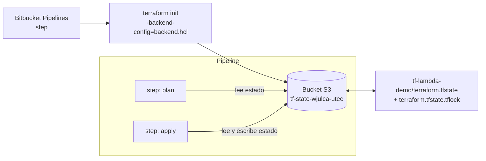

# Laboratorio: CI/CD en Bitbucket Pipelines - Despliegue de Lambda en AWS con Terraform

**Duración estimada:** 90–120 min  
**Nivel:** Intermedio  
**Contexto:** Este laboratorio es la versión Bitbucket de `laboratorio_terraform_gitlab.md`. Allá el pipeline corría en GitLab CI/CD y el estado de Terraform vivía en el backend HTTP que GitLab trae integrado. Aquí el pipeline corre en **Bitbucket Pipelines** y, como Bitbucket **no ofrece un backend de estado propio**, el estado se guarda en un **bucket S3** con bloqueo nativo. Al final podrás comparar los tres mundos: Serverless Framework vs Terraform, y GitLab CI vs Bitbucket Pipelines.

---

## Objetivos de aprendizaje

- Escribir un handler Lambda en Python puro, ejecutable localmente sin AWS
- Empaquetar el handler como ZIP con el data source `archive_file`
- Declarar un IAM execution role explícitamente en HCL
- Exponer la Lambda con API Gateway v2 (HTTP API)
- Crear un pipeline Bitbucket con `parallel:` (validación) → `plan` → `stage` de apply con `trigger: manual`
- Configurar el backend S3 de Terraform con bloqueo nativo (`use_lockfile`), sin DynamoDB
- Diferenciar *Repository variables* de *Deployment variables* y decidir cuál usar cuando `plan` también necesita credenciales
- Comparar el backend HTTP de GitLab con el backend S3 en Bitbucket

---

## Requisitos previos

✅ Cuenta en Bitbucket ([https://bitbucket.org/](https://bitbucket.org/)) con un repositorio y Pipelines habilitado  
✅ Cuenta AWS propia con permisos para crear Lambda, IAM, API Gateway y S3  
✅ Terraform 1.11+ instalado localmente (el bloqueo nativo de S3 requiere 1.11 o superior)  
✅ AWS CLI configurado localmente (opcional, solo para crear el bucket por terminal)  
✅ Python 3.11+ instalado localmente  
✅ Haber completado `laboratorio_terraform_gitlab.md` o `laboratorio_bitbucket.md` para el comparativo

---

## Estructura del proyecto

```
bitbucket_terraform_demo/
├── bitbucket-pipelines.yml   # Pipeline de CI/CD
├── main.tf                   # Backend S3 + IAM role + Lambda + API Gateway v2
├── variables.tf              # Variables de entrada
├── backend.hcl               # Configuración del backend S3 (bucket, key, región)
├── .gitignore                # Excluye .terraform/, tfstate, tfplan, lambda.zip y el lock de providers
└── app/
    └── handler.py            # Handler Lambda — ejecutable localmente
```

Sin `scripts/`, sin `requirements.txt`, sin Node. El handler usa solo la librería estándar de Python y Terraform corre desde su imagen oficial.

> Al correr `terraform init` aparece `.terraform.lock.hcl`: fija la versión exacta de cada provider. En este lab va en `.gitignore` para simplificar; en un proyecto real conviene commitearlo para que el pipeline use el mismo `aws 5.x.y` que tu laptop.

---

## Parte 1: Bitbucket Pipelines frente a GitLab CI/CD

Antes de escribir YAML, estas equivalencias te permiten leer el lab de GitLab y traducirlo mentalmente:

| Concepto | GitLab CI/CD (`.gitlab-ci.yml`) | Bitbucket Pipelines (`bitbucket-pipelines.yml`) |
|---|---|---|
| Unidad de ejecución | `job` | `step` (un contenedor Docker por step) |
| Orden | `stages:` + `needs:` | **el orden de la lista**: cada elemento espera al anterior |
| Paralelismo | jobs del mismo stage | bloque `parallel:` |
| Job manual | `when: manual` | `trigger: manual` (en un `stage` o en un step suelto) |
| Entornos | `environment:` | `deployment:` → Test / Staging / Production |
| Variables | Settings → CI/CD → Variables (masked/protected) | Repository variables y Deployment variables (*Secured*) |
| Artefactos | `artifacts:` + `expire_in` | `artifacts:` (14 días; pasan solos a los steps siguientes) |
| Cache | `cache:` con `key` y `paths` | `caches:` (predefinidos o propios en `definitions.caches`) |
| Reutilizar YAML | `extends:`, `!reference` | anclas YAML (`&`, `*`, `<<:`) en `definitions.steps` |
| Backend de estado Terraform | **HTTP integrado** (`TF_HTTP_*` + `CI_JOB_TOKEN`) | **No existe** → S3, HCP Terraform u otro backend externo |

**Reglas de Bitbucket que afectan este pipeline:**

- Un `stage` agrupa steps **secuenciales**; no admite `parallel:` dentro ni steps con `trigger: manual` propio. El `trigger` y el `deployment` van en el `stage`.
- Los artifacts se guardan 14 días y se descargan automáticamente en los steps posteriores del mismo pipeline. Por eso `tfplan` y `lambda.zip` llegan al step `apply` sin configuración extra.
- Las variables se resuelven con prioridad **Pipeline > Deployment > Repository > Workspace**.

---

## Parte 2: Handler Lambda

El handler es una función Python pura: recibe un evento, devuelve un dict. No necesita FastAPI ni Mangum — Lambda llama directamente a la función.

### 2.1 `app/handler.py`

**Archivo: `app/handler.py`**

```python
import json


def lambda_handler(event, context):
    params = event.get("queryStringParameters") or {}
    name = params.get("name", "World")

    return {
        "statusCode": 200,
        "headers": {"Content-Type": "application/json"},
        "body": json.dumps({
            "message": f"Hello, {name}!",
            "source": "Lambda puro en Python",
        }),
    }


if __name__ == "__main__":
    event = {"queryStringParameters": {"name": "UTEC"}}
    print(json.dumps(lambda_handler(event, None), indent=2))
```

### 2.2 Probar localmente

```bash
cd app/
python handler.py
```

```json
{
  "statusCode": 200,
  "headers": {"Content-Type": "application/json"},
  "body": "{\"message\": \"Hello, UTEC!\", \"source\": \"Lambda puro en Python\"}"
}
```

No necesitas AWS, credenciales ni internet. El handler es código Python normal.

---

## Parte 3: Archivos Terraform

### 3.1 `main.tf`

Terraform declara explícitamente todo lo que Serverless Framework crea automáticamente: el IAM role, la función Lambda y el endpoint HTTP. La única diferencia con el lab de GitLab es el bloque `backend`: `"s3"` en lugar de `"http"`.

**Archivo: `main.tf`**

```hcl
terraform {
  required_version = ">= 1.11"

  required_providers {
    aws = {
      source  = "hashicorp/aws"
      version = "~> 5.0"
    }
    archive = {
      source  = "hashicorp/archive"
      version = "~> 2.0"
    }
  }

  # Configuración parcial: bucket, key y región vienen de backend.hcl
  # (terraform init -backend-config=backend.hcl)
  backend "s3" {}
}

provider "aws" {
  region = var.aws_region
}

# ── Empaquetar handler.py como ZIP ────────────────────────────────────────────
# archive_file corre localmente durante terraform plan.
# Lee app/handler.py y genera lambda.zip en la raíz del proyecto.
data "archive_file" "lambda_zip" {
  type        = "zip"
  source_file = "${path.module}/app/handler.py"
  output_path = "${path.module}/lambda.zip"
}

# ── IAM execution role ────────────────────────────────────────────────────────
# Serverless Framework crea este role automáticamente.
# Con Terraform lo declaramos nosotros en HCL.
resource "aws_iam_role" "lambda_exec" {
  name = "${var.project_name}-exec-role"

  assume_role_policy = jsonencode({
    Version = "2012-10-17"
    Statement = [{
      Effect    = "Allow"
      Principal = { Service = "lambda.amazonaws.com" }
      Action    = "sts:AssumeRole"
    }]
  })
}

resource "aws_iam_role_policy_attachment" "lambda_logs" {
  role       = aws_iam_role.lambda_exec.name
  policy_arn = "arn:aws:iam::aws:policy/service-role/AWSLambdaBasicExecutionRole"
}

# ── Lambda Function ───────────────────────────────────────────────────────────
resource "aws_lambda_function" "hello" {
  function_name    = var.project_name
  role             = aws_iam_role.lambda_exec.arn
  runtime          = "python3.11"
  handler          = "handler.lambda_handler"
  filename         = data.archive_file.lambda_zip.output_path
  source_code_hash = data.archive_file.lambda_zip.output_base64sha256

  tags = {
    ManagedBy = "Terraform"
  }
}

# ── API Gateway v2 ───────────────────────────────────────────────────────────
# Equivalente a "events.httpApi" en serverless.yml.
# Serverless lo crea con 2 líneas de YAML; Terraform requiere 5 recursos.

resource "aws_apigatewayv2_api" "hello" {
  name          = "${var.project_name}-api"
  protocol_type = "HTTP"
}

resource "aws_apigatewayv2_integration" "hello" {
  api_id                 = aws_apigatewayv2_api.hello.id
  integration_type       = "AWS_PROXY"
  integration_uri        = aws_lambda_function.hello.invoke_arn
  payload_format_version = "2.0"
}

resource "aws_apigatewayv2_route" "hello" {
  api_id    = aws_apigatewayv2_api.hello.id
  route_key = "GET /hello"
  target    = "integrations/${aws_apigatewayv2_integration.hello.id}"
}

resource "aws_apigatewayv2_stage" "hello" {
  api_id      = aws_apigatewayv2_api.hello.id
  name        = "$default"
  auto_deploy = true
}

resource "aws_lambda_permission" "apigw" {
  action        = "lambda:InvokeFunction"
  function_name = aws_lambda_function.hello.function_name
  principal     = "apigateway.amazonaws.com"
  source_arn    = "${aws_apigatewayv2_api.hello.execution_arn}/*/*"
}

output "api_url" {
  description = "URL del endpoint en API Gateway v2"
  # api_endpoint no lleva slash final; invoke_url del stage $default sí → "//hello"
  value       = "${aws_apigatewayv2_api.hello.api_endpoint}/hello"
}
```

**Recursos que Terraform crea y lo que hace cada uno:**

| Recurso HCL | Equivalente en Serverless Framework |
|---|---|
| `data.archive_file.lambda_zip` | `sls deploy` empaqueta automáticamente |
| `aws_iam_role.lambda_exec` | Serverless crea `IamRoleLambdaExecution` en CloudFormation |
| `aws_iam_role_policy_attachment.lambda_logs` | Serverless adjunta permisos de logs automáticamente |
| `aws_lambda_function.hello` | `functions.hello` en `serverless.yml` |
| `aws_apigatewayv2_api.hello` | `events.httpApi` en `serverless.yml` (1 de 5) |
| `aws_apigatewayv2_integration.hello` | `events.httpApi` en `serverless.yml` (2 de 5) |
| `aws_apigatewayv2_route.hello` | `events.httpApi` en `serverless.yml` (3 de 5) |
| `aws_apigatewayv2_stage.hello` | `events.httpApi` en `serverless.yml` (4 de 5) |
| `aws_lambda_permission.apigw` | `events.httpApi` en `serverless.yml` (5 de 5) |

> **`source_code_hash`**: cuando cambias `handler.py`, el hash del ZIP cambia. Terraform detecta ese cambio en el próximo `plan` y sube el nuevo código a Lambda. Sin este campo, Terraform no actualizaría la función aunque el código cambie.

### 3.2 `variables.tf`

**Archivo: `variables.tf`**

```hcl
variable "aws_region" {
  description = "Región AWS"
  type        = string
  default     = "us-east-1"
}

variable "project_name" {
  description = "Nombre de la función Lambda y prefijo de recursos IAM"
  type        = string
  default     = "tf-lambda-demo"
}
```

### 3.3 `backend.hcl`

El bloque `backend "s3" {}` de `main.tf` está vacío a propósito. Los valores concretos van en este archivo, que **sí se commitea**: el nombre de un bucket no es un secreto, y así el mismo comando `terraform init` funciona en tu laptop y en el pipeline sin interpolar variables.

**Archivo: `backend.hcl`**

```hcl
bucket       = "tf-state-<usuario>-utec"         # debe ser único a nivel global
key          = "tf-lambda-demo/terraform.tfstate"
region       = "us-east-1"
use_lockfile = true                              # bloqueo nativo en S3, sin DynamoDB
```

**Convención de nombre del bucket:** `tf-state-<usuario>-utec`, donde `<usuario>` es tu **usuario de Bitbucket** en minúsculas. Los nombres de bucket S3 son globales en todo AWS: si dos alumnos usan el mismo nombre, el segundo recibe `BucketAlreadyExists`.

| Usuario de Bitbucket | Nombre del bucket |
|---|---|
| `wjulca` | `tf-state-wjulca-utec` |
| `maria.perez` | `tf-state-maria-perez-utec` |
| `Juan_Lopez` | `tf-state-juan-lopez-utec` |

Reglas de S3 que debes respetar: solo minúsculas, números y guiones; sin `_`, sin `.` seguidos, sin mayúsculas; entre 3 y 63 caracteres. Tu usuario de Bitbucket aparece en **Personal settings → Account settings → Username**.

Verifica que el nombre esté libre antes de seguir:

```bash
aws s3api head-bucket --bucket tf-state-<usuario>-utec
# "Not Found"  → libre, puedes crearlo
# "Forbidden"  → ya existe en otra cuenta, agrega un sufijo: tf-state-<usuario>-utec-2026
# sin salida   → ya es tuyo
```

---

## Parte 4: Backend S3 — el estado fuera de Bitbucket

### 4.1 Por qué S3

En GitLab el bloque `backend "http" {}` apuntaba al propio proyecto: GitLab guardaba `terraform.tfstate`, gestionaba el lock y autenticaba con `CI_JOB_TOKEN`. Bitbucket no tiene nada equivalente. El estado tiene que vivir en un servicio externo, y S3 es la opción natural cuando ya estás en AWS.



### 4.2 Bloqueo nativo con `use_lockfile`

Históricamente el backend S3 necesitaba una tabla DynamoDB para el lock. Desde Terraform 1.11 el backend puede crear un objeto `.tflock` junto al estado dentro del mismo bucket. Con `use_lockfile = true`:

- `plan` y `apply` crean `tf-lambda-demo/terraform.tfstate.tflock` al empezar y lo borran al terminar.
- Si dos pipelines corren a la vez, el segundo falla con `Error acquiring the state lock` en lugar de corromper el estado.
- No hay DynamoDB que crear, pagar ni limpiar.

### 4.3 Crear el bucket (bootstrap manual)

El bucket es el único recurso que **no** puede crear Terraform en este lab: lo necesita antes de `terraform init`. Es el clásico problema del huevo y la gallina del estado remoto. Se crea una sola vez, a mano.

**Opción A — AWS CLI:**

```bash
BUCKET="tf-state-<usuario>-utec"      # el mismo valor que pusiste en backend.hcl, p. ej. tf-state-wjulca-utec

aws s3api create-bucket --bucket "$BUCKET" --region us-east-1
aws s3api put-bucket-versioning --bucket "$BUCKET" \
  --versioning-configuration Status=Enabled
aws s3api put-public-access-block --bucket "$BUCKET" \
  --public-access-block-configuration \
  BlockPublicAcls=true,IgnorePublicAcls=true,BlockPublicPolicy=true,RestrictPublicBuckets=true
```

> Si usas otra región distinta de `us-east-1`, agrega `--create-bucket-configuration LocationConstraint=<region>` al primer comando.

**Opción B — Consola AWS:**

1. **S3 → Create bucket**, nombre `tf-state-<usuario>-utec` (el mismo de `backend.hcl`, p. ej. `tf-state-wjulca-utec`), región `us-east-1`
2. Deja **Block all public access** activado
3. En **Bucket Versioning** selecciona **Enable** (permite recuperar un estado anterior si algo sale mal)
4. **Create bucket**

### 4.4 Validación local antes del pipeline

```bash
terraform init -backend-config=backend.hcl   # requiere credenciales AWS con acceso al bucket
terraform fmt -check -recursive
terraform validate
terraform plan                                # genera lambda.zip + muestra los recursos a crear
```

Si solo quieres validar sintaxis sin tocar el bucket:

```bash
terraform init -backend=false
terraform validate
```

```bash
# Al terminar el laboratorio
terraform destroy
```

---

## Parte 5: Credenciales en Bitbucket

### 5.1 Crear el usuario IAM

1. Ve a **AWS Console → IAM → Users → Create user**
2. Nómbralo `bitbucket-ci-terraform` → **Next**
3. Selecciona **Attach policies directly** y agrega:
   - `AWSLambda_FullAccess`
   - `IAMFullAccess` (necesario para crear el execution role)
   - `AmazonAPIGatewayAdministrator` (necesario para crear el API Gateway v2)
   - `AmazonS3FullAccess` (necesario para leer/escribir el estado en el bucket)
4. **Create user**

> En un entorno real `AmazonS3FullAccess` es excesivo. Lo correcto es una política inline acotada al bucket de estado:
>
> ```json
> {
>   "Version": "2012-10-17",
>   "Statement": [
>     { "Effect": "Allow", "Action": "s3:ListBucket",
>       "Resource": "arn:aws:s3:::tf-state-<usuario>-utec" },
>     { "Effect": "Allow", "Action": ["s3:GetObject", "s3:PutObject", "s3:DeleteObject"],
>       "Resource": "arn:aws:s3:::tf-state-<usuario>-utec/*" }
>   ]
> }
> ```
>
> `DeleteObject` es obligatorio: sin él Terraform no puede borrar el `.tflock` y el estado queda bloqueado.

### 5.2 Generar las credenciales

1. Abre el usuario `bitbucket-ci-terraform` → pestaña **Security credentials**
2. **Access keys → Create access key → Command Line Interface (CLI)**
3. Copia `Access key ID` y `Secret access key` — **solo se muestran una vez**

### 5.3 Repository variables vs Deployment variables

Bitbucket ofrece dos niveles:

- **Repository variables**: llegan a **todos** los steps.
- **Deployment variables**: llegan **solo** a los steps/stages con `deployment: <entorno>`.

En el lab de Serverless Framework pusimos las credenciales AWS como Deployment variables porque solo el step de deploy las necesitaba. **Aquí no alcanza**: el step `plan` también habla con AWS (lee el estado desde S3 y consulta los recursos existentes), y `plan` no es un deployment. Por eso las credenciales van como **Repository variables** marcadas *Secured*.

**Repository settings → Pipelines → Repository variables:**

| Variable                | Valor                      | Secured |
|-------------------------|----------------------------|---------|
| `AWS_ACCESS_KEY_ID`     | Access key del usuario IAM | Sí      |
| `AWS_SECRET_ACCESS_KEY` | Secret key del usuario IAM | Sí      |
| `AWS_DEFAULT_REGION`    | `us-east-1`                | No      |

**Repository settings → Pipelines → Deployments:** verifica que exista el entorno `production` (Bitbucket lo crea por defecto junto con `test` y `staging`). No necesita variables propias en este lab; se usa para que `apply` aparezca en el panel de **Deployments** y para colgar el `trigger: manual` del stage.

*Secured* oculta el valor en la UI y lo enmascara en los logs (`$AWS_SECRET_ACCESS_KEY` aparece como `****`).

---

## Parte 6: Pipeline completo `bitbucket-pipelines.yml`

### 6.1 Diseño

```
pull request     ──► [fmt-check ‖ validate ‖ lint-python]
push a main      ──► [fmt-check ‖ validate ‖ lint-python] ──► plan ──► stage apply (manual, deployment: production)
custom: destroy  ──► terraform destroy (lanzado desde la UI)
```

### 6.2 Archivo completo

**Archivo: `bitbucket-pipelines.yml`**

```yaml
# Bitbucket Pipelines: Lambda Python + API Gateway v2 con Terraform
#
# Variables necesarias (Repository settings → Pipelines → Repository variables):
#   AWS_ACCESS_KEY_ID (secured), AWS_SECRET_ACCESS_KEY (secured), AWS_DEFAULT_REGION
# Estado remoto: bucket S3 definido en backend.hcl (creado a mano antes del primer pipeline)

image: hashicorp/terraform:1.11

definitions:
  caches:
    terraform: .terraform            # providers descargados por terraform init (aws ≈ 100 MB comprimido)

  steps:
    # ── Formato canónico HCL (no necesita init ni credenciales) ──────────────
    - step: &fmt-check
        name: fmt-check
        script:
          - terraform --version
          - terraform fmt -check -recursive -diff

    # ── Validación de sintaxis y referencias (sin backend → sin credenciales) ─
    - step: &validate
        name: validate
        caches:
          - terraform
        script:
          - terraform init -input=false -backend=false
          - terraform validate

    # ── Lint del handler Python ──────────────────────────────────────────────
    - step: &lint-python
        name: lint-python
        image: python:3.11-slim
        caches:
          - pip
        script:
          - pip install flake8
          - flake8 app/ --max-line-length=100 --statistics

    # ── Plan: conecta al backend S3 y genera tfplan + lambda.zip ─────────────
    - step: &plan
        name: plan
        caches:
          - terraform
        script:
          - terraform init -input=false -reconfigure -backend-config=backend.hcl
          - terraform plan -input=false -out=tfplan
          - terraform show -no-color tfplan > tfplan.txt   # versión legible para revisar en la UI
        artifacts:
          - tfplan
          - tfplan.txt
          - lambda.zip                  # generado por archive_file durante el plan

    # ── Apply: aplica exactamente el plan revisado ───────────────────────────
    - step: &apply
        name: apply
        caches:
          - terraform
        script:
          - terraform init -input=false -reconfigure -backend-config=backend.hcl
          - terraform apply -input=false tfplan
          - terraform output
          # Smoke test contra el endpoint real
          - apk add --no-cache curl
          - export API_URL=$(terraform output -raw api_url)
          - curl -sf --retry 5 --retry-delay 3 --retry-all-errors "$API_URL?name=UTEC" -o hello-aws.json && cat hello-aws.json
          - grep -q "Hello, UTEC!" hello-aws.json
        artifacts:
          - hello-aws.json

    # ── Destroy: elimina Lambda, API Gateway y IAM role (no el bucket) ───────
    - step: &destroy
        name: destroy
        caches:
          - terraform
        script:
          - terraform init -input=false -reconfigure -backend-config=backend.hcl
          - terraform destroy -input=false -auto-approve

pipelines:
  # Los PR solo validan, nunca tocan AWS
  pull-requests:
    '**':
      - parallel:
          - step: *fmt-check
          - step: *validate
          - step: *lint-python

  branches:
    main:
      - parallel:
          - step: *fmt-check
          - step: *validate
          - step: *lint-python
      - step: *plan
      - stage:
          name: apply-production
          deployment: production
          trigger: manual
          steps:
            - step: *apply

  # Pipeline manual (Pipelines → Run pipeline → Custom) para limpiar AWS al terminar el laboratorio
  custom:
    destroy:
      - step:
          <<: *destroy
          deployment: production
```

### 6.3 Explicación bloque por bloque

#### `image: hashicorp/terraform:1.11`

Imagen oficial, basada en Alpine. Incluye `terraform` y `sh`; no incluye `curl`, por eso el step `apply` hace `apk add --no-cache curl` antes del smoke test. El step `lint-python` sobrescribe la imagen con `python:3.11-slim` porque Terraform no sabe de `flake8`.

#### `definitions.caches.terraform`

`terraform init` descarga el provider `aws` (cientos de MB descomprimido) en cada step que lo ejecuta. El cache guarda `.terraform/` entre pipelines. Bitbucket lo escribe la primera vez que un step termina bien y lo reutiliza 7 días. Gracias al `-reconfigure`, da igual que el cache contenga la configuración de backend de un step anterior.

#### `fmt-check` y `validate` sin credenciales

`terraform fmt` no necesita providers ni backend. `terraform validate` necesita providers (para conocer los atributos de cada recurso) pero no el estado: por eso `init -backend=false`. Resultado: estos dos steps corren también en pull requests de forks o ramas sin exponer las credenciales AWS al backend S3.

#### `plan` y los artifacts

`terraform plan -out=tfplan` deja dos archivos en el workspace: el plan binario y `lambda.zip` (lo genera `archive_file`). El step `apply` corre en un contenedor nuevo con el workspace vacío, así que ambos van en `artifacts:`. Bitbucket los descarga automáticamente en los steps siguientes del mismo pipeline, sin `needs:` ni `dependencies:`.

`tfplan.txt` es solo para humanos: descárgalo desde la pestaña **Artifacts** del step `plan` para revisar qué se va a crear antes de aprobar el apply.

#### `stage` de apply

El stage cumple las tres reglas de Bitbucket: `trigger: manual` y `deployment: production` están en el **stage**, no en el step, y dentro del stage no hay `parallel:`. El `deployment:` hace que el apply quede registrado en **Deployments** con el commit, la rama y quién lo aprobó.

#### `-reconfigure` en cada `init`

Cada step es un contenedor nuevo, pero el cache puede traer un `.terraform/terraform.tfstate` de otra ejecución con una configuración de backend ligeramente distinta. `-reconfigure` ignora lo que haya y reconstruye la conexión al backend desde `backend.hcl`. Sin él, aparece `Error: Backend configuration changed`.

#### `custom: destroy`

Un pipeline `custom` solo corre cuando alguien lo lanza desde **Pipelines → Run pipeline → Custom: destroy**. Lleva `deployment: production` para que la destrucción también quede en el historial de Deployments. No borra el bucket de estado: eso se hace a mano al final del curso.

### 6.4 Flujo visual del pipeline

```
push a main:
  ┌───────────────┐  ┌────────────┐  ┌──────────────┐
  │   fmt-check   │  │  validate  │  │ lint-python  │  ← parallel
  └───────────────┘  └────────────┘  └──────────────┘
                             │
                           plan  (init → S3 · genera tfplan + lambda.zip + tfplan.txt)
                             │
            stage apply-production ▶ (manual · deployment: production)
                             │
                           apply (init → S3 · apply tfplan · curl al endpoint)
```

### 6.5 Validar el YAML antes del push

```bash
python3 -c "import yaml; yaml.safe_load(open('bitbucket-pipelines.yml')); print('OK')"
```

Esto detecta errores de sintaxis y de anclas. Las reglas propias de Bitbucket (steps dentro de stages, triggers, etc.) las valida el **validador oficial**: [https://bitbucket-pipelines.atlassian.io/validator](https://bitbucket-pipelines.atlassian.io/validator). Pega el archivo y corrige antes de gastar minutos.

---

## Parte 7: Conceptos clave

### 7.1 `archive_file` — packaging del ZIP

```hcl
data "archive_file" "lambda_zip" {
  type        = "zip"
  source_file = "${path.module}/app/handler.py"
  output_path = "${path.module}/lambda.zip"
}
```

`archive_file` es un **data source** — corre localmente durante `terraform plan`, no en AWS. Lee `app/handler.py` del workspace y genera `lambda.zip`. Por eso el artifact del step `plan` incluye tanto `tfplan` como `lambda.zip`: el step `apply` los necesita a ambos.

```
terraform plan
  └── archive_file corre localmente
        └── genera lambda.zip en el contenedor del step plan
              └── tfplan referencia ese ZIP (hash + path)

terraform apply tfplan   (otro contenedor; recibe tfplan + lambda.zip como artifacts)
  └── sube lambda.zip a AWS
  └── crea/actualiza aws_lambda_function
```

### 7.2 `source_code_hash` — redeploy automático

```hcl
source_code_hash = data.archive_file.lambda_zip.output_base64sha256
```

Terraform compara este hash con el que tiene registrado en el estado (en S3). Si cambió (porque modificaste `handler.py`), el próximo `plan` marca la función Lambda para actualización. Sin este campo, Terraform no detectaría el cambio de código aunque el archivo sí haya cambiado.

### 7.3 API Gateway v2 — los 5 recursos que Serverless oculta

En el lab de Serverless Framework creaste el endpoint con 2 líneas en `serverless.yml`:

```yaml
events:
  - httpApi:
      path: /hello
      method: GET
```

Terraform expone exactamente lo que Serverless hace por debajo. Esas 2 líneas equivalen a 5 recursos HCL:

```
aws_apigatewayv2_api          → el API Gateway en sí (protocolo HTTP)
aws_apigatewayv2_integration  → conecta el API con la función Lambda
aws_apigatewayv2_route        → mapea "GET /hello" a la integración
aws_apigatewayv2_stage        → stage "$default" con auto-deploy activado
aws_lambda_permission         → permite que API Gateway invoque la función
```

Sin el `aws_lambda_permission`, API Gateway recibe un `403 Forbidden` al intentar llamar a Lambda — aunque la ruta esté bien configurada. Serverless lo crea silenciosamente; Terraform te lo hace visible.

### 7.4 Backend HTTP (GitLab) vs backend S3 (Bitbucket)

| Aspecto | GitLab — `backend "http"` | Bitbucket — `backend "s3"` |
|---|---|---|
| Dónde vive el estado | En el propio proyecto GitLab | En un bucket S3 de tu cuenta AWS |
| Quién lo crea | Nadie: existe al primer `init` | Tú, a mano, antes del primer `init` |
| Autenticación | `CI_JOB_TOKEN` generado por job | Mismas credenciales AWS del pipeline |
| Configuración | 7 variables `TF_HTTP_*` en el YAML | `backend.hcl` con 4 líneas |
| Lock | Endpoint `/lock` de GitLab | Objeto `.tflock` en el bucket (`use_lockfile`) |
| Ver el estado en la UI | **Operate → Terraform states** | Consola S3 → objeto `terraform.tfstate` |
| Historial de versiones | GitLab guarda versiones | Versionado del bucket (si lo activaste) |
| Funciona fuera del CI | Sí, con un Personal Access Token | Sí, con cualquier credencial AWS con acceso al bucket |

La lección: **el backend es una decisión independiente del CI**. Podrías usar S3 desde GitLab también. GitLab solo te ahorra el bootstrap.

### 7.5 El problema del bootstrap

Terraform puede crear buckets S3 (`aws_s3_bucket`), pero no puede crear el bucket donde guarda su propio estado antes de tener estado. Las soluciones habituales:

1. **Crear el bucket a mano** (este lab): simple, una sola vez por cuenta.
2. **Proyecto Terraform separado "bootstrap"** con estado local, que crea el bucket; el resto de proyectos usan ese bucket.
3. **HCP Terraform / Terraform Cloud** como backend `remote`: HashiCorp aloja el estado, sin bucket.

---

## Parte 8: Probar el pipeline

### 8.1 Push inicial

```bash
git add bitbucket-pipelines.yml main.tf variables.tf backend.hcl app/handler.py .gitignore
git commit -m "feat: pipeline Bitbucket con despliegue Lambda via Terraform"
git push origin main
```

### 8.2 Observar la ejecución

1. Ve a **Pipelines** en Bitbucket.
2. Los tres steps del bloque `parallel` corren a la vez.
3. El step `plan` corre y guarda `tfplan`, `tfplan.txt` y `lambda.zip` como artifacts. Descarga `tfplan.txt` y revisa los 9 recursos a crear.
4. El stage `apply-production` queda en pausa con el botón **Deploy**. Haz clic después de revisar el plan.
5. Al terminar, el log muestra la URL y la respuesta del smoke test:

```
api_url = "https://xxxxxxxxxx.execute-api.us-east-1.amazonaws.com/hello"
{"message": "Hello, UTEC!", "source": "Lambda puro en Python"}
```

### 8.3 Verificar el estado en S3

Ve a **S3 → tu bucket → tf-lambda-demo/**. Debes ver `terraform.tfstate`. Mientras un `plan` o `apply` esté corriendo verás también `terraform.tfstate.tflock`; desaparece al terminar.

### 8.4 Invocar la función

```bash
curl "https://xxxxxxxxxx.execute-api.us-east-1.amazonaws.com/hello?name=UTEC"
# {"message": "Hello, UTEC!", "source": "Lambda puro en Python"}
```

### 8.5 Actualizar el handler y ver el redeploy

Modifica `app/handler.py` (agrega un campo al response), commitea y haz push a `main`. El step `plan` detecta el cambio de hash (`~ update in-place` en `aws_lambda_function.hello`) y al aprobar el apply la función se actualiza.

### 8.6 Pipeline de Pull Request

Crea una rama, cambia el formato de `main.tf` (por ejemplo, quita la alineación de un `=`) y abre un PR. El pipeline de PR corre solo los tres steps de validación y `fmt-check` falla mostrando el diff. Corrige con `terraform fmt -recursive`, haz push y el PR queda en verde. Nunca hubo `plan` ni `apply`: las credenciales no se usaron.

### 8.7 Limpiar recursos

Desde Bitbucket: **Pipelines → Run pipeline → Branch: main → Pipeline: custom: destroy**.

O localmente:

```bash
terraform init -backend-config=backend.hcl
terraform destroy
```

El bucket de estado no se borra con `destroy`. Al terminar el curso, vacíalo y elimínalo desde la consola S3.

---

## Parte 9: Comparativo — Terraform vs Serverless Framework

| Aspecto | Serverless Framework | Terraform |
|---|---|---|
| Config principal | `serverless.yml` | `main.tf` (HCL) |
| IAM execution role | Creado automáticamente | Declarado en `aws_iam_role` + `aws_iam_role_policy_attachment` |
| Packaging del código | Interno (`sls deploy`) | `data "archive_file"` genera el ZIP |
| Endpoint HTTP | `events.httpApi` → 2 líneas YAML | API Gateway v2 → 5 recursos HCL explícitos |
| Estado de infraestructura | CloudFormation stack (lo gestiona AWS) | `terraform.tfstate` en S3 (lo gestionas tú) |
| Bootstrap previo | Ninguno (CloudFormation ya existe) | Crear el bucket de estado a mano |
| Destruir recursos | `sls remove` | `terraform destroy` |
| Detectar cambios de código | Siempre reempaqueta | `source_code_hash` compara hashes |
| Soporte multi-provider | Solo AWS/Azure/GCP serverless | AWS, GCP, Azure, Kubernetes, etc. |
| Curva de aprendizaje | Menor (abstrae IAM y packaging) | Mayor (debes declarar todo) |

**¿Cuándo usar cada uno?**

- **Serverless Framework**: cuando el foco es la lógica de la app y quieres que el tool gestione la infraestructura serverless automáticamente.
- **Terraform**: cuando necesitas controlar exactamente qué recursos se crean, combinar Lambda con otros recursos (RDS, VPC, S3) o gestionar infraestructura de múltiples providers en el mismo pipeline.

---

## Parte 10: Troubleshooting

| Problema | Causa probable | Solución |
|----------|---------------|----------|
| `fmt-check` falla | Archivos `.tf` sin formatear | Corre `terraform fmt -recursive` localmente y commitea |
| `validate` falla | Referencia incorrecta en `main.tf` | Corre `terraform validate` localmente |
| `lint-python` falla | Estilo incorrecto en `app/` | Corre `flake8 app/ --max-line-length=100` y corrige |
| `plan` falla con `NoCredentialProviders` | Variables AWS no configuradas | Agrega `AWS_ACCESS_KEY_ID`, `AWS_SECRET_ACCESS_KEY`, `AWS_DEFAULT_REGION` como **Repository variables** (no Deployment) |
| `init` falla con `NoSuchBucket` | El bucket de `backend.hcl` no existe o el nombre no coincide | Crea el bucket (Parte 4.3) o corrige `bucket` en `backend.hcl` |
| `create-bucket` falla con `BucketAlreadyExists` | Otro alumno (u otra cuenta AWS) ya usa ese nombre | Agrega un sufijo (`tf-state-<usuario>-utec-2026`) y actualiza `backend.hcl` |
| `create-bucket` falla con `InvalidBucketName` | Mayúsculas, `_` o `.` en el nombre | Usa solo minúsculas, números y guiones (Parte 3.3) |
| `init` falla con `AccessDenied` al leer el estado | El usuario IAM no tiene permisos sobre el bucket | Agrega `AmazonS3FullAccess` o la política inline de la Parte 5.1 |
| `init` falla con `Backend configuration changed` | Cache `.terraform/` con otra configuración | Verifica que el `init` lleve `-reconfigure` |
| `init` falla con `Unsupported argument: use_lockfile` | Terraform anterior a 1.11 | Usa `image: hashicorp/terraform:1.11` o superior (y localmente, actualiza Terraform) |
| `plan` falla con `Error acquiring the state lock` | Otro pipeline corriendo, o un step anterior murió sin liberar el lock | Espera; si persiste, borra `terraform.tfstate.tflock` del bucket o corre `terraform force-unlock <ID>` |
| `plan` falla con `AccessDenied` al crear IAM role | Política IAM insuficiente | Verifica que el usuario tenga `IAMFullAccess` |
| `apply` falla con `AccessDenied` en API Gateway | Falta política de API Gateway | Agrega `AmazonAPIGatewayAdministrator` al usuario IAM |
| `apply` falla con `lambda.zip: no such file` | Artifact no incluido en el plan | Agrega `lambda.zip` a los `artifacts` del step `plan` |
| `apply tfplan` falla con `Saved plan is stale` | El estado cambió entre plan y apply | Vuelve a correr el pipeline para generar un `tfplan` nuevo |
| Stage `apply-production` no aparece en pausa | `trigger: manual` en el step en lugar del stage | Mueve `trigger: manual` al nivel del `stage` |
| `curl` devuelve `{"message":"Forbidden"}` | Falta `aws_lambda_permission` para `apigateway.amazonaws.com` | Verifica que el recurso `aws_lambda_permission.apigw` esté en `main.tf` |
| `curl` devuelve `{"message":"Internal Server Error"}` | Error en el handler Python | Revisa CloudWatch Logs: AWS Console → Lambda → Monitor → View logs |
| Handler no actualiza en Lambda | Falta `source_code_hash` | Agrega `source_code_hash = data.archive_file.lambda_zip.output_base64sha256` |
| `apk: not found` en `apply` | Cambiaste la imagen por una que no es Alpine | Usa `apt-get install -y curl` o vuelve a `hashicorp/terraform` |
| El log muestra `$AWS_DEFAULT_REGION` dentro de la URL | Marcaste la región como *Secured*; Bitbucket sustituye en los logs el valor de toda variable Secured por su nombre | Cosmético. Si quieres leer la URL completa, desmarca Secured en `AWS_DEFAULT_REGION` (no es un secreto) |
| `api_url` termina en `//hello` | El output usa `invoke_url` del stage `$default`, que ya termina en `/` | Usa `aws_apigatewayv2_api.hello.api_endpoint` (sin slash final). API Gateway acepta ambas rutas |

**Reglas de seguridad:**
- Marca `AWS_ACCESS_KEY_ID` y `AWS_SECRET_ACCESS_KEY` como **Secured**
- Usa un usuario IAM dedicado para CI/CD, nunca tu usuario personal
- Activa el versionado del bucket de estado: `terraform.tfstate` contiene ARNs, nombres y a veces valores sensibles
- Nunca commitees `terraform.tfstate` ni `lambda.zip`. Agrega al `.gitignore`:

```
.terraform/
.terraform.lock.hcl
terraform.tfstate
terraform.tfstate.backup
tfplan
tfplan.txt
lambda.zip
```

---

## Checklist de Éxito

- [ ] Handler corre localmente: `python app/handler.py` → respuesta JSON
- [ ] Bucket S3 creado con versionado y acceso público bloqueado
- [ ] `terraform init -backend-config=backend.hcl` conecta al bucket desde tu laptop
- [ ] `fmt-check`, `validate` y `lint-python` corren en paralelo
- [ ] Step `plan` genera artifacts `tfplan`, `tfplan.txt` y `lambda.zip`
- [ ] Stage `apply-production` requiere aprobación manual y aparece en **Deployments**
- [ ] Lambda respondiendo vía API Gateway: `curl <api_url>?name=UTEC`
- [ ] `terraform.tfstate` visible en el bucket S3 bajo `tf-lambda-demo/`
- [ ] Al modificar `handler.py` y hacer push, el pipeline actualiza la función
- [ ] Un PR solo corre validación, sin `plan` ni `apply`
- [ ] Credenciales AWS no aparecen en logs del pipeline (`****`)
- [ ] Recursos destruidos al finalizar (pipeline `custom: destroy` o `terraform destroy`)

---

📘 **Autor:**  
Wilson Julca Mejía  
Curso: *DevOps e Infraestructura como Código – Terraform y Bitbucket Pipelines*  
Universidad de Ingeniería y Tecnología (UTEC)
