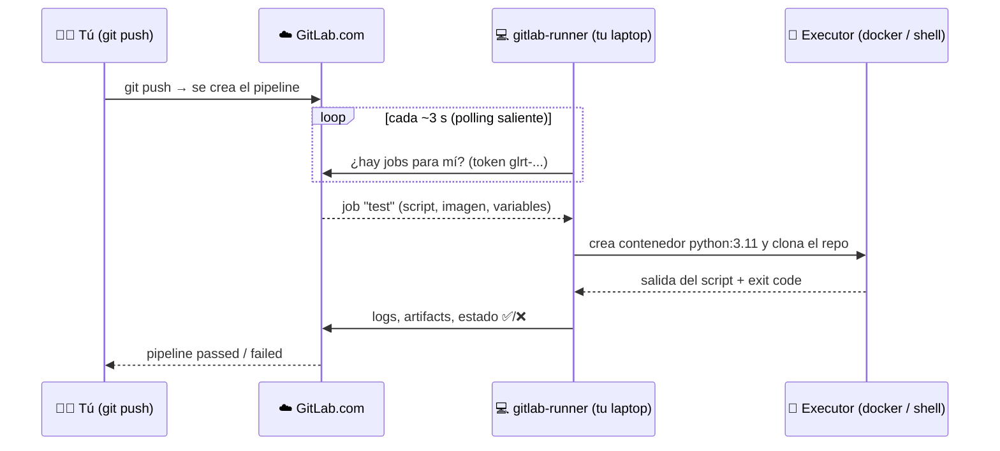
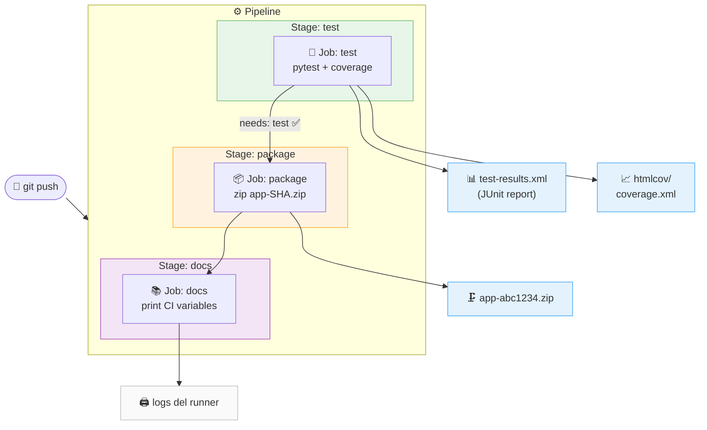
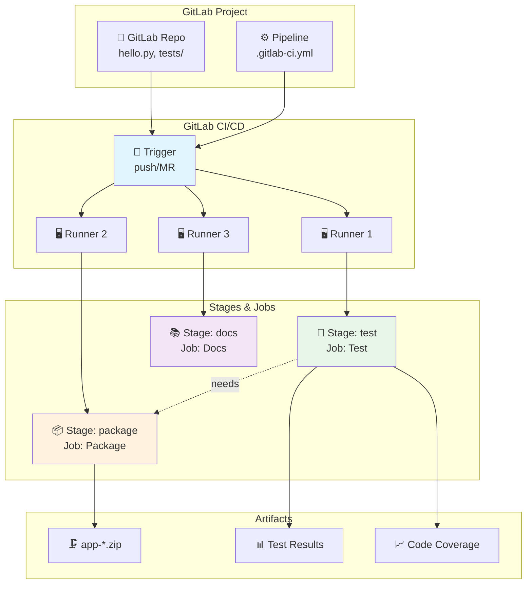

# Guía: GitLab CI/CD con Python y runner en tu laptop

**Duración estimada:** 3 h  
**Nivel:** Intermedio  
**Contexto:** En esta guía construyes un pipeline de CI/CD para una app Python (stages, jobs, artifacts, cache, variables) y lo ejecutas primero en los *shared runners* de GitLab.com. Luego instalas y registras tu propio `gitlab-runner` en tu laptop, enrutas jobs con `tags:`, lees el log para saber dónde corrió cada job y entiendes qué deja el runner en Docker. Para cerrar, conviertes la app en una API FastAPI con handler Lambda (Mangum) y la levantas **en local** con Serverless Framework en modo *offline*, validándola también desde el pipeline. El despliegue real a AWS se verá en el laboratorio de Bitbucket Pipelines.

---

## Objetivos de aprendizaje

- Entender la arquitectura y componentes de GitLab CI/CD (Pipelines, Stages, Jobs, Artifacts, Variables, Runners)
- Entender qué es un runner, cómo se comunica con GitLab y qué es un *executor*
- Crear pipelines de CI/CD para aplicaciones Python con stages y jobs paralelos y secuenciales
- Gestionar artefactos y outputs entre stages y configurar cache para optimizar tiempos de ejecución
- Instalar `gitlab-runner` en macOS, Linux o Windows
- Crear un *project runner* desde la interfaz de GitLab y registrarlo con su token de autenticación
- Elegir y configurar el executor `docker` (recomendado) o `shell`
- Enrutar jobs al runner usando `tags:` y distinguir en el log si un job corrió en tu laptop o en un shared runner
- Entender por qué los stages se ejecutan en orden y cuándo usar `needs:`
- Interpretar lo que el runner deja en Docker (contenedores efímeros, volúmenes de `/builds` y `/cache`, imágenes)
- Leer y modificar `config.toml` (concurrencia, imagen por defecto, volúmenes)
- Adaptar una API FastAPI para AWS Lambda con Mangum y describirla en `serverless.yml` (Serverless Framework v3, sin cuenta)
- Levantar la API en local con `serverless offline` (API Gateway + Lambda simulados) y validarla desde un job del pipeline

---

## Requisitos previos

✅ Cuenta en GitLab ([https://gitlab.com/](https://gitlab.com/)) con un proyecto donde seas **Maintainer** u **Owner**  
✅ Conocimientos básicos de Git y control de versiones  
✅ Familiaridad con Python y pytest  
✅ Editor de texto o IDE configurado  
✅ Docker Desktop (macOS/Windows) o Docker Engine (Linux) instalado y corriendo  
✅ Terminal con permisos de administrador (`sudo` en macOS/Linux, PowerShell como administrador en Windows)  
✅ Conexión a internet (el runner hace *polling* saliente hacia GitLab; **no** necesitas abrir puertos ni IP pública)  
✅ **Para la Parte 14:** Node.js 20+ y npm (Serverless Framework es una herramienta Node)

---

## Estructura del proyecto

```
gitlab_lambda_demo/
├── .gitlab-ci.yml             # Pipeline principal de CI/CD
├── hello.py                   # Aplicación Python (Partes 2-13) → API FastAPI (Parte 14)
├── handler.py                 # Handler Lambda con Mangum (Parte 14)
├── serverless.yml             # Serverless Framework + serverless-offline (Parte 14)
├── package.json               # Dependencias Node (serverless, serverless-offline)
├── tests/
│   ├── test_hello.py          # Tests unitarios de la app / API
│   └── test_handler.py        # Tests del handler Lambda con evento API Gateway v2
├── requirements.txt           # Dependencias Python de producción (van al ZIP de Lambda)
├── requirements-dev.txt       # Dependencias de desarrollo (pytest, uvicorn, httpx)
├── .gitignore                 # node_modules/, .serverless/, .venv/ ...
└── README.md                  # Documentación del proyecto
```

> Las Partes 1–13 trabajan con `hello.py` como script simple. En la Parte 14 el mismo archivo se convierte en una API FastAPI manteniendo `greet()` y `add()`, así los tests anteriores siguen pasando.

---

## Parte 1: Conceptos Fundamentales de GitLab CI/CD

### 1.1 ¿Qué es GitLab CI/CD?

**GitLab CI/CD** es un sistema de integración y entrega continua integrado en GitLab, que permite automatizar la construcción, prueba y despliegue de código mediante pipelines definidos como código.

**Ventajas principales:**
- ✅ Integración nativa: Repositorios, issues y CI/CD en una sola plataforma
- ✅ Multi-plataforma: Soporte para runners en Linux, Windows, macOS
- ✅ Gratuito: Minutos gratuitos en proyectos públicos y privados
- ✅ Extensible: Marketplace de templates y scripts
- ✅ Soporte YAML: Pipelines como código

### 1.2 Componentes de GitLab CI/CD

- **Pipeline:** Proceso completo de CI/CD definido en `.gitlab-ci.yml`
- **Stage:** Agrupación lógica de jobs, ejecutados secuencialmente
- **Job:** Colección de comandos que se ejecutan en un runner (en paralelo dentro del stage)
- **Runner:** Máquina que ejecuta los jobs (shared o specific)
- **Artifact:** Archivos generados por un job y usados por otros jobs o descargados
- **Cache:** Almacena archivos entre jobs para acelerar builds (ej. dependencias pip)
- **Variable:** Valores usados en el pipeline, definidos en el archivo o en la configuración del proyecto

### 1.3 ¿Qué es un runner y cómo funciona?

Un **runner** es un proceso (`gitlab-runner`) que corre en una máquina y le pregunta a GitLab cada pocos segundos: *"¿hay algún job pendiente para mí?"*. Cuando GitLab le asigna uno, el runner clona el repositorio, ejecuta el `script:` del job y envía los logs y artifacts de vuelta.



**Conceptos clave:**

| Concepto | Qué es |
|---|---|
| **Runner** | El proceso `gitlab-runner` instalado en una máquina. Un mismo proceso puede tener varios runners registrados. |
| **Executor** | *Cómo* corre cada job: `shell` (directamente en tu sistema), `docker` (en un contenedor nuevo por job), `kubernetes`, `ssh`, etc. |
| **Project runner** | Runner registrado para un proyecto específico (antes llamado *specific runner*). Es el que vamos a crear. |
| **Shared / instance runner** | Runners que GitLab.com ofrece a todos los proyectos. Consumen minutos de cómputo del plan. |
| **Tags** | Etiquetas que describen al runner (`laptop`, `docker`, `macos`). Un job con `tags:` solo corre en runners que tengan **todas** esas etiquetas. |
| **Token de autenticación** | Cadena `glrt-...` que identifica a *este* runner. Se genera al crear el runner en la UI. Trátala como un secreto. |

> **¿Por qué un runner propio?** (lo haremos a partir de la Parte 6) El plan gratuito de GitLab.com incluye una cantidad limitada de minutos de cómputo al mes en shared runners, y las cuentas nuevas suelen requerir verificación de identidad para habilitarlos. Un runner en tu laptop no tiene límite de minutos, puede usar tus herramientas locales y es ideal para aprender.

---
## Parte 2: Crear tu primer Pipeline

### 2.1 Crear proyecto en GitLab

1. Ve a [https://gitlab.com/](https://gitlab.com/)
2. Haz clic en **New project**
3. Selecciona **Create blank project**
4. Nombra el proyecto: **gitlab-ci-demo**
5. Elige visibilidad: **Private** o **Public**

### 2.2 Subir archivos del proyecto

1. Sube los archivos: `hello.py`, `tests/test_hello.py`, `requirements.txt`, `README.md`, `.gitlab-ci.yml`
2. Puedes usar la interfaz web o hacer push desde tu máquina local

### 2.3 Ejemplo de archivos principales

#### hello.py

```python
"""
Aplicación Python simple para demostración de CI/CD
"""

def greet(name: str = "World") -> str:
    """Retorna un saludo personalizado"""
    return f"Hello, {name}!"

def add(a: int, b: int) -> int:
    """Suma dos números"""
    return a + b

def main():
    """Función principal"""
    print(greet())
    print(f"2 + 3 = {add(2, 3)}")

if __name__ == "__main__":
    main()
```

#### tests/test_hello.py

```python
"""
Tests unitarios para hello.py
"""
import pytest
from hello import greet, add

def test_greet_default():
    assert greet() == "Hello, World!"

def test_greet_custom():
    assert greet("DevOps") == "Hello, DevOps!"

def test_add():
    assert add(2, 3) == 5
    assert add(-1, 1) == 0
    assert add(0, 0) == 0
```

#### requirements.txt

```
pytest==7.4.3
pytest-cov==4.1.0
```

---
## Parte 3: Pipeline Básico

### 3.1 Crear el archivo `.gitlab-ci.yml`

```yaml
stages:
  - test
  - package
  - docs

default:
  image: python:3.11

variables:
  PIP_CACHE_DIR: "$CI_PROJECT_DIR/.cache/pip"
  PYTHON_VERSION: "3.11"

cache:
  key: "$CI_JOB_NAME"
  paths:
    - .cache/pip

before_script:
  - python --version
  - pip --version
  - pip install --upgrade pip
  - pip install -r requirements.txt

test:
  stage: test
  script:
    - export PYTHONPATH="$CI_PROJECT_DIR"
    - pytest tests/ -v --junitxml=test-results.xml --cov=. --cov-report=xml --cov-report=html
  artifacts:
    reports:
      junit: test-results.xml
    paths:
      - htmlcov/
      - coverage.xml
    expire_in: 1 week

package:
  stage: package
  needs: ["test"]
  script:
    - apt-get update && apt-get install -y zip
    - mkdir -p dist
    - cp hello.py dist/
    - cp requirements.txt dist/
    - cd dist && zip -r ../app-"$CI_COMMIT_SHORT_SHA".zip .
  artifacts:
    paths:
      - app-*.zip
    expire_in: 1 week

docs:
  stage: docs
  script:
    - |
      echo "Repository: $CI_PROJECT_PATH"
      echo "Branch: $CI_COMMIT_REF_NAME"
      echo "Commit: $CI_COMMIT_SHA"
      echo "Pipeline ID: $CI_PIPELINE_ID"
      echo "Runner: $CI_RUNNER_DESCRIPTION"
```

### 3.2 Explicación del pipeline

#### Stages

```yaml
stages:
  - test
  - package
  - docs
```

Define el **orden de ejecución**. GitLab corre los stages de arriba hacia abajo. Todos los jobs de `test` terminan antes de que empiece `package`, y `package` antes de `docs`. Jobs dentro del mismo stage corren en **paralelo**.

---

#### Imagen base y variables globales

```yaml
default:
  image: python:3.11

variables:
  PIP_CACHE_DIR: "$CI_PROJECT_DIR/.cache/pip"
  PYTHON_VERSION: "3.11"
```

- `default.image` → todos los jobs usan el contenedor Docker `python:3.11` salvo que indiquen su propia imagen.
- `PIP_CACHE_DIR` → le dice a pip dónde guardar los paquetes descargados (dentro del workspace del runner), para que el `cache:` de GitLab los reutilice.
- `PYTHON_VERSION` → variable disponible en cualquier script del pipeline vía `$PYTHON_VERSION`.

---

#### Cache

```yaml
cache:
  key: "$CI_JOB_NAME"
  paths:
    - .cache/pip
```

- `key: "$CI_JOB_NAME"` → cada job tiene su propio cache (ej. el job `test` no comparte cache con `package`).
- `paths` → carpeta que GitLab guarda entre ejecuciones. En el próximo pipeline, pip ya encuentra los paquetes y no los descarga de nuevo.

---

#### before_script (global)

```yaml
before_script:
  - python --version      # verifica la versión instalada en el contenedor
  - pip --version         # verifica pip
  - pip install --upgrade pip             # actualiza pip al último disponible
  - pip install -r requirements.txt       # instala pytest y pytest-cov
```

Corre **antes del `script:` de cada job** automáticamente. Sirve para preparar el entorno una sola vez sin repetir código.

---

#### Job: `test`

```yaml
test:
  stage: test
  script:
    - export PYTHONPATH="$CI_PROJECT_DIR"   # (1)
    - pytest tests/ -v                      # (2)
        --junitxml=test-results.xml         # (3)
        --cov=. --cov-report=xml            # (4)
        --cov-report=html                   # (5)
  artifacts:
    reports:
      junit: test-results.xml               # (6)
    paths:
      - htmlcov/
      - coverage.xml
    expire_in: 1 week
```

| # | Qué hace |
|---|----------|
| 1 | Agrega el directorio raíz al `PYTHONPATH` para que `from hello import ...` funcione dentro del contenedor |
| 2 | Corre todos los tests en `tests/` con salida detallada (`-v`) |
| 3 | Genera reporte XML compatible con JUnit (GitLab lo parsea y muestra los tests en la UI) |
| 4 | Mide cobertura de código y la exporta a `coverage.xml` |
| 5 | Genera reporte HTML de cobertura navegable en `htmlcov/` |
| 6 | `reports.junit` → GitLab integra los resultados en la pestaña **Tests** del pipeline |

Los `artifacts.paths` hacen que `htmlcov/` y `coverage.xml` queden disponibles para descargar desde la UI durante 1 semana.

---

#### Job: `package`

```yaml
package:
  stage: package
  needs: ["test"]
  script:
    - apt-get update && apt-get install -y zip   # (1)
    - mkdir -p dist                              # (2)
    - cp hello.py dist/                          # (3)
    - cp requirements.txt dist/
    - cd dist && zip -r ../app-"$CI_COMMIT_SHORT_SHA".zip .  # (4)
  artifacts:
    paths:
      - app-*.zip
    expire_in: 1 week
```

| # | Qué hace |
|---|----------|
| 1 | Instala `zip` en el contenedor (la imagen `python:3.11` no lo trae por defecto) |
| 2 | Crea carpeta temporal `dist/` para staging de archivos |
| 3 | Copia los archivos de la aplicación a `dist/` |
| 4 | Empaqueta todo en un `.zip` nombrado con el hash corto del commit (ej. `app-a1b2c3d.zip`) para identificar exactamente qué versión fue empaquetada |

`needs: ["test"]` → no espera a que **todo** el stage `test` termine si hubiera más jobs; arranca en cuanto el job `test` específico pase. Reduce tiempo total del pipeline.

El artifact `app-*.zip` queda descargable desde GitLab por 1 semana.

---

#### Job: `docs`

```yaml
docs:
  stage: docs
  script:
    - |
      echo "Repository: $CI_PROJECT_PATH"      # namespace/nombre-repo
      echo "Branch: $CI_COMMIT_REF_NAME"       # rama que disparó el pipeline
      echo "Commit: $CI_COMMIT_SHA"            # SHA completo del commit
      echo "Pipeline ID: $CI_PIPELINE_ID"      # ID numérico del pipeline
      echo "Runner: $CI_RUNNER_DESCRIPTION"    # nombre del runner que ejecutó el job
```

Imprime metadatos del pipeline usando **variables predefinidas** de GitLab. El bloque `|` (literal block scalar de YAML) permite múltiples líneas sin escribir un `script:` por línea.

En un proyecto real, aquí se generaría documentación automática (Sphinx, MkDocs, etc.) o se publicaría a GitLab Pages.

---

#### Flujo completo



---
## Parte 4: Ejecutar el Pipeline en GitLab

### 4.1 Primer pipeline

1. Sube el archivo `.gitlab-ci.yml` a la raíz del repositorio
2. Ve a **CI/CD → Pipelines** en GitLab
3. El pipeline se ejecutará automáticamente en cada push
4. Puedes ver los logs, artefactos y reportes desde la interfaz web
5. Abre el log de `docs`: la línea `Runner: ...` y la primera línea `Running with gitlab-runner ... on green-N.saas-linux-small-amd64...` muestran que corrió en un **shared runner** de GitLab.com. A partir de la Parte 6 lo moverás a tu laptop.

### 4.2 Diagrama de arquitectura



---
## Parte 5: Variables Predefinidas de GitLab CI/CD

| Variable | Descripción | Ejemplo |
|----------|-------------|---------|
| `$CI_PIPELINE_ID` | ID único del pipeline | `12345` |
| `$CI_COMMIT_SHA` | SHA del commit | `abc123...` |
| `$CI_COMMIT_REF_NAME` | Nombre de la rama | `main` |
| `$CI_PROJECT_PATH` | Namespace y nombre del repo | `usuario/gitlab-ci-demo` |
| `$CI_PROJECT_DIR` | Directorio de trabajo | `/builds/usuario/gitlab-ci-demo` |
| `$CI_JOB_NAME` | Nombre del job | `Test` |
| `$CI_RUNNER_DESCRIPTION` | Descripción del runner | `shared-runners-manager-1`, `laptop-wilson` |
| `$CI_COMMIT_SHORT_SHA` | SHA corto (8 chars) | `0d8540be` |
| `$CI_JOB_ID` | ID numérico del job | `987654` |

---

> **Hasta aquí todo corrió en los shared runners de GitLab.com.** A partir de la Parte 6 vas a ver el mismo pipeline ejecutarse en tu máquina.

---

## Parte 6: Instalar `gitlab-runner`

Elige la sección de tu sistema operativo.

### 6.1 macOS (Homebrew)

```bash
brew install gitlab-runner

# Verificar
gitlab-runner --version
# Salida esperada: Version: 19.x.x ...
```

> En macOS **no uses `sudo`** con `gitlab-runner`. Lo instalaremos como servicio de usuario; así `config.toml` queda en `~/.gitlab-runner/config.toml` y el runner tiene acceso a tu Docker Desktop.

### 6.2 Linux (Debian / Ubuntu)

```bash
# Agregar el repositorio oficial
curl -L "https://packages.gitlab.com/install/repositories/runner/gitlab-runner/script.deb.sh" | sudo bash

# Instalar
sudo apt-get install -y gitlab-runner

# Verificar
gitlab-runner --version
```

El paquete crea el usuario de sistema `gitlab-runner` y registra el servicio `systemd`. Para usar el executor `docker`, agrega ese usuario al grupo `docker`:

```bash
sudo usermod -aG docker gitlab-runner
sudo systemctl restart gitlab-runner
```

### 6.3 Windows (PowerShell como administrador)

```powershell
# Crear carpeta y descargar el binario
New-Item -ItemType Directory -Force -Path C:\GitLab-Runner
Invoke-WebRequest -Uri "https://gitlab-runner-downloads.s3.amazonaws.com/latest/binaries/gitlab-runner-windows-amd64.exe" -OutFile "C:\GitLab-Runner\gitlab-runner.exe"

cd C:\GitLab-Runner
.\gitlab-runner.exe --version
```

> En Windows, todos los comandos `gitlab-runner` de esta guía se ejecutan como `.\gitlab-runner.exe` desde `C:\GitLab-Runner`.

---
## Parte 7: Crear el runner en GitLab

Desde GitLab 16, el flujo recomendado es **crear el runner primero en la interfaz** y luego registrarlo con el token de autenticación que GitLab genera. Los antiguos *registration tokens* están deprecados.

1. Abre tu proyecto en GitLab (por ejemplo `gitlab_ci_demo`, el de la intro)
2. Ve a **Settings → CI/CD → Runners** y haz clic en **Expand**
3. En la sección **Project runners**, haz clic en **New project runner**
4. Completa el formulario:

| Campo | Valor sugerido | Por qué |
|---|---|---|
| **Platform** | Linux (aunque uses macOS — lo que importa es el OS de los contenedores) | Solo afecta a los comandos de ejemplo que muestra GitLab |
| **Tags** | `laptop` | Permitirá enrutar jobs con `tags: [laptop]` |
| **Run untagged jobs** | ✅ marcado | Así los jobs sin `tags:` (como los de la intro) también corren aquí |
| **Lock to current projects** | opcional | Evita que el runner sea compartido con otros proyectos |
| **Runner description** | `laptop-<tu-nombre>` | Aparece en `$CI_RUNNER_DESCRIPTION` y en la UI |

5. Haz clic en **Create runner**
6. GitLab muestra el **token de autenticación** (empieza por `glrt-`). **Cópialo ahora**: solo se muestra una vez.

> ⚠️ El token `glrt-...` es equivalente a una contraseña. No lo subas al repositorio ni lo pegues en un `.gitlab-ci.yml`.

---
## Parte 8: Registrar el runner

### 8.1 Registro interactivo

```bash
gitlab-runner register
```

Responde a las preguntas:

```
Enter the GitLab instance URL:          https://gitlab.com
Enter the registration token:           glrt-xxxxxxxxxxxxxxxxxxxx   ← el token de la Parte 7
Enter a name for the runner:            laptop-wilson               ← Enter para usar el hostname
Enter an executor:                      docker
Enter the default Docker image:         python:3.11
```

> Aunque el prompt diga *"registration token"*, pega el token de autenticación `glrt-...`. El runner detecta el prefijo y usa el flujo nuevo.

### 8.2 Registro no interactivo (equivalente, útil para scripts)

```bash
gitlab-runner register \
  --non-interactive \
  --url "https://gitlab.com" \
  --token "glrt-xxxxxxxxxxxxxxxxxxxx" \
  --executor "docker" \
  --docker-image "python:3.11" \
  --description "laptop-wilson"
```

### 8.3 Verificar el registro

```bash
gitlab-runner list
```

Salida esperada:

```
Listing configured runners          ConfigFile=/Users/wilson/.gitlab-runner/config.toml
laptop-wilson   Executor=docker Token=glrt-xxxx URL=https://gitlab.com
```

Ahora vuelve a **Settings → CI/CD → Runners** en GitLab. El runner aparece en la lista, pero con un círculo **gris** (`Never contacted`): está registrado pero el proceso todavía no está corriendo.

---
## Parte 9: Iniciar el runner como servicio

El registro solo escribe `config.toml`. Para que el runner haga *polling* a GitLab, el proceso tiene que estar corriendo.

### 9.1 macOS

```bash
brew services start gitlab-runner

# Verificar
brew services list | grep gitlab-runner
# gitlab-runner  started  wilson  ~/Library/LaunchAgents/homebrew.mxcl.gitlab-runner.plist
```

### 9.2 Linux

```bash
sudo systemctl enable --now gitlab-runner
sudo systemctl status gitlab-runner
```

### 9.3 Windows (PowerShell como administrador)

```powershell
cd C:\GitLab-Runner
.\gitlab-runner.exe install
.\gitlab-runner.exe start
```

### 9.4 Confirmar conexión

```bash
gitlab-runner verify
```

Salida esperada:

```
Verifying runner... is valid    runner=xxxxxxxx
```

En GitLab, recarga **Settings → CI/CD → Runners**: el círculo del runner debe estar **verde** (`Online`).

> **Alternativa para depurar:** en lugar del servicio, puedes correr el runner en primer plano con `gitlab-runner run`. Verás los logs en vivo en la terminal. Deténlo con `Ctrl+C`. No tengas ambos (servicio + `run`) al mismo tiempo.

---
## Parte 10: Probar con el pipeline

### 10.1 Agregar el job `whoami` al pipeline

No reemplaces el `.gitlab-ci.yml` de la Parte 3: agrégale un stage `info` al inicio y un job `whoami` enrutado a tu runner con `tags: [laptop]`. Los jobs `test`, `package` y `docs` quedan igual.

```yaml
stages:
  - info        # nuevo: va primero
  - test
  - package
  - docs

# default, variables, cache y before_script: sin cambios

whoami:
  stage: info
  tags:
    - laptop
  before_script: []     # anula el before_script global: no necesita pip install
  script:
    - 'echo "Runner: $CI_RUNNER_DESCRIPTION"'
    - echo "Executor OS:" && uname -a
    - echo "Python:" && python3 --version

# test, package, docs: sin cambios
```

> Si quieres que **todo** el pipeline corra en tu laptop, agrega `tags: [laptop]` también a `test`, `package` y `docs`. Si los dejas sin tags obtienes el **pipeline mixto** de 10.3: `whoami` en tu máquina, el resto en shared runners. Para la clase, el mixto es el más ilustrativo.

> ⚠️ **Por qué `'echo "Runner: $CI_RUNNER_DESCRIPTION"'` va entre comillas simples.** Sin ellas, YAML ve `: ` (dos puntos + espacio) dentro de la línea y la interpreta como un **mapa** `{echo "Runner: $CI_RUNNER_DESCRIPTION"}`, no como texto. Las comillas dobles son parte del texto del comando, no comillas de YAML. GitLab rechaza el pipeline con:
>
> ```
> jobs:whoami:script config should be a string or a nested array of strings up to 10 levels deep
> ```
>
> Las otras líneas (`echo "Executor OS:" && uname -a`) no fallan porque su `:` va pegado a la comilla, sin espacio detrás. **Regla práctica:** si una línea de `script:` contiene `: ` o empieza por `*`, `&`, `{`, `[`, `!`, `%`, `@` o `` ` ``, envuélvela completa en comillas simples. Valida antes de hacer push con **Build → Pipeline editor → Validate** o localmente:
>
> ```bash
> python3 -c "import yaml; yaml.safe_load(open('.gitlab-ci.yml'))"
> ```

> 💡 `before_script: []` dentro del job anula el `before_script:` global de la Parte 3. Sin esa línea, `whoami` también ejecutaría `pip install -r requirements.txt` y tardaría 30–40 s más para imprimir tres líneas. El `cache:` global sigue aplicando (por eso verás `Checking cache for whoami-protected...` en el log).

```bash
git add .gitlab-ci.yml
git commit -m "ci: add whoami job for local runner"
git push
```

### 10.2 Verificar

1. Ve a **Build → Pipelines** y abre el pipeline recién creado
2. Abre el job `whoami`. En la primera línea del log verás:

```
Running with gitlab-runner 19.4.1 (3c39fceb)
  on MacBook-Air-de-Wilson.local 0CjhBGvns, system ID: s_b4a1d0b056ae
Preparing the "docker" executor
Using Docker executor with image python:3.11 ...
Using helper image:  registry.gitlab.com/gitlab-org/gitlab-runner/gitlab-runner-helper:arm64-v19.4.1
Pulling docker image python:3.11 ...
Preparing environment
Running on runner-0cjhbgvns-project-87272731-concurrent-0 via MacBook-Air-de-Wilson.local...
Getting source from Git repository
Fetching changes with git depth set to 20...
Created fresh repository.
Restoring cache
Checking cache for whoami-protected...
No URL provided, cache will not be downloaded from shared cache server. Instead a local version of cache will be extracted.
Executing "step_script" stage of the job script
$ echo "Runner: $CI_RUNNER_DESCRIPTION"
Runner: laptop-wilson
$ echo "Executor OS:" && uname -a
Executor OS:
Linux runner-0cjhbgvns-project-87272731-concurrent-0 7.0.14-orbstack-00380 #1 SMP PREEMPT aarch64 GNU/Linux
$ echo "Python:" && python3 --version
Python 3.11.17
$ echo "User:" && whoami
root
Saving cache for successful job
No URL provided, cache will not be uploaded to shared cache server. Cache will be stored only locally.
Job succeeded
```

Cómo leer ese log (cada línea es una prueba de que el job corrió en **tu** máquina):

| Línea del log | Qué demuestra |
|---|---|
| `on MacBook-Air-de-Wilson.local 0CjhBGvns` | Nombre del runner registrado en tu laptop (`name` en `config.toml`). En un shared runner verías algo como `on green-4.saas-linux-small-amd64.runners-manager.gitlab.com`. |
| `Runner: laptop-wilson` | `$CI_RUNNER_DESCRIPTION`, la descripción que pusiste en la UI. |
| `helper:arm64-v19.4.1` | Imagen auxiliar ARM64 → Apple Silicon. Los shared runners usan `x86_64`. |
| `Linux ... orbstack ... aarch64` | `uname -a` muestra el **kernel de la VM de Docker** (OrbStack / Docker Desktop), no macOS. El job corre en un contenedor Linux dentro de tu Mac. |
| `User: root` | Usuario **dentro del contenedor**, no tu usuario de Mac. Esperado con executor `docker`. |
| `No URL provided, cache will not be uploaded to shared cache server. Cache will be stored only locally.` | Tu runner no tiene cache distribuida (S3/GCS). La cache vive en un volumen Docker local (ver 10.5). Los shared runners sí suben la cache a un servidor compartido. |
| `Created fresh repository.` | Primera vez que este slot (`concurrent-0`) clona el proyecto. En jobs siguientes verás `Fetching changes...` reutilizando el volumen `/builds`. |

3. Mientras el job corre, en tu laptop ejecuta:

```bash
docker ps
```

Verás un contenedor con nombre tipo `runner-xxxx-project-NNN-concurrent-0-...`. Ese es el job ejecutándose en tu máquina. Cuando termina, el contenedor se elimina (detalle en 10.5).

### 10.3 ¿Y si el job no tiene `tags:`? Pipelines mixtos

Como marcaste **Run untagged jobs** en la Parte 7, los jobs sin `tags:` también pueden caer en tu runner. Pero si el proyecto también tiene shared runners habilitados, GitLab elegirá **cualquiera** de los dos. Para garantizar que el job corra en tu laptop, usa `tags:` o deshabilita los shared runners del proyecto en **Settings → CI/CD → Runners → Instance runners → toggle**.

Si **no** marcaste *Run untagged jobs* (o lo desmarcas después), obtienes un **pipeline mixto**, muy útil para la clase: solo los jobs con `tags: [laptop]` corren en tu máquina y el resto va a los shared runners de GitLab.com. Con el pipeline de la Parte 3 más el job `whoami` de 10.1:

| Job | `tags:` | Dónde corre | Primera línea del log |
|---|---|---|---|
| `whoami` | `laptop` | Tu laptop | `on MacBook-Air-de-Wilson.local ...` |
| `test`, `package`, `docs` | ninguno | Shared runner (SaaS) | `on green-N.saas-linux-small-amd64.runners-manager.gitlab.com ...` |

Para demostrarlo en vivo abre el log de `whoami` y el de `test` y compara: nombre del runner en `on ...`, `aarch64` vs `x86_64`, helper `arm64` vs `x86_64`, y el mensaje de cache (`stored only locally` vs subida al servidor compartido).

> **Matiz:** si tu runner tuviera *Run untagged jobs* activo, también podría tomar `test`, `package` o `docs`. Revísalo en **Settings → CI/CD → Runners → (tu runner) → Edit**. Al registrar con un tag queda desactivado por defecto.

### 10.4 ¿Por qué `test` espera a `whoami` si no puse `needs:`?

Por `stages`. Regla por defecto de GitLab:

- **Sin `needs:`**, cada stage espera a que **todo** el stage anterior termine. Con `stages: [info, test, package, docs]`, `test` espera a `whoami` aunque no haya ninguna relación explícita entre ellos. Es una dependencia **implícita por stage**, no por job.
- **`needs:`** sirve para lo contrario: **romper** el orden de stages y construir un grafo (DAG). Un job con `needs: ["test"]` arranca apenas termina `test`, sin esperar al resto de su stage ni a los stages previos.

| | Sin `needs:` | Con `needs:` |
|---|---|---|
| Espera a | Stage anterior completo | Solo los jobs listados |
| Orden | Secuencial por `stages` | Grafo, ignora `stages` |
| Si un job previo falla | El stage siguiente no arranca | Solo se bloquean quienes lo listan |

En la vista **Pipeline → Group jobs by → Job dependencies** solo se dibujan líneas para `needs:`; el orden implícito de stages no aparece. Por eso ves una línea `test → package` (si `package` tiene `needs: ["test"]`) pero ninguna hacia `whoami`.

Para que `test` arranque en paralelo con `whoami`, declara que no depende de nadie:

```yaml
test:
  stage: test
  needs: []
```

> Ejemplo para la clase: si `whoami` fallara, `test` ni siquiera arrancaría, aunque no tenga nada que ver. Ese es el costo del orden por stages y la razón por la que `needs:` acelera pipelines grandes.

### 10.5 Qué queda en Docker Desktop después del job

Al terminar el pipeline abre Docker Desktop (o usa la CLI). Verás algo que parece raro pero es el comportamiento normal del executor `docker`:

**Containers: 0 del runner**
Cada job crea contenedores **efímeros**: uno *helper* (clona el repo, maneja cache y artifacts) y uno de *build* con la imagen del job (`runner-0cjhbgvns-project-87272731-concurrent-0` en el log). Al terminar el job se destruyen. El proceso `gitlab-runner` no aparece porque vive fuera de Docker (servicio de `brew`).

```bash
# Mientras el job está en estado "running":
docker ps
# CONTAINER ID  IMAGE        NAMES
# 3f2a...       python:3.11  runner-0cjhbgvns-project-87272731-concurrent-0-xxxx-build
# 9c1d...       registry.gitlab.com/gitlab-org/gitlab-runner/gitlab-runner-helper:arm64-v19.4.1  ...-predefined
```

**Volumes: 2 por slot, marcados "Unused"**

```bash
docker volume ls | grep runner-
# runner-927f3b5208d3b285f1dd388c8c075213-project-87272731-concurrent-0-cache-3c3f060a0374fc8bc39395164f415a70
# runner-927f3b5208d3b285f1dd388c8c075213-project-87272731-concurrent-0-cache-c33bcaa1fd2c77edfc3893b41966cea8
```

Los crea el executor para que algo **sobreviva entre jobs**:

| Volumen | Contenido | Efecto |
|---|---|---|
| `/builds` | Repo clonado | Primer job: `Created fresh repository`. Siguientes: `Fetching changes...` (más rápido) |
| `/cache` | Cache local del pipeline (`cache:` → `.cache/pip`) | Sin servidor de cache compartido, este volumen **es** tu cache |

Nombre: `runner-<hash-del-runner>-project-<id-proyecto>-concurrent-<slot>-cache-<md5-del-path>`. Con `concurrent = 2` verás otro par `-concurrent-1`. "Unused" solo significa que **ahora** ningún contenedor los tiene montados; el próximo job los vuelve a usar. Si los borras no rompes nada: el siguiente job clona y reinstala desde cero.

**Images: `gitlab-runner-helper` y `python:3.11` "Unused"**
Igual que los volúmenes: sin un job activo, ningún contenedor las referencia y Docker Desktop las marca como no usadas. **No las borres.** Con la `pull_policy` por defecto (`always`) el runner consulta el registry en cada job pero reutiliza las capas locales; sin la imagen, cada job vuelve a descargar los ~1.6 GB de `python:3.11` (los ~30 s de `Pulling docker image python:3.11 ...` que viste en el log se repetirían siempre).

> **Limpieza segura** si quieres recuperar espacio: `docker volume prune` y `docker image prune -a` borran todo lo "unused". Solo pagas el costo de volver a clonar y descargar en el próximo job.

---
## Parte 11: Entender y ajustar `config.toml`

El registro generó este archivo:

| SO | Ruta |
|---|---|
| macOS (brew, sin sudo) | `~/.gitlab-runner/config.toml` |
| Linux (apt) | `/etc/gitlab-runner/config.toml` |
| Windows | `C:\GitLab-Runner\config.toml` |

```bash
cat ~/.gitlab-runner/config.toml
```

```toml
concurrent = 1
check_interval = 0
shutdown_timeout = 0

[session_server]
  session_timeout = 1800

[[runners]]
  name = "laptop-wilson"
  url = "https://gitlab.com"
  id = 12345678
  token = "glrt-xxxxxxxxxxxxxxxxxxxx"
  token_obtained_at = 2026-10-07T20:00:00Z
  token_expires_at = 0001-01-01T00:00:00Z
  executor = "docker"
  [runners.cache]
    MaxUploadedArchiveSize = 0
  [runners.docker]
    tls_verify = false
    image = "python:3.11"
    privileged = false
    disable_entrypoint_overwrite = false
    oom_kill_disable = false
    disable_cache = false
    volumes = ["/cache"]
    shm_size = 0
    network_mtu = 0
```

### 11.1 Ajustes útiles

**`concurrent`** — cuántos jobs puede ejecutar el proceso al mismo tiempo (global, suma de todos los `[[runners]]`). Con `concurrent = 1`, `lint` y `test` del mismo stage corren **uno después de otro** aunque GitLab los considere paralelos. Sube a `2` o `3` para verlos en paralelo:

```toml
concurrent = 2
```

**`pull_policy`** — evita bajar la imagen en cada job si ya la tienes localmente:

```toml
  [runners.docker]
    pull_policy = ["if-not-present"]
```

**`volumes`** — cache persistente de pip entre jobs (complementa el `cache:` del pipeline):

```toml
  [runners.docker]
    volumes = ["/cache", "/Users/wilson/.cache/pip:/root/.cache/pip"]
```

**Después de editar `config.toml` no hace falta reiniciar**: el runner recarga el archivo automáticamente (salvo `concurrent`, `listen_address` y `log_level`, que sí requieren reinicio).

```bash
# macOS
brew services restart gitlab-runner
# Linux
sudo systemctl restart gitlab-runner
```

---
## Parte 12: Executor `shell` (alternativa sin Docker)

El executor `shell` ejecuta el `script:` **directamente en tu sistema operativo**, con tu usuario, tus herramientas y tu `PATH`. Es más rápido (no hay contenedor) pero menos reproducible: lo que corre en tu laptop puede no correr en la de tu compañero.

Registrar un segundo runner con executor shell:

1. Crea otro runner en la UI (Parte 7) con tag `shell`
2. Regístralo:

```bash
gitlab-runner register \
  --non-interactive \
  --url "https://gitlab.com" \
  --token "glrt-yyyyyyyyyyyyyyyyyyyy" \
  --executor "shell" \
  --description "laptop-wilson-shell"
```

3. En el pipeline, la clave `image:` se **ignora** con este executor. Las herramientas deben existir en la máquina:

```yaml
test-shell:
  stage: test
  tags:
    - shell
  script:
    - python3 --version
    - python3 -m venv .venv && source .venv/bin/activate
    - pip install -r requirements-dev.txt
    - pytest tests/ -v
```

| | `docker` | `shell` |
|---|---|---|
| Aislamiento | Contenedor nuevo por job | Tu sistema, tu usuario |
| Reproducibilidad | Alta (misma imagen para todos) | Baja (depende de tu laptop) |
| Velocidad de arranque | Pull de imagen la primera vez | Inmediata |
| Requiere Docker | Sí | No |
| Uso típico | Lo recomendado para CI | Jobs que necesitan hardware/apps locales |

---
## Parte 13: Mantenimiento

```bash
# Ver estado
gitlab-runner status

# Ver logs (macOS brew)
tail -f ~/Library/Logs/gitlab-runner.log
# Linux
sudo journalctl -u gitlab-runner -f

# Detener / iniciar
brew services stop gitlab-runner      # macOS
sudo systemctl stop gitlab-runner     # Linux

# Eliminar un runner (lo borra de config.toml y lo desregistra en GitLab)
gitlab-runner unregister --name laptop-wilson

# Limpiar runners que ya no existen en GitLab pero siguen en config.toml
gitlab-runner verify --delete
```

> Si borras el runner desde la UI de GitLab, el proceso local seguirá intentando conectarse y registrará errores `401`. Ejecuta `gitlab-runner verify --delete` para limpiarlo.

> **Importante para tu laptop:** el runner solo ejecuta jobs cuando el proceso está corriendo y tu laptop está encendida y conectada. Si cierras la tapa, los jobs quedan en estado *pending* hasta que vuelvas. Si no quieres que arranque al iniciar sesión, usa `brew services stop` (macOS) o `systemctl disable` (Linux).

---

## Parte 14: Serverless Framework en modo offline

Hasta ahora el pipeline prueba y empaqueta un script. En un proyecto serverless real ese código termina en **AWS Lambda** detrás de **API Gateway**. En esta parte dejas la app lista para Lambda y la ejecutas **en tu máquina** con `serverless offline`, que simula API Gateway + Lambda sin tocar AWS ni necesitar credenciales.

> **Alcance:** aquí solo se levanta la API *offline*, en local y desde el pipeline. El despliegue real (`serverless deploy`), la cuenta de AWS y las variables `AWS_ACCESS_KEY_ID`, `AWS_SECRET_ACCESS_KEY`, `AWS_DEFAULT_REGION` y `SERVERLESS_ACCESS_KEY` se configuran en el **laboratorio de Bitbucket Pipelines**.

> **¿Por qué Serverless Framework v3 y no v4?** Desde v4, **todos** los comandos (incluido `serverless offline`) exigen iniciar sesión en app.serverless.com o definir `SERVERLESS_ACCESS_KEY` / `SERVERLESS_LICENSE_KEY`. Sin eso el runner falla con:
>
> ```
> ✖ You must sign in or use a License Key with Serverless Framework V.4 and later versions ...
> ```
>
> v3 no tiene ese requisito: `offline` corre en cualquier laptop y en cualquier runner sin credenciales. Por eso este laboratorio fija `frameworkVersion: '3'` con `serverless-offline@13`. En el laboratorio de Bitbucket, donde sí habrá credenciales, migrarás a v4 (`frameworkVersion: '4'`, `serverless-offline@14`) para desplegar.

```
Local:        curl → serverless-offline (puerto 3000) → Mangum → FastAPI
AWS (otro lab): HTTP → API Gateway → Lambda → Mangum → FastAPI
```

### 14.1 Dependencias

Separa producción de desarrollo: solo `requirements.txt` viajará dentro del ZIP de Lambda.

**`requirements.txt`**
```
fastapi==0.111.0
mangum==0.17.0
```

**`requirements-dev.txt`**
```
-r requirements.txt
uvicorn==0.29.0
httpx==0.27.0
pytest==8.1.1
pytest-cov==5.0.0
```

- `fastapi`: framework web; define rutas con funciones Python tipadas y genera Swagger en `/docs`.
- `mangum`: adaptador que traduce el evento de API Gateway al protocolo ASGI que FastAPI entiende.
- `httpx`: lo necesita `TestClient` de FastAPI. `uvicorn`: servidor ASGI para correr la API sin Lambda.

Actualiza el `before_script` global del pipeline para instalar las de desarrollo:

```yaml
before_script:
  - python --version
  - pip install --upgrade pip
  - pip install -r requirements-dev.txt
```

### 14.2 API FastAPI

**`hello.py`** — conserva `greet()` y `add()` (los tests de la Parte 2 siguen válidos) y expone dos endpoints:

```python
from fastapi import FastAPI

app = FastAPI(title="gitlab-lambda-demo")


def greet(name: str = "World") -> str:
    return f"Hello, {name}!"


def add(a: int, b: int) -> int:
    return a + b


@app.get("/hello")
def hello_endpoint(name: str = "World"):
    return {"message": greet(name), "source": "FastAPI"}


@app.get("/add")
def add_endpoint(a: int, b: int):
    return {"result": add(a, b)}


if __name__ == "__main__":
    import uvicorn

    uvicorn.run(app, host="0.0.0.0", port=8000)
```

Prueba sin Lambda:

```bash
python3 -m venv .venv && source .venv/bin/activate
pip install -r requirements-dev.txt
python hello.py
curl "http://localhost:8000/hello?name=UTEC"
# {"message":"Hello, UTEC!","source":"FastAPI"}
# Swagger: http://localhost:8000/docs
```

Agrega tests de endpoints a **`tests/test_hello.py`**:

```python
from fastapi.testclient import TestClient

from hello import add, app, greet

client = TestClient(app)


def test_hello_endpoint_with_name():
    response = client.get("/hello?name=UTEC")
    assert response.status_code == 200
    assert response.json()["message"] == "Hello, UTEC!"


def test_add_endpoint():
    assert client.get("/add?a=2&b=3").json() == {"result": 5}


def test_add_endpoint_validates_types():
    assert client.get("/add?a=x&b=3").status_code == 422   # FastAPI valida tipos por ti
```

### 14.3 Handler Lambda con Mangum

Lambda no habla HTTP ni ASGI: recibe un **evento JSON** de API Gateway y devuelve otro JSON. Mangum hace la traducción en ambos sentidos.

**`handler.py`**
```python
from mangum import Mangum

from hello import app

handler = Mangum(app)
```

`handler.handler` = módulo `handler.py` → objeto `handler`. El objeto Mangum es *callable* con la firma `(event, context)` que Lambda espera. Es lo que referencia `serverless.yml`.

**`tests/test_handler.py`** — invoca el handler con un evento API Gateway HTTP API (v2) construido a mano. Así el pipeline valida la capa Lambda **sin Node ni Serverless**, dentro del job `test`:

```python
import json
from handler import handler


def apigw_v2_event(path: str, query: dict | None = None) -> dict:
    """Evento mínimo que API Gateway HTTP API (v2) envía a Lambda."""
    return {
        "version": "2.0",
        "routeKey": f"GET {path}",
        "rawPath": path,
        "rawQueryString": "&".join(f"{k}={v}" for k, v in (query or {}).items()),
        "headers": {"host": "localhost"},
        "queryStringParameters": query or {},
        "requestContext": {
            "http": {"method": "GET", "path": path, "sourceIp": "127.0.0.1", "protocol": "HTTP/1.1"},
            "stage": "$default",
        },
        "isBase64Encoded": False,
    }


class FakeContext:
    function_name = "api"
    memory_limit_in_mb = 128
    invoked_function_arn = "arn:aws:lambda:us-east-1:000000000000:function:api"
    aws_request_id = "test-request-id"


def test_hello_with_name():
    response = handler(apigw_v2_event("/hello", {"name": "UTEC"}), FakeContext())
    assert response["statusCode"] == 200
    assert json.loads(response["body"])["message"] == "Hello, UTEC!"


def test_add():
    response = handler(apigw_v2_event("/add", {"a": "2", "b": "3"}), FakeContext())
    assert json.loads(response["body"]) == {"result": 5}


def test_unknown_route_returns_404():
    assert handler(apigw_v2_event("/nope"), FakeContext())["statusCode"] == 404
```

```bash
PYTHONPATH=. pytest tests/ -v
```

### 14.4 `serverless.yml`, `package.json` y `.gitignore`

**`serverless.yml`**
```yaml
service: gitlab-lambda-demo
frameworkVersion: '3'

provider:
  name: aws
  runtime: python3.11
  region: ${env:AWS_DEFAULT_REGION, "us-east-1"}
  stage: ${opt:stage, "dev"}

plugins:
  - serverless-offline   # simula API Gateway + Lambda en local; no afecta el deploy

custom:
  serverless-offline:
    httpPort: 3000
    lambdaPort: 3002

functions:
  api:
    handler: handler.handler   # módulo handler.py → objeto Mangum llamado handler
    description: "API FastAPI (demo GitLab CI)"
    events:
      - httpApi:               # API Gateway v2 (HTTP API)
          path: /hello
          method: GET
      - httpApi:
          path: /add
          method: GET
```

| Campo | Para qué |
|---|---|
| `frameworkVersion: '3'` | Fija la versión mayor; evita sorpresas entre laptops. v3 no exige cuenta (ver recuadro arriba) |
| `provider.runtime` | Versión de Python que tendrá Lambda en AWS. En local `serverless-offline` ignora el número menor y ejecuta `python3` del `PATH`: activa el entorno virtual **antes** de arrancarlo |
| `${opt:stage, "dev"}` | Valor de `--stage`, con `dev` por defecto |
| `${env:VAR, "default"}` | Lee una variable de entorno con fallback |
| `httpApi` | Endpoint en API Gateway v2. Un solo `functions.api` atiende las dos rutas: FastAPI enruta por dentro |
| `plugins: serverless-offline` | Servidor local que imita API Gateway + Lambda |

**`package.json`**
```json
{
  "name": "gitlab-lambda-demo",
  "version": "1.0.0",
  "private": true,
  "scripts": { "offline": "serverless offline" },
  "devDependencies": {
    "serverless": "^3.40.0",
    "serverless-offline": "^13.9.0"
  }
}
```

**`.gitignore`** (mínimo)
```
__pycache__/
.venv/
.pytest_cache/
htmlcov/
coverage.xml
node_modules/
.serverless/
```

```bash
npm install          # genera package-lock.json → commitéalo: el pipeline usa `npm ci`
```

### 14.5 Levantar la API offline

```bash
source .venv/bin/activate          # o conda activate <env>: offline usa el python del PATH
npx serverless offline
```

Salida esperada:

```
Starting Offline at stage dev (us-east-1)

Offline [http for lambda] listening on http://localhost:3002
   * api: gitlab-lambda-demo-dev-api

  ┌───────────────────────────────────────────────┐
  │   GET  | http://localhost:3000/hello          │
  │   GET  | http://localhost:3000/add            │
  └───────────────────────────────────────────────┘

Server ready: http://localhost:3000 🚀
```

En otra terminal:

```bash
curl "http://localhost:3000/hello?name=UTEC"
# {"message":"Hello, UTEC!","source":"FastAPI"}
curl "http://localhost:3000/add?a=2&b=3"
# {"result":5}
```

En la terminal del servidor verás cada invocación como la vería Lambda:

```
GET /hello (λ: api)
(λ: api) RequestId: 164a074e-...  Duration: 2464.58 ms  Billed Duration: 2465 ms
GET /add (λ: api)
(λ: api) RequestId: e77f50d4-...  Duration: 1.20 ms  Billed Duration: 2 ms
```

La primera invocación tarda ~2 s (*cold start*: arranca el intérprete y carga FastAPI); las siguientes, milisegundos. Es el mismo comportamiento que tendrás en AWS.

> Si en tu laptop ya tenías Serverless v4 con sesión iniciada (`~/.serverlessrc`), v4 también arranca `offline`. Pero el runner de CI no tiene esa sesión: ahí es donde v4 falla y v3 no. Mantén las versiones de `package.json` y commitea `package-lock.json`.

**Si `/hello` responde `{"errorMessage":"[504] - Lambda timeout." ...}`:**

| Causa | Cómo saberlo | Solución |
|---|---|---|
| El `python3` del `PATH` no tiene `fastapi`/`mangum` | En la terminal del servidor: `ModuleNotFoundError: No module named 'mangum'` | Activa el `.venv`/conda **antes** de `npx serverless offline` |
| macOS sin terminal real (IDE, `nohup`, tarea en segundo plano) | `OSError: [Errno 6] Device not configured: '/dev/tty'` | Lánzalo desde una terminal normal. Es un detalle de `serverless-offline@13` en macOS; en Linux/CI no ocurre |
| Puerto `3002` ocupado por una instancia anterior | `EADDRINUSE ... :3002` al arrancar | `pkill -f "serverless offline"` y vuelve a lanzar |

### 14.6 Job `offline` en el pipeline

Repite el smoke test anterior dentro del pipeline, en un stage nuevo entre `test` y `package`. Necesita Python **y** Node en la misma imagen:

```yaml
stages:
  - info
  - test
  - offline      # nuevo
  - package
  - docs

offline:
  stage: offline
  needs: ["test"]
  image: nikolaik/python-nodejs:python3.11-nodejs20
  cache:
    key: "$CI_COMMIT_REF_SLUG-npm"
    paths:
      - .npm/
  before_script:
    - python --version && node --version
    - pip install -r requirements.txt
    - npm ci --cache .npm --prefer-offline
  script:
    - npx serverless offline > offline.log 2>&1 &
    - |
      for i in $(seq 1 60); do
        curl -sf "http://localhost:3000/hello" > /dev/null && break
        sleep 1
      done
    - 'curl -sf "http://localhost:3000/hello?name=UTEC" -o hello.json'
    - 'echo "RESPUESTA /hello?name=UTEC → $(cat hello.json)"'
    - 'grep -q "Hello, UTEC!" hello.json'
    - 'curl -sf "http://localhost:3000/add?a=2&b=3" -o add.json'
    - 'echo "RESPUESTA /add?a=2&b=3 → $(cat add.json)"'
    - 'grep -q "\"result\":5" add.json'
  after_script:
    - echo "===== offline.log (servidor serverless-offline) ====="
    - cat offline.log
  artifacts:
    when: always
    paths:
      - offline.log   # log del servidor: invocaciones (λ: api), duración
      - hello.json    # respuesta JSON de /hello
      - add.json      # respuesta JSON de /add
    expire_in: 1 day
```

Qué hace cada bloque:

| Bloque | Por qué |
|---|---|
| `image: nikolaik/python-nodejs:...` | Sustituye el `default.image` (`python:3.11`, sin Node). Trae `python3.11` + `node 20` + `npm` |
| `before_script` propio | Sustituye el global: aquí basta `requirements.txt` (como en Lambda) y `npm ci` reproducible desde `package-lock.json` |
| `cache` con `.npm/` | `npm ci --cache .npm` guarda los tarballs; la segunda ejecución no vuelve a descargar `serverless` |
| `npx serverless offline ... &` | Arranca el servidor en segundo plano dentro del contenedor |
| bucle `for` | Espera hasta 60 s a que responda `/hello`; sin esto el `curl` siguiente corre antes de que el servidor esté listo |
| `curl -sf ... -o` + `echo RESPUESTA` + `grep -q` | `-f` falla con HTTP ≥ 400; el `echo` deja la respuesta JSON visible en el log del job; `grep` valida el contenido. Si algo no cuadra, el job falla |
| `after_script` + `artifacts.when: always` | El log del servidor queda visible en el job y descargable aunque falle. `hello.json` y `add.json` también se guardan |

> **Dónde ver cada cosa:** las líneas `RESPUESTA /hello ...` y `RESPUESTA /add ...` con el JSON están en el **log del job** (Build → Jobs → `offline`). El artifact `offline.log` es el log **del servidor** serverless-offline: muestra `Server ready`, cada `GET /hello (λ: api)` y su duración, pero no los cuerpos de respuesta. Esos están en `hello.json` y `add.json`.

Y en `package`, incluye el handler en el ZIP:

```yaml
    - cp hello.py handler.py requirements.txt dist/
```

```bash
git add .
git commit -m "feat: FastAPI + Mangum handler and serverless offline job"
git push
```

El pipeline queda `whoami → test → offline → package → docs`. Como `offline` no lleva `tags:`, corre en un shared runner; agrégale `tags: [laptop]` si quieres verlo en tu máquina (la imagen pesa ~1 GB la primera vez).

### 14.7 Lo que queda para el laboratorio de Bitbucket

| Tema | Aquí (GitLab, offline) | Bitbucket (deploy) |
|---|---|---|
| Versión del framework | v3 (`serverless@3`, `serverless-offline@13`) | v4 (`serverless@4`, `serverless-offline@14`) |
| Comando | `serverless offline` | `serverless deploy --stage production` |
| Credenciales | ninguna | `AWS_ACCESS_KEY_ID`, `AWS_SECRET_ACCESS_KEY`, `AWS_DEFAULT_REGION` |
| Cuenta Serverless | no requerida (v3) | `SERVERLESS_ACCESS_KEY` (obligatoria en v4 para cualquier comando) |
| Dónde se guardan | — | *Repository variables* **secured** en Bitbucket |
| Empaquetado de `requirements.txt` | no aplica | `custom.pythonRequirements` en `serverless.yml` |
| Infraestructura creada | ninguna | Lambda, API Gateway, IAM role, CloudFormation stack |

---

## Checklist de Éxito

- [ ] Pipeline se ejecuta correctamente en push y MR
- [ ] Tests pasan y se publican resultados
- [ ] Code coverage se publica correctamente
- [ ] Cache funciona y acelera builds subsecuentes
- [ ] Artifacts se generan y pueden descargarse
- [ ] Stages se ejecutan en el orden correcto
- [ ] Variables y artefactos funcionan entre jobs
- [ ] Logs son claros y útiles para debugging
- [ ] Runner propio registrado y **Online** en Settings → CI/CD → Runners
- [ ] El job `whoami` corre en tu laptop (el log muestra tu runner y `aarch64`/`x86_64` de tu máquina)
- [ ] Puedes explicar por qué `test` espera a `whoami` sin `needs:` y qué cambiaría con `needs: []`
- [ ] Sabes qué son los volúmenes `runner-...-cache-...` y por qué las imágenes aparecen "Unused" en Docker Desktop
- [ ] `npx serverless offline` levanta la API en `http://localhost:3000` y `/hello` y `/add` responden
- [ ] `tests/test_handler.py` pasa: el handler Mangum responde a un evento API Gateway v2
- [ ] El job `offline` del pipeline pasa: su log muestra `RESPUESTA /hello` y `RESPUESTA /add` con JSON, y el artifact `offline.log` muestra las invocaciones `(λ: api)`

---

## Entregables

1. **Proyecto GitLab** con:
   - Pipeline funcional (`.gitlab-ci.yml`)
   - Código Python con tests
   - README con instrucciones

2. **Capturas de pantalla:**
   - Ejecución exitosa del pipeline
   - Logs de cada stage/job
   - Test results publicados
   - Code coverage report
   - Artifacts generados

3. **Evidencias de funcionamiento:**
   - Historial de ejecuciones del pipeline
   - Artifacts descargables
   - Tests pasando en múltiples configuraciones

4. **Runner local:**
   - Captura de **Settings → CI/CD → Runners** con tu runner en verde (*Online*)
   - Log completo del job `whoami` mostrando `on <nombre-de-tu-runner>` y `Runner: <tu descripción>`
   - Captura de `docker ps` mientras el job está *running*
   - Un pipeline mixto: `whoami` en tu laptop y `test` en un shared runner (dos logs, dos runners distintos)

5. **Serverless offline:**
   - Captura de la terminal con `npx serverless offline` mostrando `Server ready` y las rutas `/hello` y `/add`
   - Captura de la respuesta JSON en navegador o `curl` (`http://localhost:3000/hello?name=<tu-nombre>`)
   - Captura del **log del job** `offline` en verde mostrando las líneas `RESPUESTA /hello ...` y `RESPUESTA /add ...` con el JSON (no el artifact `offline.log`, que es el log del servidor)

---

## Resumen de comandos del runner

| Paso | Comando / Acción |
|---|---|
| Instalar | `brew install gitlab-runner` / `apt-get install gitlab-runner` |
| Crear runner | Settings → CI/CD → Runners → **New project runner** → copiar `glrt-...` |
| Registrar | `gitlab-runner register --url https://gitlab.com --token glrt-... --executor docker --docker-image python:3.11` |
| Iniciar | `brew services start gitlab-runner` / `systemctl enable --now gitlab-runner` |
| Verificar | `gitlab-runner verify` + círculo verde en la UI |
| Enrutar jobs | `tags: [laptop]` en `.gitlab-ci.yml` |
| Validar YAML | Build → Pipeline editor → Validate, o `python3 -c "import yaml; yaml.safe_load(open('.gitlab-ci.yml'))"` |
| Ver el job en vivo | `docker ps` mientras el job está *running*; `docker volume ls \| grep runner-` después |
| Paralelizar | `needs: []` en el job, o `needs: ["otro-job"]` para un DAG |
| Configurar | `~/.gitlab-runner/config.toml` (`concurrent`, `pull_policy`, `volumes`) |
| Eliminar | `gitlab-runner unregister --name <nombre>` |

---

## Referencias

- [Documentación oficial de GitLab CI/CD](https://docs.gitlab.com/ee/ci/)
- [YAML CI/CD Reference](https://docs.gitlab.com/ee/ci/yaml/)
- [GitLab CI/CD Templates](https://gitlab.com/gitlab-org/gitlab/-/tree/master/lib/gitlab/ci/templates)
- [Best Practices for GitLab CI/CD](https://docs.gitlab.com/ee/ci/best_practices.html)
- [Install GitLab Runner](https://docs.gitlab.com/runner/install/)
- [Register a runner](https://docs.gitlab.com/runner/register/)
- [Executors](https://docs.gitlab.com/runner/executors/)
- [Docker executor](https://docs.gitlab.com/runner/executors/docker.html)
- [Advanced configuration (`config.toml`)](https://docs.gitlab.com/runner/configuration/advanced-configuration.html)
- [Runner tags](https://docs.gitlab.com/ci/runners/configure_runners/#use-tags-to-control-which-jobs-a-runner-can-run)
- [`needs:` y pipelines DAG](https://docs.gitlab.com/ci/yaml/needs/)
- [Docker executor: volúmenes y cache local](https://docs.gitlab.com/runner/executors/docker/#configure-directories-for-the-container-build-and-cache)
- [Caracteres especiales en YAML de GitLab CI](https://docs.gitlab.com/ci/yaml/script/#use-special-characters-with-script)
- [Serverless Framework — `serverless.yml` (AWS)](https://www.serverless.com/framework/docs/providers/aws/guide/serverless.yml)
- [serverless-offline](https://github.com/dherault/serverless-offline)
- [Mangum](https://mangum.fastapiexpert.com/)
- [FastAPI — Testing](https://fastapi.tiangolo.com/tutorial/testing/)

---

📘 **Autor:**  
Wilson Julca Mejía  
Curso: *DevOps y GitLab CI/CD con Python*  
Guía combinada: `intro_gitlab.md` + `guia_runner_local.md`  
Universidad de Ingeniería y Tecnología (UTEC)
