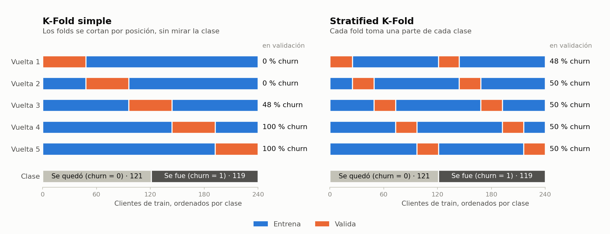

# Churn con CRISP-ML(Q) · Parte 1: del negocio a la evaluación

Laboratorio 14.1. Caso nuevo: una fintech quiere saber qué clientes están por irse (churn) para ofrecerles retención. Con House Price armaste un pipeline de regresión; aquí el problema es de **clasificación** y el hilo conductor es la metodología **CRISP-ML(Q)**.

Esta guía cubre las fases 1 a 4. La parte 2 (laboratorio 14.2, guía 12) cubre despliegue y monitoreo.

## Qué vas a construir

```
Fase 1                Fase 2             Fase 3              Fase 4
Negocio y datos  ──►  Preparación   ──►  Modelado       ──►  Evaluación
configs/churn.yaml    data_prep.py       train.py            evaluate_and_register.py
validate_data.py      features.py        MLflow + CV         umbral por costo, segmentos,
                                                             champion / challenger
      │                    │                  │                    │
      ▼                    ▼                  ▼                    ▼
 job data-validation   job data-prep      job train           job evaluate
```

Cada fase termina en un **quality gate**: si no se cumple, el pipeline se detiene. Esa es la Q de CRISP-ML(Q).

## Qué es nuevo respecto a House Price

| Concepto | En House Price | En este laboratorio |
|---|---|---|
| Metodología | Pasos sueltos del pipeline | CRISP-ML(Q): 6 fases, cada una con riesgo y control |
| Tipo de problema | Regresión (MAE, R²) | Clasificación (precision, recall, F1, ROC-AUC) |
| Preprocesamiento | `preprocessor.pkl` aparte del modelo | `Pipeline` de scikit-learn: preprocesamiento y modelo en un solo artefacto |
| Validación | Un split train/test | Validación cruzada estratificada (media ± desviación) |
| Baseline | `must_beat_baseline` | Baseline registrado en MLflow y comparado por costo |
| Decisión | La predicción es el precio | Umbral de decisión elegido por costo de negocio |
| Evaluación | Métrica global | Métrica por segmento (recall por género y edad) |
| Registry | Stages (Staging/Production) | Aliases `@champion` y `@challenger` |
| Documentación | README | Model card generada por el pipeline |

## CRISP-ML(Q) en una tabla

| Fase | Pregunta que responde | Riesgo típico | Control en este lab |
|---|---|---|---|
| 1. Negocio y datos | ¿Qué decisión mejora el modelo y con qué datos? | Datos que no cumplen lo esperado | Contrato de datos |
| 2. Preparación | ¿Cómo llegan los datos al modelo? | Training-serving skew, leakage | Preprocesamiento dentro del Pipeline |
| 3. Modelado | ¿Qué modelo y por qué? | Elegir por suerte de un split | Validación cruzada + baseline |
| 4. Evaluación | ¿Está listo para producción? | Bueno en promedio, malo en un grupo | Gate de métricas, costo y segmentos |
| 5. Despliegue | ¿Sirve lo mismo que se evaluó? | Skew entre offline y online | Test de skew (guía 12) |
| 6. Monitoreo | ¿Sigue funcionando? | Drift y degradación | PSI, KS, F1 tardío (guía 12) |

---

## 0. Preparación

### 0.1 Fork y entorno

1. Haz **fork** de `https://github.com/utec-devops-2026/mlops-churn-lab` a tu cuenta (botón **Fork** en GitHub).
2. Clona **tu fork**, no el repositorio del curso: necesitas permisos de push y tu propio GitHub Actions. En el comando, reemplaza `TU-USUARIO` por tu usuario de GitHub.
3. Crea un entorno nuevo. No reutilices `mlops-utec`: este repo fija otras versiones.

```bash
git clone https://github.com/TU-USUARIO/mlops-churn-lab.git
cd mlops-churn-lab
git checkout -b lab/14.1

conda create -n churn-lab python=3.10 -y
conda activate churn-lab
pip install -r requirements.txt "setuptools<81"
```

> `mlflow 2.10` importa `pkg_resources`, que `setuptools` eliminó en su versión 81. Sin el pin, `import mlflow` falla con `ModuleNotFoundError: No module named 'pkg_resources'`.

### 0.2 El punto de partida tiene un bug

Corre el pipeline tal como viene y levanta la API:

```bash
python src/data_prep.py
# Imprime: Train: (240, 9) | Test: (60, 9)
# Genera en data/: X_train.csv, X_test.csv, y_train.csv, y_test.csv (ya escalados y con one-hot),
#                  scaler.pkl (StandardScaler ajustado con train) y feature_names.csv

python src/train.py --model all
# Imprime el F1 y ROC-AUC de logistic, random_forest y xgboost, y cuál ganó
# Genera: mlruns/ (3 runs de MLflow), data/best_model.pkl y data/best_model_meta.json

python src/evaluate_and_register.py
# Imprime: Staging F1 ... | Versión 1 promovida a Production
# Genera: el modelo churn-predictor en el registry de MLflow (stage Production),
#         data/production_model.pkl y data/production_model_info.json

uvicorn app.main:app --port 8000
# Carga production_model.pkl, scaler.pkl y feature_names.csv. Docs en http://localhost:8000/docs
```

Ninguno de esos archivos aparece en `git status`: `.gitignore` excluye los `.pkl`, los `.json` de `data/`, los `X_*.csv`, los `y_*.csv` y `mlruns/`.

`uvicorn` se queda ocupando esa terminal: déjalo corriendo hasta ver `Uvicorn running on http://127.0.0.1:8000`. Abre **otra terminal** en la misma carpeta y pide dos predicciones para el mismo cliente cambiando solo el tipo de contrato:

```bash
for c in "Month-to-Month" "Two Year"; do
  curl -sS -X POST localhost:8000/predict -H 'Content-Type: application/json' \
    -d "{\"gender\":\"Male\",\"senior_citizen\":0,\"tenure_months\":12,\"contract_type\":\"$c\",\"internet_service\":\"Fiber\",\"monthly_charges\":95,\"support_tickets_last_6m\":6}"
  echo
done
# {"customer_id":null,"churn_prediction":1,"churn_label":"Churn","churn_probability":0.8123,"risk_level":"ALTO",...}
# {"customer_id":null,"churn_prediction":1,"churn_label":"Churn","churn_probability":0.8123,"risk_level":"ALTO",...}
```

> Si no imprime nada o dice `Failed to connect to localhost port 8000`, la API no está corriendo: revisa la terminal de `uvicorn`.

Las dos respuestas traen **la misma probabilidad**. El contrato es la variable que más separa a los clientes (65 % de churn en Month-to-Month contra 27 % en One Year) y la API la ignora.

La causa está en `app/main.py`: la API repite a mano el preprocesamiento del entrenamiento con `pd.get_dummies(..., drop_first=True)`. Con una sola fila, cada columna categórica tiene una sola categoría, `drop_first` la elimina y la columna one-hot queda en cero.

```python
import pandas as pd
df = pd.DataFrame([{"tenure": 12, "Contract": "Two Year", "InternetService": "Fiber"}])
print(pd.get_dummies(df, columns=["Contract", "InternetService"], drop_first=True).columns.tolist())
# ['tenure']   ← las columnas de contrato e internet desaparecieron
```

Los 18 tests pasan y el modelo tiene buen F1 offline. El error solo existe en producción. Se llama **training-serving skew** y es el riesgo que la fase 2 va a eliminar. Detén la API (`Ctrl+C`) y limpia lo generado:

```bash
rm -rf mlruns data/X_*.csv data/y_*.csv data/*.pkl data/*.json
```

---

## Fase 1 · Negocio y datos

### 1.1 Ficha del proyecto

CRISP-ML(Q) empieza antes del código: qué decisión de negocio se quiere mejorar, cómo se mide el éxito y qué puede salir mal. El repositorio ya trae la ficha en `docs/crisp-mlq.md`. Ábrela, revísala y ajústala a tu proyecto: registra la fecha de cada decisión y agrega las que tomes durante el laboratorio (es un entregable). Este es su contenido:

CRISP-ML(Q) organiza un proyecto de ML en seis fases. La Q (quality assurance) pide que
cada fase declare sus requisitos, los riesgos que pueden hacerla fallar y el control que
los detecta. Esta ficha es el registro de esas decisiones: se versiona junto al código.

#### Fase 1 · Negocio y datos

| Pregunta | Respuesta |
|---|---|
| Problema de negocio | La fintech pierde clientes y hoy contacta a todos por igual en las campañas de retención |
| Decisión que apoya el modelo | A qué clientes ofrecer retención este mes |
| Criterio de éxito de negocio | Gastar menos por cliente que la política actual (contactar a todos) |
| Criterio de éxito de ML | F1 ≥ 0.60 y ROC-AUC ≥ 0.70 en test |
| Criterio de éxito económico | Costo esperado por cliente menor que contactar a todos y que no contactar a nadie |
| Costo de un falso negativo | S/ 200 (cliente que se va sin oferta) |
| Costo de un falso positivo | S/ 100 (oferta a quien no se iba) |
| Factibilidad | 300 clientes, 7 features, clase balanceada (49.7 % churn) |

#### Riesgos y controles por fase

| Fase | Riesgo | Control (quality gate) | Dónde vive |
|---|---|---|---|
| 1. Negocio y datos | El dataset cambia de esquema o trae valores imposibles | Contrato de datos | `src/validate_data.py`, job `data-validation` |
| 1. Negocio y datos | `"None"` leído como nulo y luego imputado | `keep_default_na=False` + test | `src/common.py`, `tests/test_data_contract.py` |
| 2. Preparación | Training-serving skew: la API preprocesa distinto que el entrenamiento | Preprocesamiento dentro del Pipeline | `src/features.py`, `tests/test_features.py` |
| 2. Preparación | Data leakage: el escalador ve datos de test | El Pipeline se ajusta solo con train, fold por fold | `src/train.py` |
| 3. Modelado | Elegir modelo mirando test (optimismo) | Selección por validación cruzada | `src/train.py` |
| 3. Modelado | Un modelo que no aporta sobre lo trivial | Baseline registrado en MLflow | `src/train.py` |
| 4. Evaluación | Buena métrica promedio, mala en un segmento | Recall por segmento, brecha máxima | `src/evaluate_and_register.py` |
| 4. Evaluación | Promover un modelo peor que el vigente | Champion / challenger | `src/evaluate_and_register.py` |
| 5. Despliegue | La API sirve algo distinto a lo evaluado | Test de skew contra la API en ejecución | `tests/test_skew.py`, job `smoke-test` |
| 5. Despliegue | Entradas inválidas llegan al modelo | Contrato en el esquema de la API (422) | `app/main.py` |
| 6. Monitoreo | Los datos de producción cambian | PSI + KS por feature, PSI de predicciones | `src/monitor.py` |
| 6. Monitoreo | El modelo se degrada sin que cambien los datos | F1 con etiquetas tardías | `src/monitor.py`, `model-monitoring.yml` |

#### Decisiones registradas

| Fecha | Decisión | Motivo |
|---|---|---|
| | Umbral de decisión elegido por costo, no 0.5 | Un FN cuesta el doble que un FP |
| | El modelo se selecciona por F1 de validación cruzada | Test queda reservado para la evaluación final |

Hay tres criterios de éxito distintos, y los tres deben poder medirse:

- **Negocio:** gastar menos en retención que hoy.
- **ML:** F1 y ROC-AUC mínimos en test.
- **Económico:** costo esperado por cliente. Un falso negativo (cliente que se va sin oferta) cuesta S/ 200; un falso positivo (oferta a quien no se iba), S/ 100.

### 1.2 Configuración única

Todo lo decidido en la ficha vive en un solo archivo que leen todos los scripts. Crea `configs/churn.yaml`:

```yaml
# Fuente única de verdad del proyecto: lo que se decide en CRISP-ML(Q) fase 1
# (negocio y datos) vive aquí y lo leen todos los scripts.

project:
  name: churn-predictor
  experiment: churn-prediction-fintech
  random_state: 42
  test_size: 0.2

# ── Fase 1 · Criterios de éxito ─────────────────────────────────────────────
# Costos en soles por cliente. Un falso negativo (churner no detectado) cuesta
# más que un falso positivo (oferta de retención a quien no se iba).
business:
  cost_fn: 200
  cost_fp: 100

# ── Fase 1 · Contrato de datos ──────────────────────────────────────────────
data:
  raw_path: data/telco_customer_churn_mlops.csv
  id_column: customer_id
  target: churn
  min_rows: 200
  # Proporción aceptable de la clase positiva (alerta si el dataset cambia de naturaleza)
  target_rate: {min: 0.20, max: 0.80}
  columns:
    gender:                  {type: category, values: [Male, Female]}
    senior_citizen:          {type: int, min: 0, max: 1}
    tenure_months:           {type: int, min: 0, max: 120}
    contract_type:           {type: category, values: [Month-to-Month, One Year, Two Year]}
    internet_service:        {type: category, values: [Fiber, DSL, None]}
    monthly_charges:         {type: float, min: 0, max: 500}
    support_tickets_last_6m: {type: int, min: 0, max: 50}
    churn:                   {type: category, values: ["Yes", "No"]}

features:
  numeric: [tenure_months, monthly_charges, support_tickets_last_6m]
  categorical: [gender, contract_type, internet_service]
  binary: [senior_citizen]

# ── Fase 3 · Modelado ───────────────────────────────────────────────────────
training:
  cv_folds: 5
  selection_metric: cv_f1_mean

# ── Fase 4 · Quality gate de evaluación ─────────────────────────────────────
quality_gate:
  min_f1: 0.60
  min_roc_auc: 0.70
  must_beat_baseline: true
  # Diferencia máxima de recall entre grupos (gender, senior_citizen)
  max_recall_gap: 0.25
  slices: [gender, senior_citizen]

# ── Fase 6 · Monitoreo ──────────────────────────────────────────────────────
monitoring:
  psi_warning: 0.10
  psi_critical: 0.25
  ks_alpha: 0.05
  max_f1_drop: 0.10
  min_drifted_features: 2
```

### 1.3 Un nulo que no es nulo

```python
import pandas as pd
df = pd.read_csv("data/telco_customer_churn_mlops.csv")
print(df["internet_service"].isna().sum())          # 30

df = pd.read_csv("data/telco_customer_churn_mlops.csv", keep_default_na=False)
print(df["internet_service"].value_counts())        # Fiber 153, DSL 117, None 30
```

pandas convierte el texto `"None"` en `NaN` al leer. El script original veía 30 nulos y los imputaba. No falta ningún dato: `None` es la categoría "cliente sin internet". Entender los datos antes de limpiarlos es parte de la fase 1.

Crea `src/common.py` con las utilidades que comparten todos los scripts:

```python
"""Utilidades compartidas: rutas, configuración y carga del dataset crudo."""
from pathlib import Path

import pandas as pd
import yaml

ROOT = Path(__file__).resolve().parents[1]
DATA_DIR = ROOT / "data"
REPORTS_DIR = ROOT / "reports"
CONFIG_PATH = ROOT / "configs" / "churn.yaml"
MLFLOW_URI = f"file://{ROOT / 'mlruns'}"


def load_config(path: Path = CONFIG_PATH) -> dict:
    with open(path) as f:
        return yaml.safe_load(f)


def feature_columns(cfg: dict) -> list:
    feats = cfg["features"]
    return feats["numeric"] + feats["categorical"] + feats["binary"]


def load_raw(cfg: dict) -> pd.DataFrame:
    """Lee el CSV crudo.

    keep_default_na=False: pandas convierte el texto "None" en NaN por defecto.
    En este dataset "None" es una categoría válida de internet_service
    (cliente sin internet), no un dato faltante.
    """
    path = ROOT / cfg["data"]["raw_path"]
    if not path.exists():
        raise FileNotFoundError(f"Dataset no encontrado: {path}")
    return pd.read_csv(path, keep_default_na=False, na_values=[""])
```

### 1.4 Contrato de datos (quality gate de la fase 1)

Crea `src/validate_data.py`:

```python
"""CRISP-ML(Q) fase 1 · Quality gate de datos.

Valida el CSV crudo contra el contrato de configs/churn.yaml y escribe
reports/data_validation.json. Termina con exit 1 si el contrato no se cumple,
así el pipeline se detiene antes de entrenar con datos malos.
"""
import argparse
import json
import sys

import pandas as pd

from common import REPORTS_DIR, load_config, load_raw


def validate(df: pd.DataFrame, cfg: dict) -> list:
    """Devuelve la lista de checks: [{check, passed, detail}]."""
    data_cfg = cfg["data"]
    checks = []

    def add(name, passed, detail=""):
        checks.append({"check": name, "passed": bool(passed), "detail": str(detail)})

    add("min_rows", len(df) >= data_cfg["min_rows"], f"{len(df)} filas (mínimo {data_cfg['min_rows']})")

    id_col = data_cfg["id_column"]
    if id_col in df.columns:
        dups = int(df[id_col].duplicated().sum())
        add("unique_id", dups == 0, f"{dups} ids duplicados")

    for col, rule in data_cfg["columns"].items():
        if col not in df.columns:
            add(f"{col}:exists", False, "columna ausente")
            continue

        nulls = int(df[col].isna().sum())
        add(f"{col}:no_nulls", nulls == 0, f"{nulls} nulos")

        if rule["type"] == "category":
            allowed = {str(v) for v in rule["values"]}
            unexpected = sorted(set(df[col].dropna().astype(str)) - allowed)
            add(f"{col}:allowed_values", not unexpected, f"valores inesperados: {unexpected}")
        else:
            values = pd.to_numeric(df[col], errors="coerce")
            not_numeric = int(values.isna().sum()) - nulls
            add(f"{col}:numeric", not_numeric == 0, f"{not_numeric} valores no numéricos")
            out = int(((values < rule["min"]) | (values > rule["max"])).sum())
            add(f"{col}:range", out == 0, f"{out} fuera de [{rule['min']}, {rule['max']}]")

    target = data_cfg["target"]
    if target in df.columns:
        rate = float((df[target] == "Yes").mean())
        lo, hi = data_cfg["target_rate"]["min"], data_cfg["target_rate"]["max"]
        add("target_rate", lo <= rate <= hi, f"churn rate {rate:.3f} (esperado entre {lo} y {hi})")

    return checks


def main():
    parser = argparse.ArgumentParser()
    parser.add_argument("--data", default=None, help="CSV a validar (por defecto, el de configs/churn.yaml)")
    args = parser.parse_args()

    cfg = load_config()
    if args.data:
        cfg["data"]["raw_path"] = args.data
    df = load_raw(cfg)
    checks = validate(df, cfg)
    failed = [c for c in checks if not c["passed"]]

    report = {
        "dataset": cfg["data"]["raw_path"],
        "rows": len(df),
        "checks_total": len(checks),
        "checks_failed": len(failed),
        "passed": not failed,
        "checks": checks,
    }
    REPORTS_DIR.mkdir(exist_ok=True)
    with open(REPORTS_DIR / "data_validation.json", "w") as f:
        json.dump(report, f, indent=2, ensure_ascii=False)

    print(f"Contrato de datos: {len(checks) - len(failed)}/{len(checks)} checks OK")
    for c in failed:
        print(f"  FALLA {c['check']}: {c['detail']}")
    if failed:
        sys.exit(1)


if __name__ == "__main__":
    main()
```

Ejecuta:

```bash
python src/validate_data.py
# Imprime: Contrato de datos: 23/23 checks OK   (exit 0)
# Genera:  reports/data_validation.json con el detalle de cada check
# Si un check falla: lista los que fallaron y termina con exit 1
```

Comprueba que el gate detiene datos malos. Copia el dataset, rompe una fila y valida la copia:

```bash
sed '2s/Two Year/Weekly/' data/telco_customer_churn_mlops.csv > /tmp/roto.csv
python src/validate_data.py --data /tmp/roto.csv; echo "exit=$?"
#   FALLA contract_type:allowed_values: valores inesperados: ['Weekly']
# exit=1
python src/validate_data.py     # deja el reporte en verde otra vez
```

---

## Fase 2 · Preparación de datos

### 2.1 El preprocesamiento viaja con el modelo

El bug del paso 0.2 existe porque el preprocesamiento estaba escrito dos veces: en `data_prep.py` para entrenar y en `app/main.py` para servir. La solución no es corregir la copia, es que haya una sola.

Un `Pipeline` de scikit-learn encadena transformaciones y modelo en un único objeto. Se entrena, se guarda y se carga como una pieza; recibe las columnas crudas del negocio y devuelve la probabilidad.

Crea `src/features.py`:

```python
"""Preprocesamiento como parte del modelo.

El ColumnTransformer se entrena junto con el clasificador dentro de un Pipeline.
El artefacto final recibe las columnas crudas del negocio y devuelve la
probabilidad de churn: no hay código de preprocesamiento duplicado en la API.
"""
from sklearn.compose import ColumnTransformer
from sklearn.pipeline import Pipeline
from sklearn.preprocessing import OneHotEncoder, StandardScaler


def build_preprocessor(cfg: dict) -> ColumnTransformer:
    feats = cfg["features"]
    return ColumnTransformer(
        transformers=[
            ("num", StandardScaler(), feats["numeric"]),
            # handle_unknown="ignore": una categoría nunca vista no tumba la API
            ("cat", OneHotEncoder(handle_unknown="ignore"), feats["categorical"]),
            ("bin", "passthrough", feats["binary"]),
        ]
    )


def build_pipeline(estimator, cfg: dict) -> Pipeline:
    return Pipeline([("preprocess", build_preprocessor(cfg)), ("model", estimator)])
```

Segundo beneficio: no hay **data leakage**. Antes el `StandardScaler` se ajustaba una vez sobre todo train; con validación cruzada eso filtra información del fold de validación. Dentro del Pipeline, el escalador se reajusta en cada fold solo con los datos de entrenamiento de ese fold.

### 2.2 `data_prep.py` solo limpia y parte

Reemplaza `src/data_prep.py`:

```python
"""CRISP-ML(Q) fase 2 · Preparación de datos.

Solo limpia y parte el dataset. El escalado y el encoding NO se hacen aquí:
viven dentro del Pipeline de scikit-learn (src/features.py) para que el modelo
aplique en producción exactamente las mismas transformaciones que en entrenamiento.
"""
import json

from sklearn.model_selection import train_test_split

from common import DATA_DIR, feature_columns, load_config, load_raw


def clean(df, cfg):
    target = cfg["data"]["target"]
    df = df.drop(columns=[cfg["data"]["id_column"]], errors="ignore")
    df[target] = (df[target] == "Yes").astype(int)
    return df[feature_columns(cfg) + [target]]


def main():
    cfg = load_config()
    target = cfg["data"]["target"]
    df = clean(load_raw(cfg), cfg)

    train, test = train_test_split(
        df,
        test_size=cfg["project"]["test_size"],
        random_state=cfg["project"]["random_state"],
        stratify=df[target],
    )

    DATA_DIR.mkdir(exist_ok=True)
    train.to_csv(DATA_DIR / "train.csv", index=False)
    test.to_csv(DATA_DIR / "test.csv", index=False)

    summary = {
        "train_rows": len(train),
        "test_rows": len(test),
        "train_churn_rate": round(float(train[target].mean()), 4),
        "test_churn_rate": round(float(test[target].mean()), 4),
        "features": feature_columns(cfg),
    }
    with open(DATA_DIR / "data_prep_summary.json", "w") as f:
        json.dump(summary, f, indent=2)
    print(json.dumps(summary, indent=2))


if __name__ == "__main__":
    main()
```

```bash
python src/data_prep.py
# Imprime: resumen con filas, churn rate de train y test, y lista de features
# Genera:  data/train.csv (240 filas) y data/test.csv (60 filas): 7 features crudas + churn (0/1)
#          data/data_prep_summary.json con el mismo resumen
```

Ya no se generan `scaler.pkl`, `feature_names.csv` ni los `X_*.csv` escalados: el escalado y el encoding ahora ocurren dentro del Pipeline.

### 2.3 Tests de la fase

Crea `pytest.ini` en la raíz para que los tests encuentren `src/`:

```ini
[pytest]
pythonpath = . src
filterwarnings =
    ignore::DeprecationWarning
    ignore::UserWarning
```

Crea `tests/test_data_contract.py`:

```python
"""Tests del contrato de datos (CRISP-ML(Q) fase 1)."""
import pandas as pd

from common import load_config, load_raw
from validate_data import validate


def _failed(df):
    return {c["check"] for c in validate(df, load_config()) if not c["passed"]}


def test_raw_dataset_meets_contract():
    cfg = load_config()
    assert _failed(load_raw(cfg)) == set()


def test_none_is_a_category_not_a_null():
    df = load_raw(load_config())
    assert df["internet_service"].isna().sum() == 0
    assert "None" in set(df["internet_service"])


def test_unexpected_category_fails():
    df = load_raw(load_config())
    df.loc[0, "contract_type"] = "Weekly"
    assert "contract_type:allowed_values" in _failed(df)


def test_out_of_range_fails():
    df = load_raw(load_config())
    df.loc[0, "monthly_charges"] = -10
    assert "monthly_charges:range" in _failed(df)


def test_missing_column_fails():
    df = load_raw(load_config()).drop(columns=["tenure_months"])
    assert "tenure_months:exists" in _failed(df)
```

Crea `tests/test_features.py`:

```python
"""Tests del Pipeline de preprocesamiento (CRISP-ML(Q) fase 2)."""
import pandas as pd
from sklearn.linear_model import LogisticRegression

from common import feature_columns, load_config, load_raw
from features import build_pipeline


def _fitted_pipeline():
    cfg = load_config()
    df = load_raw(cfg)
    X, y = df[feature_columns(cfg)], (df[cfg["data"]["target"]] == "Yes").astype(int)
    return build_pipeline(LogisticRegression(max_iter=500), cfg).fit(X, y), X


def test_pipeline_accepts_raw_columns():
    pipeline, X = _fitted_pipeline()
    proba = pipeline.predict_proba(X.head(5))[:, 1]
    assert ((proba >= 0) & (proba <= 1)).all()


def test_contract_type_changes_the_prediction():
    """El bug original: la API ignoraba contract_type. Aquí debe influir."""
    pipeline, X = _fitted_pipeline()
    row = X.head(1).copy()
    row["contract_type"] = "Month-to-Month"
    monthly = pipeline.predict_proba(row)[0, 1]
    row["contract_type"] = "Two Year"
    two_year = pipeline.predict_proba(row)[0, 1]
    assert monthly != two_year


def test_unknown_category_does_not_crash():
    pipeline, X = _fitted_pipeline()
    row = X.head(1).copy()
    row["internet_service"] = "Satellite"
    assert 0 <= pipeline.predict_proba(row)[0, 1] <= 1
```

Un ajuste en `tests/conftest.py`. El `yield` de la fixture `client` está dentro del bloque `with patch(...)`, así que el mock de `pandas.read_csv` queda activo durante toda la sesión y los tests nuevos leerían un DataFrame falso. Los mocks solo hacen falta mientras se importa la API.

Antes (final de la fixture `client`; el `yield` tiene 8 espacios, está dentro del `with`):

```python
    with patch("joblib.load", side_effect=lambda p: _model if "model" in str(p) else _scaler), \
         patch("pandas.read_csv", return_value=_features_df), \
         patch("builtins.open", side_effect=_selective_open):

        sys.modules.pop("app.main", None)

        import app.main as app_module
        from fastapi.testclient import TestClient

        yield TestClient(app_module.app)
```

Después (el `yield` tiene 4 espacios, queda fuera del `with` y los mocks se desactivan antes de entregar el cliente):

```python
    with patch("joblib.load", side_effect=lambda p: _model if "model" in str(p) else _scaler), \
         patch("pandas.read_csv", return_value=_features_df), \
         patch("builtins.open", side_effect=_selective_open):

        sys.modules.pop("app.main", None)

        import app.main as app_module
        from fastapi.testclient import TestClient

    # Los mocks solo hacen falta mientras se importa la API
    yield TestClient(app_module.app)
```

Solo cambia la última línea: se le quitan 4 espacios y se agrega el comentario.

```bash
pytest tests/ -q
# 26 passed: 18 de la API (modelo mockeado) + 5 del contrato de datos + 3 del Pipeline
# No genera archivos
```

Agrega al final de `.gitignore`:

```
data/train.csv
data/test.csv
reports/data_validation.json
reports/evaluation_report.json
```

Y al final de `requirements.txt`:

```
pyyaml>=6.0
scipy>=1.11
prometheus-fastapi-instrumentator==7.0.0
prometheus-client>=0.20
# mlflow 2.10 importa pkg_resources, que setuptools eliminó en la versión 81
setuptools<81
```

---

## Fase 3 · Modelado

### 3.1 Qué cambia

- **Baseline.** Un clasificador que predice "todos se van" se registra en MLflow igual que los demás.
- **Validación cruzada estratificada.** Con 240 filas, un solo split da una métrica que depende de la suerte. Cinco folds dan media y desviación.
- **Test no participa.** El modelo se elige por F1 de validación cruzada. Si eliges mirando test, la métrica de test deja de ser una estimación honesta.

### 3.2 Validación cruzada simple y estratificada

**Validación cruzada (K-Fold).** En lugar de un solo split, train se divide en K partes (folds). Se entrena K veces: en cada vuelta un fold distinto se usa para validar y los otros K−1 para entrenar. El resultado es el promedio de las K métricas y su desviación. Test queda fuera de todo el proceso y solo se usa en la evaluación final.


*Fuente: documentación de scikit-learn, [Cross-validation: evaluating estimator performance](https://scikit-learn.org/1.5/modules/cross_validation.html).*

En este laboratorio: los 240 clientes de train se dividen en 5 folds de 48. Cada modelo se entrena 5 veces con 192 clientes y se valida con los 48 restantes. La barra naranja del final son los 60 clientes de test, que `train.py` nunca toca.

**Qué es una clase.** En clasificación, una clase es cada valor posible de la variable objetivo. En churn hay dos: `churn = 1` (el cliente se fue, clase positiva) y `churn = 0` (se quedó, clase negativa). De los 240 clientes de train, 119 son de la clase positiva y 121 de la negativa.

**El problema de K-Fold simple.** Los folds se arman por posición, sin mirar la etiqueta, así que la proporción de cada clase en cada fold depende de cómo vengan ordenados los datos.

**Validación cruzada estratificada (Stratified K-Fold).** Cada fold se arma tomando una parte de cada clase, de modo que todos conservan la misma proporción de clases que el dataset completo.

La figura compara las dos con los 240 clientes de train del laboratorio. Para que se vea el efecto están ordenados por clase: primero los 121 que se quedaron, luego los 119 que se fueron. Cada fila es una vuelta: naranja valida, azul entrena.



- **K-Fold simple (izquierda).** El fold de validación es un bloque contiguo. En las vueltas 1 y 2 se valida solo con clientes que se quedaron (0 % de churn): el recall no se puede medir porque no hay ningún positivo. En las vueltas 4 y 5 se valida solo con clientes que se fueron.
- **Stratified K-Fold (derecha).** Cada vuelta tiene dos tramos naranjas, uno dentro de cada clase. Todos los folds quedan con cerca de 50 % de churn, igual que el dataset.

Datos ordenados por clase es el peor caso. Barajar antes de partir (`shuffle=True`) lo suaviza pero no lo elimina. La tabla muestra el caso realista: los mismos 240 clientes barajados, con la misma semilla en ambos métodos.

Cómo leerla: cada fila es uno de los 5 folds, y cada fold tiene 48 clientes (240 / 5). La celda dice cuántos de esos 48 se fueron (churn = 1) y qué porcentaje del fold representan. Por ejemplo, con K-Fold simple el fold 4 tiene 19 clientes que se fueron y 29 que se quedaron: 19 / 48 = 39.6 % de churn. El dataset completo tiene 49.6 %, así que un fold "bien armado" debería tener 23 o 24.

| Fold (48 clientes) | K-Fold simple: clientes que se fueron | Stratified K-Fold: clientes que se fueron |
|---|---|---|
| 1 | 24 (50.0 %) | 24 (50.0 %) |
| 2 | 24 (50.0 %) | 24 (50.0 %) |
| 3 | 23 (47.9 %) | 24 (50.0 %) |
| 4 | 19 (39.6 %) | 24 (50.0 %) |
| 5 | 29 (60.4 %) | 23 (47.9 %) |
| **Total** | **119 de 240** | **119 de 240** |

Con K-Fold simple, un fold tiene 39.6 % de churn y otro 60.4 %. Precision, recall y F1 dependen de cuántos positivos hay, así que parte de la diferencia entre folds se debería a su composición y no al modelo. Con la versión estratificada todos los folds son comparables y la desviación que reporta `train.py` refleja la estabilidad del modelo.

| | K-Fold simple | Stratified K-Fold |
|---|---|---|
| Cómo arma los folds | Por posición o al azar, sin mirar la etiqueta | Reparte cada clase entre los K folds |
| Proporción de clases por fold | Variable | Igual a la del dataset (±1 muestra) |
| Cuándo usarla | Regresión | Clasificación, sobre todo con clases desbalanceadas o pocos datos |
| En scikit-learn | `KFold` | `StratifiedKFold` |

Con clases muy desbalanceadas el efecto es mayor: con 5 % de positivos, un fold de K-Fold simple puede quedarse sin ningún positivo y el recall de ese fold no se puede calcular.

En `train.py` es esta línea; `cross_validate` recibe el Pipeline completo, así que el escalador y el encoder también se reajustan en cada vuelta:

```python
cv = StratifiedKFold(n_splits=cfg["training"]["cv_folds"], shuffle=True, random_state=seed)
scores = cross_validate(pipeline, X, y, cv=cv, scoring=SCORING)
```

### 3.3 Entrenar

Reemplaza `src/train.py`:

```python
"""CRISP-ML(Q) fase 3 · Modelado con MLflow tracking.

Entrena un baseline y tres candidatos. Cada candidato es un Pipeline
(preprocesamiento + clasificador) evaluado con validación cruzada estratificada
sobre train. El mejor se elige por F1 de validación cruzada: el set de test
no participa en la selección, queda reservado para la fase de evaluación.
"""
import argparse
import json

import joblib
import mlflow
import mlflow.sklearn
import pandas as pd
from sklearn.dummy import DummyClassifier
from sklearn.ensemble import RandomForestClassifier
from sklearn.linear_model import LogisticRegression
from sklearn.model_selection import StratifiedKFold, cross_validate
from xgboost import XGBClassifier

from common import DATA_DIR, MLFLOW_URI, feature_columns, load_config
from features import build_pipeline

CANDIDATES = ["logistic", "random_forest", "xgboost"]
SCORING = {"f1": "f1", "roc_auc": "roc_auc", "precision": "precision", "recall": "recall"}


def get_estimator(name: str, seed: int):
    estimators = {
        # Baseline: predice siempre la clase positiva. Si un modelo no le gana, no aporta.
        "baseline": (DummyClassifier(strategy="constant", constant=1), {"strategy": "constant=1"}),
        "logistic": (
            LogisticRegression(C=1.0, max_iter=500, class_weight="balanced", random_state=seed),
            {"C": 1.0, "max_iter": 500, "class_weight": "balanced"},
        ),
        "random_forest": (
            RandomForestClassifier(n_estimators=200, max_depth=5, class_weight="balanced",
                                   random_state=seed, n_jobs=-1),
            {"n_estimators": 200, "max_depth": 5, "class_weight": "balanced"},
        ),
        "xgboost": (
            XGBClassifier(n_estimators=100, max_depth=3, learning_rate=0.1, random_state=seed,
                          eval_metric="logloss", verbosity=0),
            {"n_estimators": 100, "max_depth": 3, "learning_rate": 0.1},
        ),
    }
    return estimators[name]


def train_one(name, X, y, cfg):
    seed = cfg["project"]["random_state"]
    estimator, params = get_estimator(name, seed)
    pipeline = build_pipeline(estimator, cfg)
    cv = StratifiedKFold(n_splits=cfg["training"]["cv_folds"], shuffle=True, random_state=seed)

    with mlflow.start_run(run_name=name) as run:
        mlflow.set_tags({"model_type": name, "dataset": "telco_churn", "crisp_mlq_phase": "modeling"})
        mlflow.log_params({**params, "cv_folds": cv.get_n_splits(), "train_size": len(X)})

        scores = cross_validate(pipeline, X, y, cv=cv, scoring=SCORING)
        metrics = {}
        for metric in SCORING:
            fold_scores = scores[f"test_{metric}"]
            metrics[f"cv_{metric}_mean"] = round(float(fold_scores.mean()), 4)
            metrics[f"cv_{metric}_std"] = round(float(fold_scores.std()), 4)
        mlflow.log_metrics(metrics)

        # Modelo final: se reentrena con todo train
        pipeline.fit(X, y)
        mlflow.sklearn.log_model(pipeline, "model", input_example=X.head(3))

    return {"model_type": name, "run_id": run.info.run_id, "metrics": metrics, "pipeline": pipeline}


def main():
    parser = argparse.ArgumentParser()
    parser.add_argument("--model", default="all", choices=CANDIDATES + ["all"])
    args = parser.parse_args()

    cfg = load_config()
    target = cfg["data"]["target"]
    train = pd.read_csv(DATA_DIR / "train.csv", keep_default_na=False)
    X, y = train[feature_columns(cfg)], train[target]

    mlflow.set_tracking_uri(MLFLOW_URI)
    mlflow.set_experiment(cfg["project"]["experiment"])

    baseline = train_one("baseline", X, y, cfg)
    print(f"baseline       F1 CV = {baseline['metrics']['cv_f1_mean']:.4f}")

    results = []
    for name in CANDIDATES if args.model == "all" else [args.model]:
        result = train_one(name, X, y, cfg)
        results.append(result)
        m = result["metrics"]
        print(f"{name:<14} F1 CV = {m['cv_f1_mean']:.4f} ± {m['cv_f1_std']:.4f} | ROC-AUC CV = {m['cv_roc_auc_mean']:.4f}")

    selection = cfg["training"]["selection_metric"]
    best = max(results, key=lambda r: r["metrics"][selection])
    print(f"\nMejor modelo por {selection}: {best['model_type']}")

    meta = {
        "best_model": best["model_type"],
        "best_run_id": best["run_id"],
        "selection_metric": selection,
        "metrics": best["metrics"],
        "baseline_metrics": baseline["metrics"],
        "all_results": [{"model": r["model_type"], **r["metrics"]} for r in results],
    }
    with open(DATA_DIR / "best_model_meta.json", "w") as f:
        json.dump(meta, f, indent=2)
    joblib.dump(best["pipeline"], DATA_DIR / "best_model.pkl")
    print(f"Guardado data/best_model.pkl | run_id: {best['run_id']}")


if __name__ == "__main__":
    main()
```

```bash
python src/train.py --model all
# Imprime: F1 de validación cruzada (media ± desviación) del baseline y de cada candidato
# Genera:  mlruns/ con 4 runs (baseline, logistic, random_forest, xgboost): parámetros,
#          métricas cv_* y el Pipeline entrenado de cada uno
#          data/best_model.pkl       Pipeline ganador (preprocesamiento + modelo)
#          data/best_model_meta.json run_id del ganador y métricas de todos
```

Salida esperada (los decimales pueden variar según plataforma):

```
baseline       F1 CV = 0.6629
logistic       F1 CV = 0.6666 ± 0.0454 | ROC-AUC CV = 0.7315
random_forest  F1 CV = 0.6900 ± 0.0426 | ROC-AUC CV = 0.7326
xgboost        F1 CV = 0.6829 ± 0.0656 | ROC-AUC CV = 0.7100

Mejor modelo por cv_f1_mean: random_forest
```

### 3.4 Leer el resultado

- El baseline saca F1 0.66 sin aprender nada. Con la clase balanceada, predecir siempre "churn" da recall 1.0 y precision 0.5. **F1 solo no distingue un modelo útil de uno trivial**: por eso el gate de la fase 4 compara costo y ROC-AUC, no solo F1.
- La diferencia entre random forest (0.690) y xgboost (0.683) es menor que la desviación entre folds (0.04 a 0.07). No hay evidencia de que uno sea mejor: con datasets chicos, el "ganador" puede cambiar con otra semilla.

Abre MLflow y compara los cuatro runs:

```bash
mlflow ui --backend-store-uri mlruns --port 5001
# http://localhost:5001
```

---

## Fase 4 · Evaluación

### 4.1 Qué decide esta fase

1. **Umbral por costo.** El modelo entrega una probabilidad; contactar o no es una decisión de negocio. El umbral 0.5 solo es correcto si los dos errores cuestan lo mismo. Aquí se elige el umbral que minimiza `FN × 200 + FP × 100`, usando predicciones out-of-fold de train.
2. **Métricas en test.** Primera y única vez que se usa test.
3. **Segmentos.** Recall por género y por adulto mayor. Un modelo puede acertar en promedio y fallarle a un grupo.
4. **Quality gate.** F1, ROC-AUC, brecha de recall y costo menor que no tener modelo.
5. **Champion / challenger.** Toda versión evaluada se registra como `@challenger`. Solo pasa a `@champion` si supera el gate y no cuesta más que el champion vigente.

Los stages de MLflow (`Staging`, `Production`) están deprecados; los **aliases** los reemplazan. Un alias es un puntero con nombre a una versión: se carga con `models:/churn-predictor@champion` y hacer rollback es mover el puntero.

Reemplaza `src/evaluate_and_register.py`:

```python
"""CRISP-ML(Q) fase 4 · Evaluación, quality gate y registro.

1. Elige el umbral de decisión que minimiza el costo de negocio (con predicciones
   out-of-fold de train, nunca con test).
2. Mide el modelo en test: métricas globales, costo y métricas por segmento.
3. Aplica el quality gate de configs/churn.yaml.
4. Registra la versión como @challenger y la promueve a @champion solo si pasa
   el gate y no es peor que el champion vigente.
"""
import json
import sys

import joblib
import mlflow
import numpy as np
import pandas as pd
from mlflow.tracking import MlflowClient
from sklearn.base import clone
from sklearn.metrics import (confusion_matrix, f1_score, precision_score,
                             recall_score, roc_auc_score)
from sklearn.model_selection import StratifiedKFold, cross_val_predict

from common import DATA_DIR, MLFLOW_URI, REPORTS_DIR, feature_columns, load_config


def expected_cost(y_true, y_pred, cost_fn, cost_fp) -> float:
    """Costo promedio por cliente de las decisiones del modelo."""
    tn, fp, fn, tp = confusion_matrix(y_true, y_pred, labels=[0, 1]).ravel()
    return float((fn * cost_fn + fp * cost_fp) / len(y_true))


def choose_threshold(pipeline, X, y, cfg) -> float:
    """Umbral de menor costo, calculado con predicciones out-of-fold de train."""
    seed = cfg["project"]["random_state"]
    cv = StratifiedKFold(n_splits=cfg["training"]["cv_folds"], shuffle=True, random_state=seed)
    proba = cross_val_predict(clone(pipeline), X, y, cv=cv, method="predict_proba")[:, 1]
    grid = np.round(np.arange(0.05, 0.96, 0.05), 2)
    costs = [expected_cost(y, (proba >= t).astype(int), **cfg["business"]) for t in grid]
    return float(grid[int(np.argmin(costs))])


def classification_metrics(y_true, proba, threshold) -> dict:
    y_pred = (proba >= threshold).astype(int)
    return {
        "f1": round(float(f1_score(y_true, y_pred, zero_division=0)), 4),
        "precision": round(float(precision_score(y_true, y_pred, zero_division=0)), 4),
        "recall": round(float(recall_score(y_true, y_pred, zero_division=0)), 4),
        "roc_auc": round(float(roc_auc_score(y_true, proba)), 4),
    }


def slice_metrics(test, proba, threshold, cfg) -> dict:
    """Recall por segmento: un modelo bueno en promedio puede fallar en un grupo."""
    target = cfg["data"]["target"]
    y_pred = (proba >= threshold).astype(int)
    slices = {}
    for col in cfg["quality_gate"]["slices"]:
        groups = {}
        for value, idx in test.groupby(col).indices.items():
            y_true = test[target].to_numpy()[idx]
            groups[str(value)] = {
                "n": int(len(idx)),
                "recall": round(float(recall_score(y_true, y_pred[idx], zero_division=0)), 4),
            }
        recalls = [g["recall"] for g in groups.values()]
        slices[col] = {"groups": groups, "recall_gap": round(max(recalls) - min(recalls), 4)}
    return slices


def champion_cost(client, name, X_test, y_test, cfg):
    """Costo del champion vigente en el mismo test set, o None si no hay champion."""
    try:
        version = client.get_model_version_by_alias(name, "champion")
    except Exception:
        return None, None
    model = mlflow.sklearn.load_model(f"models:/{name}@champion")
    threshold = float(version.tags.get("threshold", 0.5))
    y_pred = (model.predict_proba(X_test)[:, 1] >= threshold).astype(int)
    return version.version, expected_cost(y_test, y_pred, **cfg["business"])


def write_model_card(info: dict, report: dict, cfg: dict):
    gate_rows = "\n".join(
        f"| {c['check']} | {c['value']} | {c['required']} | {'OK' if c['passed'] else 'FALLA'} |"
        for c in report["gate"]["checks"]
    )
    slice_rows = "\n".join(
        f"| {col} | {group} | {vals['n']} | {vals['recall']} |"
        for col, data in report["slices"].items()
        for group, vals in data["groups"].items()
    )
    m = report["test_metrics"]
    card = f"""# Model card · {info['model_name']} v{info['version']}

## Uso previsto
Priorizar clientes para la campaña de retención. La salida es una probabilidad de
churn; la decisión de contactar se toma con el umbral {info['threshold']}.
No usar para negar servicios ni para decisiones sin revisión humana.

## Datos
Dataset `{cfg['data']['raw_path']}`, {report['train_rows']} filas de train y {report['test_rows']} de test.
Features: {', '.join(info['features'])}.

## Modelo
Tipo: {info['model_type']} dentro de un Pipeline de scikit-learn (preprocesamiento incluido).
Run de MLflow: `{info['run_id']}`.

## Métricas en test (umbral {info['threshold']})
| F1 | Precision | Recall | ROC-AUC | Costo por cliente |
|---|---|---|---|---|
| {m['f1']} | {m['precision']} | {m['recall']} | {m['roc_auc']} | {report['cost']['model']} |

Costo sin modelo: contactar a todos {report['cost']['contact_all']}, no contactar a nadie {report['cost']['contact_none']}.

## Quality gate
| Check | Valor | Requerido | Resultado |
|---|---|---|---|
{gate_rows}

## Recall por segmento
| Segmento | Grupo | n | Recall |
|---|---|---|---|
{slice_rows}

## Limitaciones
Dataset pequeño ({report['train_rows'] + report['test_rows']} clientes): las métricas tienen alta varianza.
El umbral depende de los costos de negocio definidos en `configs/churn.yaml`; si cambian, hay que recalcularlo.
"""
    with open(REPORTS_DIR / "model_card.md", "w") as f:
        f.write(card)


def main():
    cfg = load_config()
    name = cfg["project"]["name"]
    target = cfg["data"]["target"]
    features = feature_columns(cfg)
    gate_cfg = cfg["quality_gate"]

    with open(DATA_DIR / "best_model_meta.json") as f:
        meta = json.load(f)
    pipeline = joblib.load(DATA_DIR / "best_model.pkl")
    train = pd.read_csv(DATA_DIR / "train.csv", keep_default_na=False)
    test = pd.read_csv(DATA_DIR / "test.csv", keep_default_na=False)
    X_test, y_test = test[features], test[target]

    # 1. Umbral por costo (solo con train)
    threshold = choose_threshold(pipeline, train[features], train[target], cfg)

    # 2. Evaluación en test
    proba = pipeline.predict_proba(X_test)[:, 1]
    metrics = classification_metrics(y_test, proba, threshold)
    metrics_050 = classification_metrics(y_test, proba, 0.5)
    costs = {
        "model": round(expected_cost(y_test, (proba >= threshold).astype(int), **cfg["business"]), 2),
        "model_threshold_050": round(expected_cost(y_test, (proba >= 0.5).astype(int), **cfg["business"]), 2),
        "contact_all": round(expected_cost(y_test, np.ones(len(y_test), dtype=int), **cfg["business"]), 2),
        "contact_none": round(expected_cost(y_test, np.zeros(len(y_test), dtype=int), **cfg["business"]), 2),
    }
    slices = slice_metrics(test, proba, threshold, cfg)

    # 3. Quality gate
    baseline_cost = min(costs["contact_all"], costs["contact_none"])
    max_gap = max(s["recall_gap"] for s in slices.values())
    checks = [
        {"check": "f1", "value": metrics["f1"], "required": f">= {gate_cfg['min_f1']}",
         "passed": metrics["f1"] >= gate_cfg["min_f1"]},
        {"check": "roc_auc", "value": metrics["roc_auc"], "required": f">= {gate_cfg['min_roc_auc']}",
         "passed": metrics["roc_auc"] >= gate_cfg["min_roc_auc"]},
        {"check": "recall_gap", "value": max_gap, "required": f"<= {gate_cfg['max_recall_gap']}",
         "passed": max_gap <= gate_cfg["max_recall_gap"]},
    ]
    if gate_cfg["must_beat_baseline"]:
        checks.append({"check": "costo_vs_sin_modelo", "value": costs["model"],
                       "required": f"< {baseline_cost}", "passed": costs["model"] < baseline_cost})
    gate_passed = all(c["passed"] for c in checks)

    # 4. Registro: toda versión evaluada entra como @challenger
    mlflow.set_tracking_uri(MLFLOW_URI)
    client = MlflowClient()
    champion_version, champ_cost = champion_cost(client, name, X_test, y_test, cfg)

    mv = mlflow.register_model(model_uri=f"runs:/{meta['best_run_id']}/model", name=name)
    client.set_registered_model_alias(name, "challenger", mv.version)
    client.set_model_version_tag(name, mv.version, "threshold", str(threshold))
    client.set_model_version_tag(name, mv.version, "test_f1", str(metrics["f1"]))
    client.set_model_version_tag(name, mv.version, "quality_gate", "passed" if gate_passed else "failed")

    beats_champion = champ_cost is None or costs["model"] <= champ_cost
    promoted = gate_passed and beats_champion

    report = {
        "model_type": meta["best_model"],
        "version": str(mv.version),
        "threshold": threshold,
        "train_rows": len(train),
        "test_rows": len(test),
        "test_metrics": metrics,
        "test_metrics_threshold_050": metrics_050,
        "cv_metrics": meta["metrics"],
        "cost": costs,
        "slices": slices,
        "gate": {"passed": gate_passed, "checks": checks},
        "champion": {"previous_version": champion_version, "previous_cost": champ_cost,
                     "beats_champion": beats_champion},
        "promoted": promoted,
    }
    REPORTS_DIR.mkdir(exist_ok=True)
    with open(REPORTS_DIR / "evaluation_report.json", "w") as f:
        json.dump(report, f, indent=2)

    print(f"Umbral elegido por costo: {threshold}")
    print(f"Test: {metrics}")
    print(f"Costo por cliente: {costs}")
    for c in checks:
        print(f"  {'OK   ' if c['passed'] else 'FALLA'} {c['check']}: {c['value']} (requerido {c['required']})")

    if not promoted:
        reason = "quality gate" if not gate_passed else f"no supera al champion v{champion_version}"
        print(f"Versión {mv.version} queda como @challenger. Motivo: {reason}")
        sys.exit(1)

    client.set_registered_model_alias(name, "champion", mv.version)
    info = {
        "model_name": name,
        "version": str(mv.version),
        "alias": "champion",
        "run_id": meta["best_run_id"],
        "model_type": meta["best_model"],
        "model_uri": f"models:/{name}@champion",
        "threshold": threshold,
        "features": features,
        "metrics": metrics,
    }
    joblib.dump(pipeline, DATA_DIR / "production_model.pkl")
    with open(DATA_DIR / "production_model_info.json", "w") as f:
        json.dump(info, f, indent=2)
    write_model_card(info, report, cfg)
    print(f"Versión {mv.version} promovida a @champion")


if __name__ == "__main__":
    main()
```

```bash
python src/evaluate_and_register.py
# Imprime: umbral elegido, métricas en test, costo por cliente y resultado de cada check del gate
# Genera siempre:
#   reports/evaluation_report.json   métricas, costos, segmentos y gate
#   una versión nueva de churn-predictor en el registry con alias @challenger
# Genera solo si pasa el gate y no es peor que el champion (exit 0):
#   alias @champion apuntando a esa versión
#   data/production_model.pkl y data/production_model_info.json (incluye el umbral)
#   reports/model_card.md
# Si no se promueve: exit 1 y los archivos de producción no se tocan
```

```
Umbral elegido por costo: 0.3
Test: {'f1': 0.7013, 'precision': 0.5745, 'recall': 0.9, 'roc_auc': 0.7989}
Costo por cliente: {'model': 43.33, 'model_threshold_050': 45.0, 'contact_all': 50.0, 'contact_none': 100.0}
  OK    f1: 0.7013 (requerido >= 0.6)
  OK    roc_auc: 0.7989 (requerido >= 0.7)
  OK    recall_gap: 0.1304 (requerido <= 0.25)
  OK    costo_vs_sin_modelo: 43.33 (requerido < 50.0)
Versión 1 promovida a @champion
```

### 4.2 Leer el resultado

| Política | Costo por cliente |
|---|---|
| No contactar a nadie | S/ 100.00 |
| Contactar a todos | S/ 50.00 |
| Modelo con umbral 0.5 | S/ 45.00 |
| Modelo con umbral 0.3 | S/ 43.33 |

- Con umbral 0.5 y 0.3 el F1 es casi idéntico (0.70), pero el recall pasa de 0.67 a 0.90. Como perder un cliente cuesta el doble que una oferta de más, el umbral bajo es más barato.
- El modelo ahorra S/ 6.67 por cliente frente a contactar a todos. Ese es el número que le importa al negocio, y es modesto: está en la model card.

Revisa lo generado:

```bash
cat reports/model_card.md
cat data/production_model_info.json
```

En MLflow (`Models → churn-predictor`) la versión 1 tiene los aliases `champion` y `challenger`, y los tags `threshold`, `test_f1` y `quality_gate`.

### 4.3 Probar el gate y el champion

Ejecuta de nuevo: se registra la versión 2 y, como no cuesta más que el champion, lo reemplaza.

Ahora fuerza un fallo. Sube `min_roc_auc` a `0.90` en `configs/churn.yaml` y ejecuta:

```bash
python src/evaluate_and_register.py; echo "exit=$?"
#   FALLA roc_auc: 0.7989 (requerido >= 0.9)
# Versión 3 queda como @challenger. Motivo: quality gate
# exit=1
```

La versión 3 existe en el registry como `@challenger`, pero `@champion` sigue apuntando a la 2. Devuelve `min_roc_auc` a `0.70`.

---

## Pipeline CI/CD

Reemplaza `.github/workflows/mlops.yml`. Un job por fase; los jobs de despliegue se agregan en la guía 12.

````yaml
name: MLOps Pipeline - Churn Predictor

# Cada job es una fase de CRISP-ML(Q) con su quality gate:
# si el gate falla, el pipeline se detiene y nada llega a producción.

on:
  push:
    branches: [main, develop]
    paths:
      - 'src/**'
      - 'app/**'
      - 'tests/**'
      - 'configs/**'
      - 'data/telco_customer_churn_mlops.csv'
      - 'Dockerfile'
      - 'requirements*.txt'
      - '.github/workflows/mlops.yml'
  workflow_dispatch:

env:
  PYTHON_VERSION: '3.10'
  IMAGE_NAME: churn-predictor

jobs:

  # ── Q · Tests de código ────────────────────────────────────────────────────
  test:
    name: Tests
    runs-on: ubuntu-latest
    steps:
      - uses: actions/checkout@v4
      - uses: actions/setup-python@v5
        with:
          python-version: ${{ env.PYTHON_VERSION }}
          cache: 'pip'
      - run: pip install -r requirements.txt
      - name: Tests unitarios (contrato, pipeline de features, API)
        run: pytest tests/ -v --tb=short

  # ── Fase 1 · Data Understanding: contrato de datos ─────────────────────────
  data-validation:
    name: Data Validation
    runs-on: ubuntu-latest
    needs: test
    steps:
      - uses: actions/checkout@v4
      - uses: actions/setup-python@v5
        with:
          python-version: ${{ env.PYTHON_VERSION }}
          cache: 'pip'
      - run: pip install -r requirements.txt
      - name: Validar contrato de datos
        run: python src/validate_data.py
      - name: Subir reporte de validación
        if: always()
        uses: actions/upload-artifact@v4
        with:
          name: data-validation-report
          path: reports/data_validation.json

  # ── Fase 2 · Data Preparation ──────────────────────────────────────────────
  data-prep:
    name: Data Preparation
    runs-on: ubuntu-latest
    needs: data-validation
    steps:
      - uses: actions/checkout@v4
      - uses: actions/setup-python@v5
        with:
          python-version: ${{ env.PYTHON_VERSION }}
          cache: 'pip'
      - run: pip install -r requirements.txt
      - name: Limpiar y partir el dataset
        run: python src/data_prep.py
      - uses: actions/upload-artifact@v4
        with:
          name: data-prep-artifacts
          path: data/

  # ── Fase 3 · Modeling ──────────────────────────────────────────────────────
  train:
    name: Modeling
    runs-on: ubuntu-latest
    needs: data-prep
    timeout-minutes: 20
    steps:
      - uses: actions/checkout@v4
      - uses: actions/setup-python@v5
        with:
          python-version: ${{ env.PYTHON_VERSION }}
          cache: 'pip'
      - run: pip install -r requirements.txt
      - uses: actions/download-artifact@v4
        with:
          name: data-prep-artifacts
          path: data/
      - name: Entrenar baseline y candidatos con validación cruzada
        run: python src/train.py --model all
      - uses: actions/upload-artifact@v4
        with:
          name: train-artifacts
          path: |
            mlruns/
            data/

  # ── Fase 4 · Evaluation: quality gate + registro ───────────────────────────
  evaluate:
    name: Evaluation
    runs-on: ubuntu-latest
    needs: train
    steps:
      - uses: actions/checkout@v4
      - uses: actions/setup-python@v5
        with:
          python-version: ${{ env.PYTHON_VERSION }}
          cache: 'pip'
      - run: pip install -r requirements.txt
      - uses: actions/download-artifact@v4
        with:
          name: train-artifacts
          path: .
      - name: Evaluar, aplicar quality gate y registrar
        run: python src/evaluate_and_register.py
      - name: Resumen de evaluación
        if: always()
        run: |
          if [ -f reports/model_card.md ]; then
            cat reports/model_card.md >> $GITHUB_STEP_SUMMARY
          elif [ -f reports/evaluation_report.json ]; then
            echo "## Quality gate no superado" >> $GITHUB_STEP_SUMMARY
            echo '```json' >> $GITHUB_STEP_SUMMARY
            cat reports/evaluation_report.json >> $GITHUB_STEP_SUMMARY
            echo '```' >> $GITHUB_STEP_SUMMARY
          fi
      - uses: actions/upload-artifact@v4
        if: always()
        with:
          name: production-artifacts
          retention-days: 30
          path: |
            data/
            reports/
````

```bash
git add -A
git commit -m "feat: pipeline CRISP-ML(Q) fases 1 a 4"
git push -u origin lab/14.1
```

El workflow corre en `main` y `develop`: abre un pull request de `lab/14.1` hacia `main` y haz merge, o lánzalo a mano desde **Actions → Run workflow**.

> El registry en CI es efímero: `mlruns/` nace vacío en cada corrida, así que ahí nunca hay un champion previo y la comparación champion/challenger solo se ve en local. En un equipo real el tracking server es remoto y compartido.

> Después de este laboratorio `app/main.py` todavía espera `scaler.pkl`, que ya no existe: la API no levanta en local hasta la guía 12, donde se reescribe. Los tests siguen en verde porque usan mocks.

---

## Validaciones

- `python src/validate_data.py` → `23/23 checks OK`.
- `pytest tests/ -q` → `26 passed`.
- `data/production_model.pkl` es un `Pipeline`: `python -c "import joblib; print(joblib.load('data/production_model.pkl'))"`.
- MLflow muestra 4 runs por ejecución (baseline + 3) y el modelo `churn-predictor` con alias `champion`.
- En GitHub Actions, los 5 jobs en verde y la model card en el resumen del job Evaluation.

## Problemas frecuentes

| Síntoma | Causa | Solución |
|---|---|---|
| `No module named 'pkg_resources'` | `setuptools` ≥ 81 | `pip install "setuptools<81"` |
| `ModuleNotFoundError: No module named 'common'` en pytest | Falta `pytest.ini` | Créalo en la raíz (paso 2.3) |
| Tests nuevos fallan con `KeyError` de columnas | El mock de `read_csv` sigue activo | Saca el `yield` del `with` en `conftest.py` |
| `FileNotFoundError: data/train.csv` | No corriste `data_prep.py` | Ejecuta las fases en orden |
| `evaluate_and_register.py` termina con exit 1 | El gate no se cumplió | Lee el check que falló; es el comportamiento esperado |
| Puerto 5000 ocupado al abrir MLflow | AirPlay (macOS) u otro MLflow | Usa `--port 5001` |

## Entregables

1. URL de tu fork con la rama `lab/14.1` integrada a `main`.
2. `docs/crisp-mlq.md` completado.
3. Captura del pipeline con los 5 jobs en verde y de la model card en el resumen.
4. Captura de MLflow: los 4 runs comparados y el modelo con alias `champion`.
5. `reports/evaluation_report.json`.

## Retos

**Obligatorios**

1. Cambia los costos a `cost_fn: 500` y `cost_fp: 50` y vuelve a evaluar. Explica en el README qué umbral se elige, qué check del gate falla y por qué con esos costos el modelo no aporta.
2. Agrega `contract_type` a `quality_gate.slices`. Reporta el recall por tipo de contrato y si la brecha cumple el gate. Si no cumple, propone qué harías.

**Opcionales**

3. Agrega un cuarto candidato en `train.py` (por ejemplo `GradientBoostingClassifier`) y compáralo en MLflow.
4. Agrega al contrato un check de frescura o de duplicados completos y su test.

## Siguiente paso

Guía 12 (laboratorio 14.2): la API hereda el Pipeline, test de skew, imagen en Docker Hub, monitoreo de drift y reentrenamiento automático.
