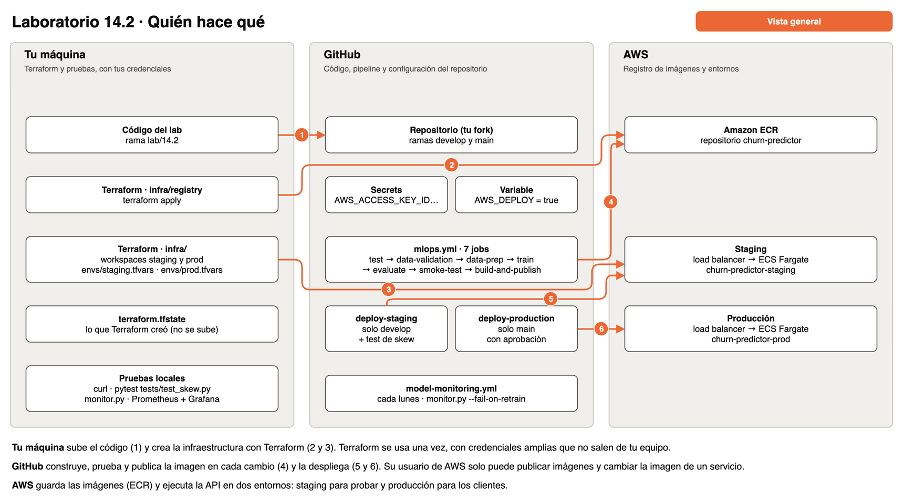
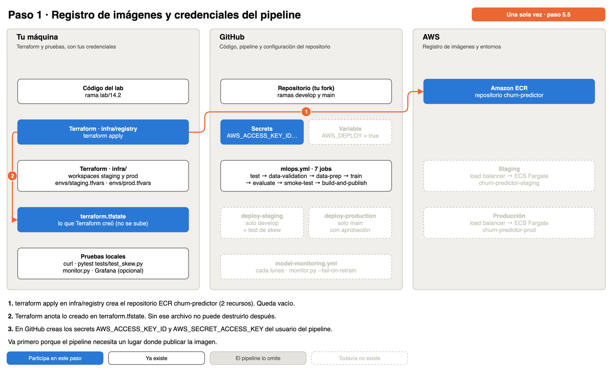
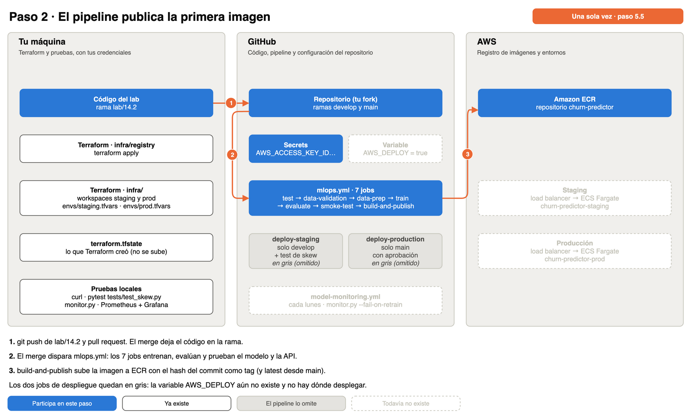
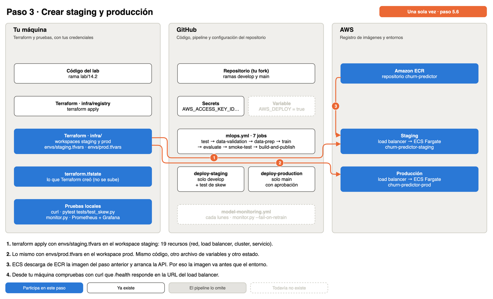
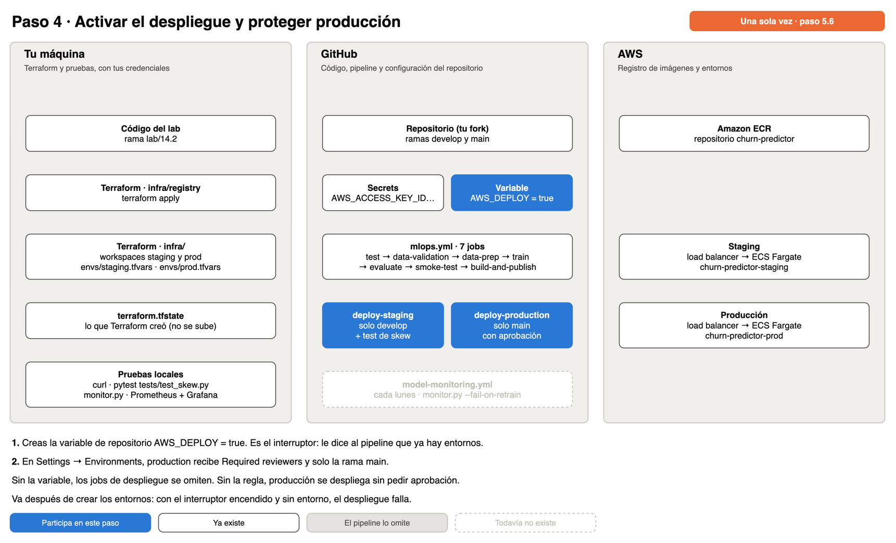
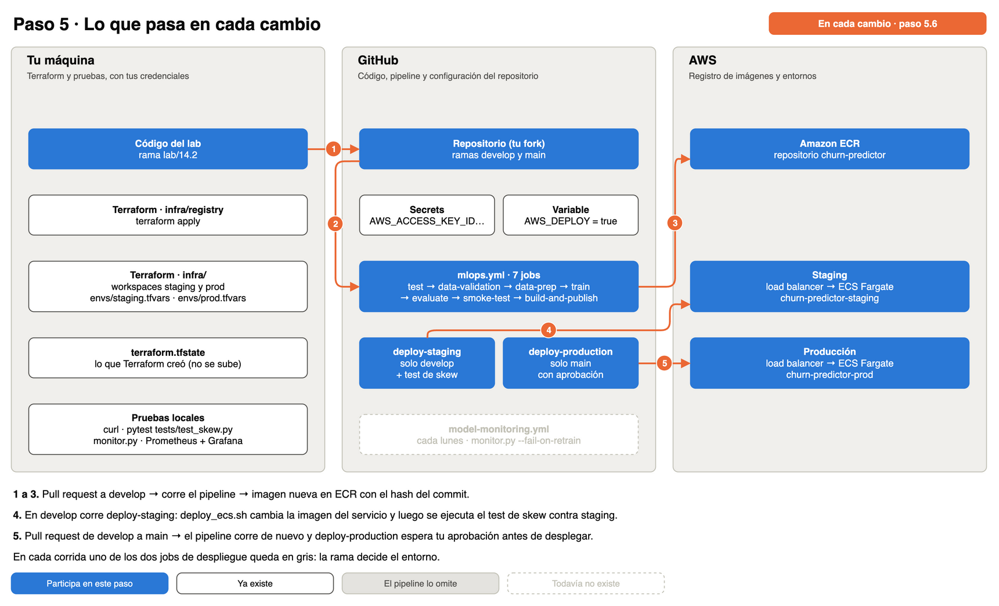
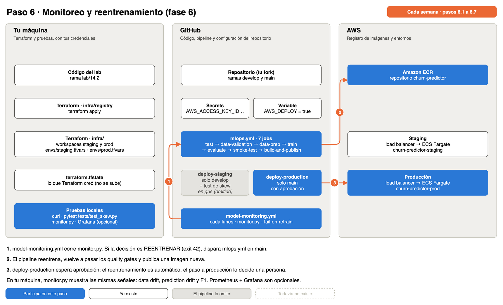
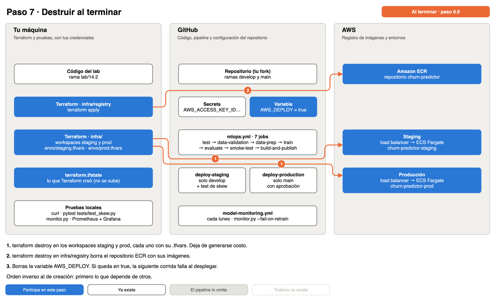

# Churn con CRISP-ML(Q) · Parte 2: despliegue y monitoreo

Laboratorio 14.2, continuación de la guía 11. Ya tienes un modelo `@champion` que pasó los quality gates de las fases 1 a 4. Faltan las dos fases que ocurren fuera del notebook: ponerlo a servir sin que cambie su comportamiento (fase 5) y saber cuándo deja de funcionar (fase 6).

## Qué vas a construir

```
Fase 5 · Despliegue                              Fase 6 · Monitoreo y mantenimiento

Pipeline (.pkl) ─► API FastAPI ─► imagen ─► Amazon ECR ─┬─► ECS staging      (rama develop)
                     │   │                               └─► ECS producción   (rama main, con aprobación)
                     │   │
                     │   └─ /metrics ─────────► Prometheus ─► Grafana      (opcional)
                     │                              ▲
                     └─ logs/predictions.jsonl ─► monitor.py ─► Pushgateway      (opcional)
                                                    │
                                                    └─ REENTRENAR (exit 42) ─► mlops.yml
```

## Qué es nuevo

| Concepto | Qué resuelve |
|---|---|
| Test de training-serving skew | Demuestra que la API devuelve lo mismo que el modelo evaluado |
| Contrato en la API | Rangos y categorías validados en la entrada (HTTP 422) |
| Log de predicciones | Sin registrar lo que se sirve no hay nada que monitorear |
| Métricas de modelo en `/metrics` | Además de latencia y status, qué está prediciendo el modelo |
| Imagen de inferencia mínima | `requirements-serve.txt`: lo de entrenamiento no viaja a producción |
| Entornos (staging y producción) | El modelo se prueba en una copia de producción antes de llegar a los clientes |
| Un entorno por rama | `develop` despliega en staging y `main` en producción: el código se prueba antes de llegar a `main` |
| Aprobación manual | Una persona decide el despliegue a producción después de ver staging |
| Circuit breaker de ECS | Si la versión nueva no levanta, el servicio vuelve solo a la anterior |
| Data drift, prediction drift, concept drift | Tres señales distintas, con y sin etiquetas |
| Etiquetas tardías | En churn la verdad llega semanas después de la predicción |
| Continuous Training | El monitor dispara el pipeline cuando decide reentrenar |
| Rollback por alias | Volver a la versión anterior moviendo `@champion` |

## Cómo se arma el despliegue

El despliegue ocurre en tres lugares: tu máquina, GitHub y AWS. El diagrama se repite a lo largo de la guía con los mismos tres carriles; cada vez se ilumina lo que cambia en ese paso.



El orden importa, porque cada paso necesita lo que dejó el anterior:

| Orden | Paso | Dónde | Frecuencia | Por qué va ahí |
|---|---|---|---|---|
| 1 | Registro de imágenes (ECR) y secrets | Tu máquina y GitHub | Una vez | El pipeline necesita un lugar donde publicar |
| 2 | Primera imagen | GitHub | Una vez | Un entorno no puede arrancar sin imagen |
| 3 | Entornos staging y producción | Tu máquina | Una vez | El pipeline no puede desplegar sin entorno |
| 4 | Interruptor `AWS_DEPLOY` y regla de aprobación | GitHub | Una vez | Recién ahora hay dónde desplegar |
| 5 | Ciclo de cada cambio | GitHub | Siempre | `develop` va a staging, `main` a producción |
| 6 | Monitoreo y reentrenamiento | GitHub y tu máquina | Cada semana | Cierra el ciclo: la fase 6 vuelve a la fase 1 |
| 7 | Destruir | Tu máquina | Al terminar | Los entornos cuestan por hora |

El archivo editable con las 8 hojas es `despliegue-14.2.drawio`.

## Mapa de archivos por fase

Cada archivo existe por un riesgo concreto de CRISP-ML(Q). La columna "Dónde corre" indica quién lo ejecuta.

**Fase 5 · Despliegue**

| Archivo | Qué hace | Dónde corre | Quality gate |
|---|---|---|---|
| `app/main.py` | Valida la entrada, llama al Pipeline, registra cada predicción y expone métricas | En el contenedor: local, CI y ECS | Entrada fuera de contrato devuelve 422 |
| `tests/conftest.py`, `tests/test_api.py` | Prueban la API con un modelo simulado | Local y job `test` | 30 tests |
| `tests/test_skew.py` | Compara la API en ejecución con el Pipeline evaluado | Local, job `smoke-test` y jobs de despliegue | Diferencia menor que 0.001 |
| `requirements-serve.txt`, `Dockerfile`, `.dockerignore` | Imagen de inferencia mínima, sin root | Job `build-and-publish` | El contenedor responde `/health` antes de publicarse |
| `infra/registry/main.tf` | Crea el repositorio ECR compartido | Tu máquina, una vez | — |
| `infra/*.tf`, `infra/envs/*.tfvars` | Crean un entorno: red, load balancer, cluster y servicio | Tu máquina, una vez por entorno | Circuit breaker de ECS |
| `scripts/deploy_ecs.sh` | Cambia la imagen del servicio y espera a que quede estable | Jobs de despliegue; a mano para el rollback | Falla si ECS volvió a la revisión anterior |
| `.github/workflows/mlops.yml` | Encadena las fases y decide el entorno según la rama | GitHub Actions | Aprobación manual antes de producción |

**Fase 6 · Monitoreo y mantenimiento**

| Archivo | Qué hace | Dónde corre | Quality gate |
|---|---|---|---|
| `src/monitor.py` | Mide data drift, prediction drift y F1, y decide MONITOREAR, ALERTA o REENTRENAR | Local y `model-monitoring.yml` | Exit 42 si hay que reentrenar |
| `configs/churn.yaml` (sección `monitoring`) | Umbrales de PSI, KS y caída de F1 | Lo lee `monitor.py` | — |
| `scripts/simulate_traffic.py` | Envía tráfico a la API para llenar el log de predicciones | Local | — |
| `monitoring/` (opcional) | Prometheus, Pushgateway, Grafana y la regla de alerta | Local, con Docker Compose | Alerta `ChurnModelRetrainNeeded` |
| `.github/workflows/model-monitoring.yml` | Corre el monitor cada semana y dispara el pipeline | GitHub Actions | Continuous Training |

## Requisitos

- Guía 11 completa: `data/production_model.pkl`, `data/production_model_info.json`, `data/train.csv` y `data/test.csv` existen en tu máquina. Si no, corre las cuatro fases:

```bash
python src/validate_data.py && python src/data_prep.py && python src/train.py --model all && python src/evaluate_and_register.py
```

- Docker corriendo.
- Opcional: GitHub CLI (`gh`). Cada paso en GitHub se muestra por la interfaz web y, como alternativa, con `gh`.
- Cuenta de AWS con un usuario IAM y sus access keys, AWS CLI v2 configurado (`aws sts get-caller-identity` responde) y Terraform 1.6 o superior. Hacen falta desde el paso 5.5.
- Rama de trabajo: `git checkout -b lab/14.2`.

---

## Fase 5 · Despliegue

### 5.1 La API ya no preprocesa

Como el preprocesamiento vive dentro del Pipeline, la API queda reducida a: validar la entrada, armar un DataFrame con las columnas crudas, pedir la probabilidad y aplicar el umbral. Reemplaza `app/main.py`:

Archivo: [`app/main.py`](https://github.com/utec-devops-2026/mlops-churn-lab/blob/lab-14.2-archivos/lab-14.2/app/main.py)

```bash
mkdir -p app
curl -sfL https://raw.githubusercontent.com/utec-devops-2026/mlops-churn-lab/lab-14.2-archivos/lab-14.2/app/main.py -o app/main.py
```

> **Archivos para descargar.** Esta guía no muestra los archivos completos: explica qué hace cada uno, enseña el fragmento que importa y da el comando para bajar la versión final. `curl -s` oculta la barra de progreso, `-f` falla si el archivo no existe (en lugar de guardar una página de error), `-L` sigue redirecciones y `-o` indica dónde guardarlo. Cuando son varios, un `for` repite lo mismo por cada archivo y crea la carpeta si falta. También puedes abrir el enlace y copiar el contenido a mano. Todos están en la rama `lab-14.2-archivos` de `utec-devops-2026/mlops-churn-lab`.

El contrato de entrada y la función que arma los datos para el modelo:

```python
class CustomerFeatures(BaseModel):
    """Contrato de entrada: mismos rangos y categorías que el contrato de datos."""
    gender: Literal["Male", "Female"] = Field(..., examples=["Male"])
    senior_citizen: int = Field(..., ge=0, le=1, examples=[0])
    tenure_months: int = Field(..., ge=0, le=120, examples=[12], description="Meses como cliente")
    contract_type: Literal["Month-to-Month", "One Year", "Two Year"] = Field(..., examples=["Month-to-Month"])
    internet_service: Optional[Literal["Fiber", "DSL", "None"]] = Field(None, examples=["Fiber"])
    monthly_charges: float = Field(..., ge=0, le=500, examples=[85.5])
    support_tickets_last_6m: int = Field(..., ge=0, le=50, examples=[3])


def to_frame(customers: List[dict]) -> pd.DataFrame:
    """Columnas crudas en el orden de entrenamiento. Sin escalado ni encoding."""
    df = pd.DataFrame(customers)
    df["internet_service"] = df["internet_service"].fillna("None")
    return df[FEATURES]
```

Cuatro cosas que mirar en el código:

- **`to_frame`** no escala ni codifica: el bug del `get_dummies` no puede volver a ocurrir porque ese código ya no existe.
- **`THRESHOLD`** viene de `production_model_info.json`. La API decide con el umbral que eligió la fase 4, no con 0.5.
- **`CustomerFeatures`** usa `Literal` y rangos: es el mismo contrato de datos de la fase 1, ahora en la puerta de la API. Una categoría inválida devuelve 422 y nunca llega al modelo.
- **`log_predictions`** guarda features y predicción en `logs/predictions.jsonl`. Ese archivo es la materia prima de la fase 6.

### 5.2 Tests

Los tests unitarios no usan un modelo entrenado. `tests/conftest.py` levanta la API con un modelo simulado (un mock): intercepta la carga de archivos y entrega un objeto que siempre responde lo mismo. Así `pytest` corre sin haber ejecutado el pipeline.

Como cambió lo que carga la API, el mock también tiene que cambiar:

| | Antes | Ahora |
|---|---|---|
| Archivos que carga la API | `production_model.pkl`, `scaler.pkl` y `feature_names.csv` | Solo `production_model.pkl` |
| Qué simula `conftest.py` | El modelo, el scaler y la lectura del CSV de features | Solo el modelo, que ahora es el Pipeline completo |
| Columnas que recibe el modelo | Ya codificadas: `Contract_One Year`, `InternetService_Fiber`... | Las 7 crudas: `contract_type`, `internet_service`... |
| `production_model_info.json` simulado | Nombre, versión y métricas | Además, `threshold` y `features`, que la API nueva lee |

Si dejas el archivo anterior, los tests fallan por el mock y no por tu código: simula un scaler y un CSV de features que la API ya no carga, y su `production_model_info.json` no trae el umbral ni la lista de features.

Reemplaza `tests/conftest.py` y `tests/test_api.py`:

Archivos: [`tests/conftest.py`](https://github.com/utec-devops-2026/mlops-churn-lab/blob/lab-14.2-archivos/lab-14.2/tests/conftest.py) · [`tests/test_api.py`](https://github.com/utec-devops-2026/mlops-churn-lab/blob/lab-14.2-archivos/lab-14.2/tests/test_api.py)

```bash
BASE=https://raw.githubusercontent.com/utec-devops-2026/mlops-churn-lab/lab-14.2-archivos/lab-14.2
for f in tests/conftest.py tests/test_api.py; do
  mkdir -p "$(dirname "$f")" && curl -sfL "$BASE/$f" -o "$f" && echo "ok $f"
done
```

El modelo simulado devuelve siempre probabilidad 0.85, sin importar la entrada. Por eso estos tests comprueban la API (rutas, validación, formato de la respuesta) y no la calidad del modelo. La variable `PREDICTION_LOG` apunta a una carpeta temporal para que los tests no escriban en `logs/predictions.jsonl`.

`tests/test_api.py` es el mismo de antes con cuatro tests más al final: dos del contrato de entrada (una categoría inválida y un valor fuera de rango devuelven 422) y dos de observabilidad (`/metrics` expone las métricas del modelo y cada predicción queda en el log).

```bash
pytest tests/ -q
# 30 passed, 2 skipped: 22 de la API + 5 del contrato + 3 del Pipeline; los 2 de skew se saltan
# No genera archivos (el log de predicciones de los tests va a una carpeta temporal)
```

Los dos tests saltados son los de skew: necesitan la API levantada.

### 5.3 Test de training-serving skew (quality gate de la fase 5)

Los tests unitarios usan un modelo falso, así que nunca habrían detectado el bug original. El test de skew usa el modelo real y la API real: toma 30 clientes de test, calcula su probabilidad con el Pipeline offline y la compara con la que devuelve la API.

Crea `tests/test_skew.py`:

Archivo: [`tests/test_skew.py`](https://github.com/utec-devops-2026/mlops-churn-lab/blob/lab-14.2-archivos/lab-14.2/tests/test_skew.py)

```bash
mkdir -p tests
curl -sfL https://raw.githubusercontent.com/utec-devops-2026/mlops-churn-lab/lab-14.2-archivos/lab-14.2/tests/test_skew.py -o tests/test_skew.py
```

El test principal. Si la diferencia máxima entre el Pipeline offline y la API supera 0.001, falla:

```python
def test_api_matches_offline_pipeline(sample):
    pipeline = joblib.load(DATA_DIR / "production_model.pkl")
    offline = pipeline.predict_proba(sample)[:, 1]

    payload = {"customers": sample.to_dict(orient="records")}
    res = requests.post(f"{API_URL}/predict/batch", json=payload, timeout=30)
    assert res.status_code == 200
    online = [p["churn_probability"] for p in res.json()["predictions"]]

    diffs = [abs(a - b) for a, b in zip(offline, online)]
    assert max(diffs) < 1e-3, f"skew detectado: diferencia máxima {max(diffs):.4f}"
```

Un segundo test repite la prueba del bug original: el mismo cliente con dos contratos distintos debe dar dos probabilidades distintas. El archivo se salta solo si no defines `API_URL`.

```bash
uvicorn app.main:app --port 8000        # terminal 1
# Carga data/production_model.pkl y data/production_model_info.json
# Cada predicción agrega una línea a logs/predictions.jsonl
```

```bash
API_URL=http://localhost:8000 pytest tests/test_skew.py -v      # terminal 2
# 2 passed: la API devuelve la misma probabilidad que el Pipeline offline (diferencia < 0.001)
#           y cambiar contract_type cambia la predicción
# Si falla: imprime "skew detectado: diferencia máxima ..."
```

Repite la prueba del paso 0.2 de la guía 11. Ahora el contrato sí cambia la probabilidad:

```bash
for c in "Month-to-Month" "Two Year"; do
  curl -sS -X POST localhost:8000/predict -H 'Content-Type: application/json' \
    -d "{\"gender\":\"Male\",\"senior_citizen\":0,\"tenure_months\":12,\"contract_type\":\"$c\",\"internet_service\":\"Fiber\",\"monthly_charges\":95,\"support_tickets_last_6m\":6}"
  echo
done
# Month-to-Month → 0.77 ALTO      Two Year → 0.47 MEDIO
```

Y una entrada fuera de contrato se rechaza antes de llegar al modelo:

```bash
curl -s -o /dev/null -w "%{http_code}\n" -X POST localhost:8000/predict -H 'Content-Type: application/json' \
  -d '{"gender":"Male","senior_citizen":0,"tenure_months":12,"contract_type":"Weekly","internet_service":"Fiber","monthly_charges":95,"support_tickets_last_6m":6}'
# 422
```

### 5.4 Imagen de inferencia

La imagen original instalaba todo `requirements.txt`: mlflow, shap, matplotlib, evidently. Nada de eso se usa para servir. `requirements-serve.txt` lista solo lo que la API necesita (FastAPI, scikit-learn, xgboost, pandas y las métricas de Prometheus), con las mismas versiones que `requirements.txt`. Crea ese archivo y reemplaza `Dockerfile`:

Archivos: [`requirements-serve.txt`](https://github.com/utec-devops-2026/mlops-churn-lab/blob/lab-14.2-archivos/lab-14.2/requirements-serve.txt) · [`Dockerfile`](https://github.com/utec-devops-2026/mlops-churn-lab/blob/lab-14.2-archivos/lab-14.2/Dockerfile)

```bash
BASE=https://raw.githubusercontent.com/utec-devops-2026/mlops-churn-lab/lab-14.2-archivos/lab-14.2
for f in requirements-serve.txt Dockerfile; do
  mkdir -p "$(dirname "$f")" && curl -sfL "$BASE/$f" -o "$f" && echo "ok $f"
done
```

El `Dockerfile` nuevo:

```dockerfile
FROM python:3.10-slim

WORKDIR /app

COPY requirements-serve.txt .
RUN pip install --no-cache-dir -r requirements-serve.txt

COPY app/ ./app/

# Artefactos que produce el job evaluate del pipeline
COPY data/production_model.pkl       ./data/production_model.pkl
COPY data/production_model_info.json ./data/production_model_info.json

# El proceso no corre como root
RUN useradd --create-home appuser && mkdir -p /app/logs && chown -R appuser /app
USER appuser

ENV PREDICTION_LOG=/app/logs/predictions.jsonl
EXPOSE 8000

HEALTHCHECK --interval=30s --timeout=5s --start-period=10s --retries=3 \
  CMD python -c "import urllib.request; urllib.request.urlopen('http://localhost:8000/health')"

CMD ["uvicorn", "app.main:app", "--host", "0.0.0.0", "--port", "8000"]
```

Agrega al final de `.dockerignore`:

```
data/train.csv
data/test.csv
data/best_model.pkl
logs/
monitoring/
scripts/
configs/
src/
```

Y `logs/` al `.gitignore`.

```bash
docker build -t churn-predictor:local .
docker run -d --name churn-api -p 8000:8000 churn-predictor:local
curl localhost:8000/health
API_URL=http://localhost:8000 pytest tests/test_skew.py -v      # el mismo test, ahora contra el contenedor
docker rm -f churn-api
```

> La versión de scikit-learn de la imagen debe ser la misma con la que se entrenó. Un `.pkl` cargado con otra versión puede fallar o, peor, predecir distinto: por eso `requirements-serve.txt` fija las mismas versiones que `requirements.txt`.

### 5.5 Jobs de despliegue en el pipeline

<details>
<summary>Ver el diagrama: paso 1: registro de imágenes y credenciales del pipeline</summary>



</details>

La imagen se publica en Amazon ECR, el registro privado de la misma cuenta de AWS donde se va a ejecutar. ECS la descarga con su rol de ejecución, sin credenciales adicionales.

El registro es compartido: el pipeline publica ahí la imagen de cada commit y los dos entornos leen del mismo repositorio. Por eso vive fuera de los entornos, en su propia carpeta de Terraform. Crea `infra/registry/main.tf`:

Archivo: [`infra/registry/main.tf`](https://github.com/utec-devops-2026/mlops-churn-lab/blob/lab-14.2-archivos/lab-14.2/infra/registry/main.tf)

```bash
mkdir -p infra/registry
curl -sfL https://raw.githubusercontent.com/utec-devops-2026/mlops-churn-lab/lab-14.2-archivos/lab-14.2/infra/registry/main.tf -o infra/registry/main.tf
```

No hace falta escribirlo: ya lo descargaste. El archivo tiene tres partes: la conexión con AWS, el repositorio donde se guardan las imágenes de Docker y una regla de limpieza que borra las imágenes antiguas y deja solo las 10 más recientes, para no pagar almacenamiento de más.

Esta es la parte que crea el repositorio. Se muestra para que sepas qué va a crear Terraform:

```hcl
resource "aws_ecr_repository" "app" {
  name                 = var.project_name
  image_tag_mutability = "MUTABLE"
  force_delete         = true

  image_scanning_configuration {
    scan_on_push = true
  }
}
```

| Línea | Qué significa |
|---|---|
| `resource "aws_ecr_repository" "app"` | Crea un repositorio de imágenes en Amazon ECR |
| `name = var.project_name` | Se llama `churn-predictor` |
| `image_tag_mutability = "MUTABLE"` | Un tag puede moverse a otra imagen. Hace falta para `latest`, que apunta siempre a la más reciente |
| `force_delete = true` | Permite borrar el repositorio aunque tenga imágenes, al destruir el laboratorio |
| `scan_on_push = true` | AWS revisa cada imagen que se publica en busca de vulnerabilidades conocidas |

Terraform se ejecuta desde tu máquina, con tus credenciales, y no desde GitHub Actions. Hay dos razones:

- **Permisos separados.** Crear infraestructura exige permisos amplios (red, IAM, ECS, load balancer). Esas credenciales se quedan en tu máquina. El pipeline usa otro usuario, que solo puede publicar imágenes y cambiar la imagen de un servicio: si sus secrets se filtran, nadie puede crear ni borrar infraestructura con ellos.
- **Estado local.** Terraform anota lo que creó en `terraform.tfstate`. Para una sola persona basta con tenerlo en disco. Un equipo necesita guardarlo en S3 y aplicar desde un pipeline (retos 6 y 7).

Configura el AWS CLI con un usuario que pueda crear esos recursos y comprueba la cuenta:

```bash
aws configure                  # access key, secret key, región us-east-1, formato json
aws sts get-caller-identity    # debe mostrar tu cuenta y tu usuario
```

Crea el registro:

```bash
cd infra/registry
terraform init
terraform apply
# Plan: 2 to add (el repositorio y su política de retención)
# Outputs: repository_url = "<cuenta>.dkr.ecr.us-east-1.amazonaws.com/churn-predictor"
cd ../..
```

Agrega al `.gitignore` el estado local de Terraform:

```
infra/.terraform/
infra/terraform.tfstate*
infra/terraform.tfstate.d/
infra/registry/.terraform/
infra/registry/terraform.tfstate*
```

> No borres ni subas al repositorio los archivos `terraform.tfstate`. Sin ese archivo Terraform no sabe qué creó y `terraform destroy` no borra nada: habría que eliminar cada recurso a mano desde la consola de AWS. Tampoco debe ir a GitHub, porque puede contener datos sensibles.

El pipeline necesita un usuario IAM propio. No crea infraestructura: solo publica imágenes y, en el paso 5.6, despliega. Política mínima:

<details>
<summary>Ver la política IAM mínima del pipeline</summary>

```json
{
  "Version": "2012-10-17",
  "Statement": [
    {
      "Effect": "Allow",
      "Action": "ecr:GetAuthorizationToken",
      "Resource": "*"
    },
    {
      "Effect": "Allow",
      "Action": [
        "ecr:BatchCheckLayerAvailability",
        "ecr:InitiateLayerUpload",
        "ecr:UploadLayerPart",
        "ecr:CompleteLayerUpload",
        "ecr:PutImage",
        "ecr:BatchGetImage",
        "ecr:GetDownloadUrlForLayer",
        "ecr:DescribeRepositories"
      ],
      "Resource": "arn:aws:ecr:*:*:repository/churn-predictor"
    },
    {
      "Effect": "Allow",
      "Action": ["ecs:DescribeServices", "ecs:UpdateService"],
      "Resource": "arn:aws:ecs:*:*:service/churn-predictor-*/*"
    },
    {
      "Effect": "Allow",
      "Action": [
        "ecs:DescribeTaskDefinition",
        "ecs:RegisterTaskDefinition",
        "elasticloadbalancing:DescribeLoadBalancers"
      ],
      "Resource": "*"
    },
    {
      "Effect": "Allow",
      "Action": "iam:PassRole",
      "Resource": "arn:aws:iam::*:role/churn-predictor-*"
    }
  ]
}
```

</details>

Crea los secrets `AWS_ACCESS_KEY_ID` y `AWS_SECRET_ACCESS_KEY` de ese usuario en tu fork (**Settings → Secrets and variables → Actions**).

Reemplaza `.github/workflows/mlops.yml` con la versión final. Conserva los 5 jobs del laboratorio 14.1 y agrega `AWS_REGION` al bloque `env:` y cuatro jobs: `smoke-test` y `build-and-publish`, que se explican aquí, y los dos de despliegue del paso 5.6.

Archivo: [`.github/workflows/mlops.yml`](https://github.com/utec-devops-2026/mlops-churn-lab/blob/lab-14.2-archivos/lab-14.2/.github/workflows/mlops.yml)

```bash
mkdir -p .github/workflows
curl -sfL https://raw.githubusercontent.com/utec-devops-2026/mlops-churn-lab/lab-14.2-archivos/lab-14.2/.github/workflows/mlops.yml -o .github/workflows/mlops.yml
```

> Si cambiaste tu `mlops.yml` en el laboratorio 14.1, revisa antes qué vas a perder: después de descargar, `git diff .github/workflows/mlops.yml` muestra las diferencias.

- **`smoke-test`** levanta la API con el modelo que acaba de pasar la evaluación, corre el test de skew contra ella y comprueba que un cliente de alto riesgo recibe más probabilidad que uno de bajo riesgo.
- **`build-and-publish`** construye la imagen, arranca el contenedor y le pide `/health` antes de publicar. Solo corre en `main` y `develop`. El paso que publica:

```yaml
- name: Publicar con tag de commit (y latest solo desde main)
  env:
    IMAGE: ${{ steps.ecr.outputs.registry }}/${{ env.IMAGE_NAME }}
  run: |
    docker push $IMAGE:${{ github.sha }}
    echo "Imagen publicada en ECR: \`${{ env.IMAGE_NAME }}:${{ github.sha }}\`" >> $GITHUB_STEP_SUMMARY
    if [ "${{ github.ref }}" = "refs/heads/main" ]; then
      docker tag $IMAGE:${{ github.sha }} $IMAGE:latest
      docker push $IMAGE:latest
      echo "Tag \`latest\` actualizado" >> $GITHUB_STEP_SUMMARY
    fi
```

El pipeline queda con 7 jobs:

```
test → data-validation → data-prep → train → evaluate → smoke-test → build-and-publish
```

`build-and-publish` corre en `main` y en `develop`. La imagen se publica siempre con el hash del commit como tag (trazabilidad: qué código produjo esta imagen). El tag `latest` solo se mueve desde `main`.

<details>
<summary>Ver el diagrama: paso 2: el pipeline publica la primera imagen</summary>



</details>

Integra `lab/14.2` a `main` con un pull request y espera los 7 jobs en verde. Al terminar, el repositorio debe tener una imagen con dos tags. El paso siguiente usa esa imagen.

```bash
aws ecr list-images --repository-name churn-predictor --query 'imageIds[].imageTag'
# ["<hash del commit>", "latest"]
```

### 5.6 Dos entornos en AWS: staging y producción

Hasta aquí la imagen está publicada, pero nadie la usa. Falta ejecutarla en un servidor, y hacerlo sin que un modelo defectuoso llegue directo a los clientes. Para eso se usan dos entornos idénticos:

| | Staging | Producción |
|---|---|---|
| Para qué sirve | Probar la imagen en infraestructura real | Atender a los clientes |
| Quién lo usa | El equipo y el pipeline | La campaña de retención |
| Qué rama lo actualiza | `develop` | `main` |
| Quality gate de entrada | Smoke test + contenedor probado antes de publicar | Lo mismo + aprobación manual |
| Verificación después de desplegar | Test de skew contra su URL | Test de skew contra su URL |
| Recursos en AWS | `churn-predictor-staging` | `churn-predictor-prod` |

El pipeline se bifurca después de publicar la imagen. La rama decide el entorno:

```
                                  ┌─► deploy-staging                       (solo develop)
... → build-and-publish ──────────┤
                                  └─► (aprobación) → deploy-production     (solo main)
```

El flujo de trabajo es: los cambios entran a `develop` y se ven en staging; cuando staging está bien, se abre un pull request de `develop` a `main` y, tras la aprobación, llegan a producción.

> Cada rama construye su propia imagen y entrena su propio modelo. Lo que llega a producción es el mismo código que se probó en staging, no la misma imagen. Con los mismos datos y la misma semilla el modelo debe salir igual, pero nada lo garantiza: por eso producción repite sus propios quality gates y el test de skew después de desplegar. La alternativa, promover a producción la imagen exacta de staging, es el reto 8.

#### Infraestructura con Terraform

Cada entorno es un cluster de ECS Fargate detrás de un load balancer, en su propia red. Los dos salen del mismo código: lo único que cambia es el archivo de variables.

Descarga los archivos del entorno:

Archivos: [`infra/main.tf`](https://github.com/utec-devops-2026/mlops-churn-lab/blob/lab-14.2-archivos/lab-14.2/infra/main.tf) · [`infra/ecs.tf`](https://github.com/utec-devops-2026/mlops-churn-lab/blob/lab-14.2-archivos/lab-14.2/infra/ecs.tf) · [`infra/variables.tf`](https://github.com/utec-devops-2026/mlops-churn-lab/blob/lab-14.2-archivos/lab-14.2/infra/variables.tf) · [`infra/vpc.tf`](https://github.com/utec-devops-2026/mlops-churn-lab/blob/lab-14.2-archivos/lab-14.2/infra/vpc.tf) · [`infra/alb.tf`](https://github.com/utec-devops-2026/mlops-churn-lab/blob/lab-14.2-archivos/lab-14.2/infra/alb.tf) · [`infra/iam.tf`](https://github.com/utec-devops-2026/mlops-churn-lab/blob/lab-14.2-archivos/lab-14.2/infra/iam.tf) · [`infra/outputs.tf`](https://github.com/utec-devops-2026/mlops-churn-lab/blob/lab-14.2-archivos/lab-14.2/infra/outputs.tf) · [`infra/envs/staging.tfvars`](https://github.com/utec-devops-2026/mlops-churn-lab/blob/lab-14.2-archivos/lab-14.2/infra/envs/staging.tfvars) · [`infra/envs/prod.tfvars`](https://github.com/utec-devops-2026/mlops-churn-lab/blob/lab-14.2-archivos/lab-14.2/infra/envs/prod.tfvars)

```bash
BASE=https://raw.githubusercontent.com/utec-devops-2026/mlops-churn-lab/lab-14.2-archivos/lab-14.2
for f in infra/main.tf infra/ecs.tf infra/variables.tf infra/vpc.tf infra/alb.tf infra/iam.tf infra/outputs.tf infra/envs/staging.tfvars infra/envs/prod.tfvars; do
  mkdir -p "$(dirname "$f")" && curl -sfL "$BASE/$f" -o "$f" && echo "ok $f"
done
```

| Archivo | Qué define |
|---|---|
| `infra/main.tf` | Proveedor de AWS, nombre del entorno y la URL de la imagen en ECR |
| `infra/ecs.tf` | Cluster, task definition y servicio: qué contenedor se ejecuta y cómo se reemplaza |
| `infra/variables.tf` | Las variables del entorno: nombre, región, tamaño de la tarea, réplicas, rango de red e `image_tag` |
| `infra/vpc.tf` | Red propia, dos subredes públicas, salida a internet y los dos security groups |
| `infra/alb.tf` | Load balancer, target group y health check en `/health` |
| `infra/iam.tf` | Rol de ejecución (descargar la imagen, escribir logs) y rol de la tarea |
| `infra/outputs.tf` | Lo que imprime `terraform apply`: URL de la API, nombres del cluster y del servicio |
| `infra/envs/*.tfvars` | Lo que cambia entre staging y producción |

Tres fragmentos que conviene leer. En `main.tf`, la imagen sale del repositorio ECR del paso 5.5:

```hcl
locals {
  name_prefix = "${var.project_name}-${var.environment}"

  # Repositorio ECR compartido por los entornos; lo crea infra/registry
  ecr_repository_url = "${data.aws_caller_identity.current.account_id}.dkr.ecr.${var.aws_region}.amazonaws.com/${var.project_name}"
  image              = "${local.ecr_repository_url}:${var.image_tag}"
}
```

En `ecs.tf`, dos decisiones sobre el servicio:

```hcl
# Si las tareas nuevas no pasan el health check, ECS vuelve a la versión anterior
deployment_circuit_breaker {
  enable   = true
  rollback = true
}

lifecycle {
  # La imagen desplegada la cambia el pipeline (scripts/deploy_ecs.sh), no Terraform
  ignore_changes = [task_definition]
}
```

- `deployment_circuit_breaker`: si las tareas nuevas no pasan el health check, ECS devuelve el servicio a la revisión anterior sin intervención.
- `ignore_changes = [task_definition]`: Terraform crea el servicio, pero la imagen desplegada la cambia el pipeline. Sin esa línea, cada `terraform apply` devolvería el servicio a la imagen inicial.

Las diferencias entre entornos viven en un archivo por entorno. `infra/envs/staging.tfvars`:

```hcl
# Entorno de staging: recibe cada commit de develop y de main
environment = "staging"

vpc_cidr            = "10.10.0.0/16"
public_subnet_cidrs = ["10.10.1.0/24", "10.10.2.0/24"]

task_cpu      = 256
task_memory   = 512
desired_count = 1
```

`prod.tfvars` cambia el nombre, el rango de red y el tamaño de la tarea.

#### Crear los dos entornos

<details>
<summary>Ver el diagrama: paso 3: crear staging y producción</summary>



</details>

Igual que el registro, los entornos se crean desde tu máquina. El servicio nace con el tag `latest` que dejó el pipeline en el paso 5.5. Cada entorno necesita su propio estado. Un workspace de Terraform es eso: un estado separado para el mismo código.

```bash
cd infra
terraform init

terraform workspace new staging
terraform apply -var-file=envs/staging.tfvars
# Plan: 19 to add. Tarda varios minutos: lo más lento es el load balancer.
# Outputs: api_url, ecs_cluster_name = "churn-predictor-staging", ecs_service_name = "churn-predictor-staging-service"

terraform workspace new prod
terraform apply -var-file=envs/prod.tfvars
# Outputs: ecs_cluster_name = "churn-predictor-prod", ecs_service_name = "churn-predictor-prod-service"
cd ..
```

Qué significa cada parte del comando:

| Parte | Qué hace |
|---|---|
| `terraform apply` | Compara lo que describen los `.tf` con lo que existe en AWS, muestra el plan y pide confirmación. Nada se crea hasta que escribes `yes` |
| `-var-file=envs/staging.tfvars` | Carga los valores de ese entorno: nombre, rango de red, tamaño de la tarea y número de réplicas |
| workspace activo | Decide en qué estado se anota lo creado (`terraform.tfstate.d/staging/`). Por eso cada entorno tiene el suyo |

Para ver el plan sin crear nada, usa `terraform plan` con los mismos argumentos.

Los 19 recursos de cada entorno:

| Grupo | Recursos | Para qué |
|---|---|---|
| Red | VPC, 2 subredes públicas, internet gateway, tabla de rutas y sus 2 asociaciones | Red propia del entorno |
| Seguridad | 2 security groups | Internet llega al load balancer por el puerto 80; solo el load balancer llega al contenedor por el 8000 |
| Load balancer | ALB, target group y listener | URL pública; consulta `/health` para saber si la tarea está sana |
| Permisos | 2 roles de IAM y 1 política | ECS descarga la imagen de ECR y escribe logs |
| ECS | Cluster, task definition y servicio | Ejecuta el contenedor en Fargate y lo repone si se cae |
| Logs | 1 grupo de CloudWatch | Salida del contenedor, 7 días |

Terraform crea el servicio con una imagen inicial y no la vuelve a tocar: de ahí en adelante la cambia el pipeline.

> Si tu repositorio ECR no tiene el tag `latest` (por ejemplo, porque el pipeline solo corrió en `develop`), indica el tag que sí existe: `terraform apply -var-file=envs/staging.tfvars -var image_tag=<hash del commit>`. Con un tag inexistente el entorno se crea, pero la tarea no arranca y el load balancer responde 503.

Puedes crear primero solo staging y probar todo el flujo en `develop`. Crea producción antes de llevar cambios a `main`: con `AWS_DEPLOY` en `true` y sin ese entorno, `deploy-production` falla.

Para volver a un entorno: `terraform workspace select staging`. Antes de cada `apply` o `destroy`, confirma con `terraform workspace show` que estás en el entorno correcto y usa su `.tfvars`.

Comprueba que los dos responden. El load balancer tarda uno o dos minutos en marcar la tarea como sana; antes de eso devuelve 503.

```bash
cd infra
terraform workspace select staging && curl "$(terraform output -raw api_url)/health"
terraform workspace select prod    && curl "$(terraform output -raw api_url)/model/info"
cd ..
# {"status":"ok","model_loaded":true}
```

> Los dos entornos encendidos generan costo por hora: dos load balancers, dos tareas Fargate y sus IP públicas, del orden de USD 0.10 a 0.15 por hora en total (estimado; revisa los precios vigentes de tu región). Destrúyelos al terminar: paso 6.9.

#### Script de despliegue

Terraform crea el entorno una vez. Cada despliegue posterior solo cambia la imagen del servicio. Crea `scripts/deploy_ecs.sh`:

Archivo: [`scripts/deploy_ecs.sh`](https://github.com/utec-devops-2026/mlops-churn-lab/blob/lab-14.2-archivos/lab-14.2/scripts/deploy_ecs.sh)

```bash
mkdir -p scripts
curl -sfL https://raw.githubusercontent.com/utec-devops-2026/mlops-churn-lab/lab-14.2-archivos/lab-14.2/scripts/deploy_ecs.sh -o scripts/deploy_ecs.sh
```

El núcleo del script:

```bash
# La revisión nueva es una copia de la actual: solo cambia la imagen
NEW_DEFINITION=$(aws ecs describe-task-definition --task-definition "$PREVIOUS" --region "$REGION" \
  --query 'taskDefinition' \
  | jq --arg IMAGE "$IMAGE" \
      'del(.taskDefinitionArn, .revision, .status, .requiresAttributes, .compatibilities, .registeredAt, .registeredBy)
       | .containerDefinitions[0].image = $IMAGE')
NEW=$(aws ecs register-task-definition --cli-input-json "$NEW_DEFINITION" --region "$REGION" \
  --query 'taskDefinition.taskDefinitionArn' --output text)

echo "Entorno:  $ENVIRONMENT"
echo "Imagen:   $IMAGE"
echo "Anterior: $PREVIOUS"
echo "Nueva:    $NEW"

aws ecs update-service --cluster "$CLUSTER" --service "$SERVICE" --task-definition "$NEW" \
  --region "$REGION" --query 'service.serviceName' --output text
aws ecs wait services-stable --cluster "$CLUSTER" --services "$SERVICE" --region "$REGION"

# Si las tareas nuevas no pasaron el health check, el circuit breaker de ECS devolvió
# el servicio a la revisión anterior y "estable" no significa "desplegado"
RUNNING=$(aws ecs describe-services --cluster "$CLUSTER" --services "$SERVICE" --region "$REGION" \
  --query 'services[0].taskDefinition' --output text)
if [ "$RUNNING" != "$NEW" ]; then
  echo "El despliegue falló: ECS hizo rollback a $RUNNING" >&2
  exit 1
fi
```

Lo que hace, en orden: lee la task definition actual, registra una revisión nueva que solo cambia la imagen, actualiza el servicio, espera a que quede estable y verifica que la revisión en ejecución sea la nueva. Esa última verificación importa: si el circuit breaker hizo rollback, el servicio queda "estable" con la versión vieja y el pipeline debe fallar.

Pruébalo a mano contra staging con una imagen que ya esté en el repositorio:

```bash
chmod +x scripts/deploy_ecs.sh
REPOSITORY=$(aws ecr describe-repositories --repository-names churn-predictor --query 'repositories[0].repositoryUri' --output text)
scripts/deploy_ecs.sh staging "$REPOSITORY:latest"
# Imprime: Entorno, Imagen, Anterior (task definition previa), Nueva (revisión registrada) y API (URL del load balancer)
# Tarda varios minutos: ECS levanta la tarea nueva, espera el health check y recién entonces apaga la anterior
```

#### Configurar GitHub

<details>
<summary>Ver el diagrama: paso 4: activar el despliegue y proteger producción</summary>



</details>

Crea la variable de repositorio `AWS_DEPLOY` con valor `true`. Hay dos formas; usa la que prefieras.

Desde GitHub: en tu fork, **Settings → Secrets and variables → Actions**, pestaña **Variables → New repository variable**. Nombre `AWS_DEPLOY`, valor `true`.

Con GitHub CLI (`gh`), si lo tienes instalado:

```bash
gh variable set AWS_DEPLOY --body true --repo TU-USUARIO/mlops-churn-lab
```
 Los secrets `AWS_*` ya existen desde el paso 5.5.

`AWS_DEPLOY` es el interruptor de los jobs de despliegue. Sin ella, el pipeline termina en `build-and-publish` y los dos jobs de despliegue quedan en gris (skipped). Si destruyes los entornos, bórrala o ponla en `false`.

La región está en el propio workflow (`AWS_REGION: us-east-1`). Si creaste los entornos en otra región, cámbiala ahí, en `infra/variables.tf` y en `infra/registry/main.tf`.

Luego, **Settings → Environments**, crea dos entornos:

| Environment | Configuración |
|---|---|
| `staging` | Sin reglas |
| `production` | **Required reviewers**: tú mismo. **Deployment branches and tags**: Selected branches → `main` |

El nombre debe coincidir con el `environment:` de cada job. Con esa regla, el job de producción se detiene y espera a que alguien lo apruebe desde la página de la corrida.

> En un proyecto real cada entorno vive en una cuenta de AWS distinta. En ese caso los secrets `AWS_*` se crean dentro de cada Environment, con el mismo nombre y valores distintos, y el workflow no cambia.

#### Jobs de despliegue

Los dos jobs ya están en el `mlops.yml` que descargaste en el paso 5.5. El de staging:

```yaml
deploy-staging:
  name: Deploy · Staging
  runs-on: ubuntu-latest
  needs: build-and-publish
  # AWS_DEPLOY=true activa el despliegue cuando la infraestructura ya existe
  if: vars.AWS_DEPLOY == 'true' && github.ref == 'refs/heads/develop'
  concurrency: deploy-staging
  environment:
    name: staging
    url: ${{ steps.deploy.outputs.url }}
  steps:
    # ... credenciales de AWS ...
    - name: Desplegar la imagen del commit en staging
      id: deploy
      run: |
        REPOSITORY=$(aws ecr describe-repositories --repository-names "$IMAGE_NAME" \
          --query 'repositories[0].repositoryUri' --output text)
        bash scripts/deploy_ecs.sh staging "$REPOSITORY:${{ github.sha }}"
    # ... instala dependencias y descarga el modelo de esta corrida ...
    - name: Test de training-serving skew contra staging
      run: API_URL=${{ steps.deploy.outputs.url }} pytest tests/test_skew.py -v
```

`deploy-production` es igual, con `prod` en lugar de `staging`, la condición `github.ref == 'refs/heads/main'` y `environment: production`.

- `deploy-staging` solo corre en `develop` y `deploy-production` solo en `main`. Los dos dependen de `build-and-publish`: en el grafo de la corrida aparecen como dos ramas y la que no corresponde queda en gris.
- Después de desplegar, cada job corre `tests/test_skew.py` contra la URL de su entorno, con el modelo de la misma corrida. Es el mismo test de la fase 5.3, ahora contra infraestructura real: si el entorno responde distinto al Pipeline evaluado, el job falla.
- `deploy-production` usa el Environment `production`: se detiene hasta que alguien lo apruebe.
- `concurrency` evita que dos corridas desplieguen a la vez en el mismo entorno.

El pipeline completo queda con 9 jobs. En cada corrida se ejecutan 8: los 7 anteriores y el despliegue que corresponde a la rama.

```
test → data-validation → data-prep → train → evaluate → smoke-test → build-and-publish ─┬─► deploy-staging
                                                                                       └─► deploy-production
```

#### Probar el flujo

<details>
<summary>Ver el diagrama: paso 5: lo que pasa en cada cambio</summary>



</details>

`develop` nace de `main` y recibe primero los cambios. Crea la rama y lleva a ella lo que hiciste en este paso:

```bash
git checkout main && git pull
git checkout -b develop && git push -u origin develop

git checkout lab/14.2 && git merge main
git add infra scripts/deploy_ecs.sh .gitignore
git commit -m "feat: staging and production environments on AWS"
git push
```

Abre un pull request de `lab/14.2` hacia `develop` y haz merge. Hay dos formas.

Desde GitHub, en tu fork:

1. Pestaña **Pull requests → New pull request**.
2. **base repository**: tu fork (`TU-USUARIO/mlops-churn-lab`), no el repositorio original. GitHub propone el original por defecto.
3. **base**: `develop`. **compare**: `lab/14.2`.
4. **Create pull request** y luego **Merge pull request**.

Con GitHub CLI:

```bash
gh pr create --repo TU-USUARIO/mlops-churn-lab --base develop --head lab/14.2 --title "Entornos staging y producción" --body "Paso 5.6"
gh pr merge lab/14.2 --repo TU-USUARIO/mlops-churn-lab --merge
```

`--repo` evita el mismo problema que en la interfaz: en un fork, `gh` apunta por defecto al repositorio original.

El merge dispara el pipeline en `develop`. Si no arranca solo, lánzalo a mano:

- Desde GitHub: pestaña **Actions → MLOps Pipeline - Churn Predictor → Run workflow**, elige la rama `develop` y confirma.
- Con GitHub CLI: `gh workflow run mlops.yml --ref develop --repo TU-USUARIO/mlops-churn-lab`

| Rama | Jobs que corren | Resultado |
|---|---|---|
| `develop` | 8: los 7 anteriores y `deploy-staging` | Staging actualizado; `deploy-production` en gris |
| `main` | 8: los 7 anteriores y `deploy-production` | `deploy-production` en espera de aprobación; `deploy-staging` en gris |

Abre la URL de staging que aparece en el job `Deploy · Staging` y revisa `/model/info`. Si está bien, lleva el cambio a `main` con otro pull request.

- Desde GitHub: igual que el anterior, con **base** `main` y **compare** `develop`, en tu fork.
- Con GitHub CLI:

```bash
gh pr create --repo TU-USUARIO/mlops-churn-lab --base main --head develop --title "Release a producción" --body "Probado en staging"
gh pr merge develop --repo TU-USUARIO/mlops-churn-lab --merge
```

Tras el merge, el pipeline corre de nuevo, ahora en `main`. Cuando `build-and-publish` termine, la corrida queda en **Waiting**. Apruébala con **Review deployments → production → Approve and deploy**.

Compara qué sirve cada entorno:

```bash
cd infra
for e in staging prod; do
  terraform workspace select $e >/dev/null
  curl -s "$(terraform output -raw api_url)/model/info" | python -c "import json,sys; d=json.load(sys.stdin); print('$e', d['model_type'], d['threshold'], d['run_id'])"
done
cd ..
# El tipo de modelo y el umbral deben coincidir. El run_id es distinto: cada rama entrenó su modelo.
```

`simulate_traffic.py` también funciona contra un entorno: `python scripts/simulate_traffic.py --n 100 --api http://<api_url de staging>`.

> En ECS el archivo `logs/predictions.jsonl` vive dentro del contenedor y se pierde cuando la tarea se reemplaza. Para monitorear un entorno desplegado hay que enviar ese log a un almacenamiento externo (S3, CloudWatch Logs). En este laboratorio el monitoreo de la fase 6 se hace en local.

---

## Fase 6 · Monitoreo y mantenimiento

### 6.1 Tres señales

Un modelo se degrada por dos razones distintas, y no se detectan igual:

| Señal | Qué cambió | Cómo se mide | ¿Necesita etiquetas? |
|---|---|---|---|
| **Data drift** | Las features: `P(X)` | PSI y KS (numéricas), PSI y chi-cuadrado (categóricas) | No |
| **Prediction drift** | Lo que predice el modelo: `P(ŷ)` | PSI de la probabilidad predicha | No |
| **Concept drift** | La relación entre features y churn: `P(y\|X)` | F1 y recall contra la etiqueta real | Sí |

En House Price el precio real se conoce al cerrar la venta. En churn la etiqueta llega **tarde**: para saber si un cliente se fue hay que esperar semanas. Mientras tanto, las únicas señales disponibles son las dos primeras. Por eso se monitorean las tres: las dos tempranas avisan antes, la tercera es la que confirma.

Umbrales de PSI (en `configs/churn.yaml`): menor a 0.10 estable, entre 0.10 y 0.25 alerta, mayor a 0.25 crítico.

### 6.2 `src/monitor.py`

El script tiene 250 líneas. Descárgalo completo:

Archivo: [`src/monitor.py`](https://github.com/utec-devops-2026/mlops-churn-lab/blob/lab-14.2-archivos/lab-14.2/src/monitor.py)

```bash
mkdir -p src
curl -sfL https://raw.githubusercontent.com/utec-devops-2026/mlops-churn-lab/lab-14.2-archivos/lab-14.2/src/monitor.py -o src/monitor.py
```

Sus partes:

| Función | Qué hace |
|---|---|
| `psi_numeric`, `psi_categorical` | Calculan el PSI de una feature comparando producción contra entrenamiento |
| `data_drift` | Recorre las features y marca cada una como estable, alerta o crítica según los umbrales de `configs/churn.yaml` |
| `apply_scenario` | Simula `price_hike` y `competitor` sobre los datos de test |
| `evaluate_window` | Evalúa una ventana: data drift, prediction drift, F1 si hay etiquetas, y la decisión |
| `push_metrics` | Publica las métricas `model_*` en el Pushgateway. Solo se usa con `--push`, en el stack opcional del paso 6.4 |
| `main` | Corre las 8 semanas o lee el log de la API, escribe el reporte y devuelve exit 42 si hay que reentrenar |

La parte que hay que entender es el final de `evaluate_window`, donde las tres señales se convierten en una decisión:

```python
    reasons = []
    if len(drifted) >= mon["min_drifted_features"]:
        reasons.append(f"data drift en {drifted}")
    if prediction_psi >= mon["psi_critical"]:
        reasons.append(f"prediction drift (PSI {prediction_psi:.2f})")
    if performance and f1_drop >= mon["max_f1_drop"]:
        reasons.append(f"F1 cayó {f1_drop:.2f}")

    if reasons:
        decision = "REENTRENAR"
    elif psi_max >= mon["psi_warning"] or prediction_psi >= mon["psi_warning"]:
        decision = "ALERTA"
    else:
        decision = "MONITOREAR"
```

En palabras:

- **REENTRENAR** si hay 2 o más features con PSI crítico, o el PSI de predicción es crítico, o el F1 cae 0.10 o más.
- **ALERTA** si algún PSI supera 0.10.
- **MONITOREAR** en otro caso.

### 6.3 Tres escenarios

El script simula 8 semanas; el drift empieza en la semana 5 y crece hasta la 8.

```bash
python src/monitor.py --scenario none
python src/monitor.py --scenario price_hike
python src/monitor.py --scenario competitor
# Cada corrida imprime una fila por semana (psi_max, pred_psi, f1, decisión) y la decisión final
# Genera: reports/monitoring_report.json con el detalle por semana y por feature.
#         Cada corrida lo sobrescribe: usa --output para conservar uno por escenario, por ejemplo
#         python src/monitor.py --scenario price_hike --output reports/drift_price_hike.json
# Exit 0 siempre; con --fail-on-retrain devuelve exit 42 si la decisión final es REENTRENAR
```

**`price_hike`** — sube la tarifa y se disparan los reclamos:

```
ventana     psi_max  pred_psi      f1  decisión
week_4        0.057     0.025   0.701  MONITOREAR
week_5        0.584     0.066   0.716  ALERTA
week_6        0.927     0.160   0.732  ALERTA
week_7        2.418     0.182   0.723  REENTRENAR
week_8        2.579     0.206   0.723  REENTRENAR

Decisión final: REENTRENAR ["data drift en ['monthly_charges', 'support_tickets_last_6m']"]
```

**`competitor`** — un competidor capta a los clientes de contrato largo:

```
ventana     psi_max  pred_psi      f1  decisión
week_4        0.057     0.025   0.701  MONITOREAR
week_5        0.040     0.018   0.732  MONITOREAR
week_6        0.019     0.020   0.507  REENTRENAR
week_7        0.041     0.016   0.493  REENTRENAR
week_8        0.055     0.028   0.384  REENTRENAR

Decisión final: REENTRENAR ['F1 cayó 0.32']
```

Compara las dos tablas:

- En `price_hike` el PSI se dispara y el F1 **no baja**. Hay data drift sin pérdida de performance: los datos cambiaron pero la relación con el churn sigue igual. Se reentrena por precaución, porque el modelo opera fuera del rango que conoció.
- En `competitor` el PSI se queda en 0.02 a 0.05, todo en verde, mientras el F1 se desploma a 0.38. Es **concept drift**: ningún monitor de datos lo ve. Solo aparece cuando llegan las etiquetas.

Un dashboard que solo mira drift de datos deja pasar el segundo caso. Uno que solo mira F1 se entera del primero semanas tarde.

### 6.4 Opcional · Stack local: Prometheus + Pushgateway + Grafana

> Este paso es opcional. El monitoreo funciona sin él: `monitor.py` imprime la tabla, guarda el reporte y decide si hay que reentrenar. Prometheus y Grafana agregan el dashboard y la alerta. Si lo saltas, continúa en el paso 6.5 con la API levantada con `uvicorn` y omite el paso 6.6.

Descarga los seis archivos del stack:

Archivos: [`monitoring/docker-compose.yml`](https://github.com/utec-devops-2026/mlops-churn-lab/blob/lab-14.2-archivos/lab-14.2/monitoring/docker-compose.yml) · [`monitoring/prometheus/prometheus.yml`](https://github.com/utec-devops-2026/mlops-churn-lab/blob/lab-14.2-archivos/lab-14.2/monitoring/prometheus/prometheus.yml) · [`monitoring/prometheus/alerts.yml`](https://github.com/utec-devops-2026/mlops-churn-lab/blob/lab-14.2-archivos/lab-14.2/monitoring/prometheus/alerts.yml) · [`monitoring/grafana/provisioning/datasources/datasource.yml`](https://github.com/utec-devops-2026/mlops-churn-lab/blob/lab-14.2-archivos/lab-14.2/monitoring/grafana/provisioning/datasources/datasource.yml) · [`monitoring/grafana/provisioning/dashboards/dashboard.yml`](https://github.com/utec-devops-2026/mlops-churn-lab/blob/lab-14.2-archivos/lab-14.2/monitoring/grafana/provisioning/dashboards/dashboard.yml) · [`monitoring/grafana/dashboards/churn-monitoring.json`](https://github.com/utec-devops-2026/mlops-churn-lab/blob/lab-14.2-archivos/lab-14.2/monitoring/grafana/dashboards/churn-monitoring.json)

```bash
BASE=https://raw.githubusercontent.com/utec-devops-2026/mlops-churn-lab/lab-14.2-archivos/lab-14.2
for f in monitoring/docker-compose.yml monitoring/prometheus/prometheus.yml monitoring/prometheus/alerts.yml monitoring/grafana/provisioning/datasources/datasource.yml monitoring/grafana/provisioning/dashboards/dashboard.yml monitoring/grafana/dashboards/churn-monitoring.json; do
  mkdir -p "$(dirname "$f")" && curl -sfL "$BASE/$f" -o "$f" && echo "ok $f"
done
```

| Archivo | Qué hace |
|---|---|
| `docker-compose.yml` | Levanta la API, Prometheus, el Pushgateway y Grafana |
| `prometheus/prometheus.yml` | Le dice a Prometheus que lea `/metrics` de la API y del Pushgateway |
| `prometheus/alerts.yml` | La regla de alerta |
| `grafana/provisioning/` | Conecta Grafana con Prometheus y le indica dónde están los dashboards |
| `grafana/dashboards/churn-monitoring.json` | El dashboard: paneles de PSI, F1, predicciones y el indicador ¿Reentrenar? |

La regla de alerta, `monitoring/prometheus/alerts.yml`:

```yaml
groups:
  - name: churn-model
    rules:
      - alert: ChurnModelRetrainNeeded
        expr: model_retrain_needed == 1
        for: 30s
        labels:
          severity: critical
        annotations:
          summary: "El monitor decidió REENTRENAR el modelo de churn"
```

Levanta todo:

```bash
mkdir -p logs
docker compose -f monitoring/docker-compose.yml up -d --build
docker compose -f monitoring/docker-compose.yml ps
```

| Servicio | URL |
|---|---|
| API | http://localhost:8000/docs |
| Prometheus | http://localhost:9090 (Status → Targets: `fastapi` y `pushgateway` en UP) |
| Pushgateway | http://localhost:9091 |
| Grafana | http://localhost:3000 (admin / admin) → dashboard **Churn Predictor · Monitoring** |

Para usar la imagen publicada en ECR en lugar de construirla, inicia sesión en el registro y pasa su URL:

```bash
REPOSITORY=$(aws ecr describe-repositories --repository-names churn-predictor --query 'repositories[0].repositoryUri' --output text)
aws ecr get-login-password | docker login --username AWS --password-stdin "${REPOSITORY%%/*}"
API_IMAGE=$REPOSITORY:latest docker compose -f monitoring/docker-compose.yml up -d
```

### 6.5 Monitorear tráfico real (sin etiquetas)

`scripts/simulate_traffic.py` envía clientes del set de test a la API, con o sin el alza de tarifas, y cuenta cuántos quedaron en cada nivel de riesgo. Descárgalo:

Archivo: [`scripts/simulate_traffic.py`](https://github.com/utec-devops-2026/mlops-churn-lab/blob/lab-14.2-archivos/lab-14.2/scripts/simulate_traffic.py)

```bash
mkdir -p scripts
curl -sfL https://raw.githubusercontent.com/utec-devops-2026/mlops-churn-lab/lab-14.2-archivos/lab-14.2/scripts/simulate_traffic.py -o scripts/simulate_traffic.py
```

La API tiene que estar corriendo en `localhost:8000`. Si no levantaste el stack del paso 6.4, déjala en otra terminal:

```bash
uvicorn app.main:app --port 8000
```

Envía tráfico normal y analiza el log que dejó la API. El log se borra primero para analizar solo esta ventana:

```bash
rm -f logs/predictions.jsonl
python scripts/simulate_traffic.py --n 300
# Imprime: 300 requests (none): {'BAJO': 56, 'MEDIO': 125, 'ALTO': 119}
# No genera archivos propios: es la API la que agrega 300 líneas a logs/predictions.jsonl

python src/monitor.py --from-log logs/predictions.jsonl --output reports/drift_api.json
# Imprime: api_log       0.041     0.016     s/e  MONITOREAR
# Genera:  reports/drift_api.json (data drift y prediction drift; performance queda en null)
```

Ahora tráfico con el alza de tarifas. Borra el log para analizar solo la ventana nueva:

```bash
rm logs/predictions.jsonl
python scripts/simulate_traffic.py --n 300 --scenario price_hike
# Imprime: 300 requests (price_hike): {'BAJO': 28, 'MEDIO': 94, 'ALTO': 178}

python src/monitor.py --from-log logs/predictions.jsonl --output reports/drift_api.json
# Imprime: api_log       2.710     0.278     s/e  REENTRENAR
# Genera:  reports/drift_api.json
```

La columna `f1` dice `s/e` (sin etiquetas): la decisión se tomó solo con data drift y prediction drift. La proporción de predicciones `ALTO` pasó de 119 a 178 de 300.

### 6.6 Opcional · Ver las señales en Grafana

Requiere el stack del paso 6.4. Con `--push`, `monitor.py` publica sus métricas en el Pushgateway y el dashboard las muestra.

Para ver el tráfico del paso 6.5, repite su último comando con `--push localhost:9091`. En Grafana, los paneles de la fila 2 muestran cómo crece la proporción de predicciones `ALTO` y sube la probabilidad media servida.

Para ver las 8 semanas del escenario `competitor`:

```bash
python src/monitor.py --scenario competitor --push localhost:9091 --interval 10
# Tarda 80 segundos: publica una semana cada 10 s en el Pushgateway (métricas model_*)
# Genera: reports/monitoring_report.json
```

Cada 10 segundos se publica una semana. En el dashboard: el F1 cae a partir de la semana 6, el PSI no se mueve y el panel **¿Reentrenar?** pasa a 1. En Prometheus (**Alerts**) la regla `ChurnModelRetrainNeeded` pasa a `FIRING`.

### 6.7 Monitoreo programado y Continuous Training

<details>
<summary>Ver el diagrama: paso 6: monitoreo y reentrenamiento</summary>



</details>

Crea `.github/workflows/model-monitoring.yml`:

Archivo: [`.github/workflows/model-monitoring.yml`](https://github.com/utec-devops-2026/mlops-churn-lab/blob/lab-14.2-archivos/lab-14.2/.github/workflows/model-monitoring.yml)

```bash
mkdir -p .github/workflows
curl -sfL https://raw.githubusercontent.com/utec-devops-2026/mlops-churn-lab/lab-14.2-archivos/lab-14.2/.github/workflows/model-monitoring.yml -o .github/workflows/model-monitoring.yml
```

Se ejecuta cada lunes y también a mano, con el escenario como parámetro. Los dos pasos que cierran el ciclo:

```yaml
- name: Ejecutar monitor
  id: monitor
  run: |
    set +e
    python src/monitor.py --scenario "${{ inputs.scenario || 'none' }}" --fail-on-retrain
    CODE=$?
    set -e
    echo "exit_code=$CODE" >> $GITHUB_OUTPUT
    if [ $CODE -ne 0 ] && [ $CODE -ne 42 ]; then exit $CODE; fi

- name: Disparar reentrenamiento (Continuous Training)
  if: steps.monitor.outputs.exit_code == '42'
  run: |
    echo "El monitor pidió reentrenar: se dispara mlops.yml"
    gh workflow run mlops.yml --ref "${{ github.ref_name }}"
```

El workflow descarga el modelo del último pipeline exitoso, corre el monitor y, si la decisión es REENTRENAR (exit 42), dispara `mlops.yml`. Con eso el ciclo de CRISP-ML(Q) se cierra: la fase 6 vuelve a la fase 1.

> **El workflow solo aparece cuando está en `main`.** GitHub lista en la pestaña Actions los workflows de la rama por defecto, y solo desde ella corren los programados (`schedule`). Mientras `model-monitoring.yml` esté únicamente en `lab/14.2` o en `develop`, no lo vas a ver en el menú de la izquierda ni se va a ejecutar los lunes. Llévalo a `main` con el mismo flujo del paso 5.6: pull request a `develop` y luego de `develop` a `main`.

Cuando esté en `main`, pruébalo desde **Actions → Model Monitoring - Churn Predictor → Run workflow** con cada escenario:

| Escenario | Decisión | ¿Dispara `mlops.yml`? |
|---|---|---|
| `none` | MONITOREAR | No |
| `price_hike` | REENTRENAR | Sí |
| `competitor` | REENTRENAR | Sí |

Con los entornos del paso 5.6 activos, el pipeline que dispara el monitor en `main` reentrena, publica la imagen y se detiene en la aprobación de producción. El reentrenamiento es automático; el despliegue a producción sigue siendo una decisión de una persona.

> Reentrenar con los mismos datos produce el mismo modelo. En producción, el reentrenamiento toma datos nuevos con sus etiquetas; aquí el objetivo es ver el disparo automático.

#### Qué ejecutar para la evidencia

La evidencia pide la corrida del monitor **y** la corrida de `mlops.yml` que disparó. Las dos solo aparecen juntas cuando la decisión es REENTRENAR, así que `none` no sirve.

1. **Actions → Model Monitoring - Churn Predictor → Run workflow**.
2. **Use workflow from**: `main`. **Escenario de producción a simular**: `competitor` (o `price_hike`).
3. **Run workflow**.

Con GitHub CLI: `gh workflow run model-monitoring.yml --ref main -f scenario=competitor --repo TU-USUARIO/mlops-churn-lab`

Dónde está cada parte de la evidencia:

| Qué | Dónde verlo |
|---|---|
| Decisión del monitor | Resumen de la corrida de Model Monitoring: debe decir REENTRENAR |
| Artefacto `monitoring-report` | En esa misma corrida, al final de la página, sección **Artifacts** |
| Corrida de `mlops.yml` disparada | En Actions, segundos después, una corrida nueva de MLOps Pipeline - Churn Predictor en la rama `main`, lanzada por `workflow_dispatch` |

Esa corrida de `mlops.yml` se ejecuta en `main`, así que termina en `deploy-production`. Qué esperar según el estado de tus entornos:

| Estado | Resultado de la corrida disparada |
|---|---|
| Producción creada y con regla de aprobación | 7 jobs en verde y `Deploy · Production` en **Waiting** hasta que lo apruebes |
| `AWS_DEPLOY` distinto de `true` | 7 jobs en verde; los dos de despliegue en gris |
| `AWS_DEPLOY` = `true` pero producción no existe | 7 jobs en verde y `Deploy · Production` falla con "No existe el servicio churn-predictor-prod-service" |

Si ya destruiste los entornos o solo creaste staging, pon `AWS_DEPLOY` en `false` antes de ejecutar el monitor. La evidencia es igual de válida: lo que se evalúa es que el monitor decidió reentrenar y disparó el pipeline.

### 6.8 Rollback con alias

Si el champion nuevo se comporta mal en producción, volver atrás es mover el alias, sin reentrenar ni reconstruir:

```python
import sys; sys.path.insert(0, "src")
import mlflow
from mlflow.tracking import MlflowClient
from common import MLFLOW_URI

mlflow.set_tracking_uri(MLFLOW_URI)
client = MlflowClient()
actual = client.get_model_version_by_alias("churn-predictor", "champion").version
client.set_registered_model_alias("churn-predictor", "champion", str(int(actual) - 1))
print("champion:", client.get_model_version_by_alias("churn-predictor", "champion").version)
```

En la imagen, el rollback equivalente es desplegar el tag del commit anterior. Por eso cada imagen se publica con el hash de su commit: `latest` no dice qué había antes.

```bash
scripts/deploy_ecs.sh prod "$REPOSITORY:<hash del commit anterior>"
```

El resumen del job `deploy-production` muestra la task definition anterior. Hay dos rollbacks distintos: el automático del circuit breaker, cuando la versión nueva no levanta, y este, manual, cuando levanta pero predice mal.

### 6.9 Detener

<details>
<summary>Ver el diagrama: paso 7: destruir al terminar</summary>



</details>

Si levantaste el stack opcional del paso 6.4, detenlo:

```bash
docker compose -f monitoring/docker-compose.yml down
```

Destruye los dos entornos de AWS, cada uno con su workspace y su archivo de variables, y al final el registro:

```bash
cd infra
terraform workspace select staging
terraform destroy -var-file=envs/staging.tfvars
terraform workspace select prod
terraform destroy -var-file=envs/prod.tfvars
cd registry && terraform destroy      # borra el repositorio con sus imágenes
cd ../..
```

Después borra la variable `AWS_DEPLOY` del repositorio (**Settings → Secrets and variables → Actions → Variables**, o `gh variable delete AWS_DEPLOY --repo TU-USUARIO/mlops-churn-lab`). Si queda en `true`, la siguiente corrida falla en el job de despliegue porque el servicio ya no existe. Sin el repositorio ECR, `build-and-publish` también falla: para seguir usando el pipeline sin AWS, conserva `infra/registry`.

---

## Checklist de archivos

Todo lo que este laboratorio crea o cambia en tu fork. La columna **Fuente** indica de dónde sale el contenido:

- **Repositorio**: se descarga con el comando del paso, desde la rama `lab-14.2-archivos` de `utec-devops-2026/mlops-churn-lab`.
- **Guía**: se edita a mano; el paso indica las líneas que hay que agregar.

Son 23 archivos: 21 se descargan del repositorio y 2 se editan a mano con las líneas que da la guía.

| ☐ | Paso | Archivo | Acción | Fuente |
|---|---|---|---|---|
| ☐ | 5.1 | `app/main.py` | Reemplazar | Repositorio |
| ☐ | 5.2 | `tests/conftest.py` | Reemplazar | Repositorio |
| ☐ | 5.2 | `tests/test_api.py` | Reemplazar | Repositorio |
| ☐ | 5.3 | `tests/test_skew.py` | Crear | Repositorio |
| ☐ | 5.4 | `requirements-serve.txt` | Crear | Repositorio |
| ☐ | 5.4 | `Dockerfile` | Reemplazar | Repositorio |
| ☐ | 5.4 | `.dockerignore` | Agregar líneas | Guía |
| ☐ | 5.5 | `infra/registry/main.tf` | Crear | Repositorio |
| ☐ | 5.4 y 5.5 | `.gitignore` | Agregar líneas | Guía |
| ☐ | 5.5 | `.github/workflows/mlops.yml` | Reemplazar | Repositorio |
| ☐ | 5.6 | `infra/main.tf` | Crear | Repositorio |
| ☐ | 5.6 | `infra/ecs.tf` | Crear | Repositorio |
| ☐ | 5.6 | `infra/variables.tf` | Crear | Repositorio |
| ☐ | 5.6 | `infra/vpc.tf` | Crear | Repositorio |
| ☐ | 5.6 | `infra/alb.tf` | Crear | Repositorio |
| ☐ | 5.6 | `infra/iam.tf` | Crear | Repositorio |
| ☐ | 5.6 | `infra/outputs.tf` | Crear | Repositorio |
| ☐ | 5.6 | `infra/envs/staging.tfvars` | Crear | Repositorio |
| ☐ | 5.6 | `infra/envs/prod.tfvars` | Crear | Repositorio |
| ☐ | 5.6 | `scripts/deploy_ecs.sh` | Crear | Repositorio |
| ☐ | 6.2 | `src/monitor.py` | Crear | Repositorio |
| ☐ | 6.5 | `scripts/simulate_traffic.py` | Crear | Repositorio |
| ☐ | 6.7 | `.github/workflows/model-monitoring.yml` | Crear | Repositorio |

Solo si hiciste los pasos opcionales 6.4 y 6.6:

| ☐ | Paso | Archivo | Acción | Fuente |
|---|---|---|---|---|
| ☐ | 6.4 | `monitoring/docker-compose.yml` | Crear | Repositorio |
| ☐ | 6.4 | `monitoring/prometheus/prometheus.yml` | Crear | Repositorio |
| ☐ | 6.4 | `monitoring/prometheus/alerts.yml` | Crear | Repositorio |
| ☐ | 6.4 | `monitoring/grafana/provisioning/datasources/datasource.yml` | Crear | Repositorio |
| ☐ | 6.4 | `monitoring/grafana/provisioning/dashboards/dashboard.yml` | Crear | Repositorio |
| ☐ | 6.4 | `monitoring/grafana/dashboards/churn-monitoring.json` | Crear | Repositorio |

Comprueba que no falte ninguno. El comando solo revisa que existan, no su contenido:

```bash
for f in app/main.py tests/conftest.py tests/test_api.py tests/test_skew.py requirements-serve.txt Dockerfile .dockerignore infra/registry/main.tf .gitignore .github/workflows/mlops.yml infra/main.tf infra/ecs.tf infra/variables.tf infra/vpc.tf infra/alb.tf infra/iam.tf infra/outputs.tf infra/envs/staging.tfvars infra/envs/prod.tfvars scripts/deploy_ecs.sh src/monitor.py scripts/simulate_traffic.py .github/workflows/model-monitoring.yml; do
  [ -f "$f" ] && echo "ok     $f" || echo "FALTA  $f"
done
```

Para los opcionales, el mismo comando con esta lista:

```bash
for f in monitoring/docker-compose.yml monitoring/prometheus/prometheus.yml monitoring/prometheus/alerts.yml monitoring/grafana/provisioning/datasources/datasource.yml monitoring/grafana/provisioning/dashboards/dashboard.yml monitoring/grafana/dashboards/churn-monitoring.json; do
  [ -f "$f" ] && echo "ok     $f" || echo "FALTA  $f"
done
```

Fuera de la lista quedan dos archivos que cambias tú en los retos, sin fuente que copiar: `README.md` y `docs/crisp-mlq.md`.

Terraform genera archivos propios. `infra/.terraform.lock.hcl` e `infra/registry/.terraform.lock.hcl` sí se suben al repositorio, porque fijan la versión del proveedor. Las carpetas `.terraform/` y los `terraform.tfstate*` no se suben: ya están en `.gitignore`.

## Validaciones

- `pytest tests/ -q` → `30 passed, 2 skipped`.
- `API_URL=http://localhost:8000 pytest tests/test_skew.py -v` → `2 passed`, contra uvicorn y contra el contenedor.
- `curl localhost:8000/metrics | grep churn_` muestra `churn_predictions_total` y `churn_probability_bucket`.
- `logs/predictions.jsonl` crece con cada predicción.
- Los tres escenarios de `monitor.py` dan MONITOREAR, REENTRENAR y REENTRENAR.
- `aws ecr list-images --repository-name churn-predictor` muestra el hash del commit y `latest`.
- `terraform plan` de staging muestra `Plan: 19 to add` antes de crear el entorno.
- `curl <api_url>/health` responde en staging y en producción.
- En `develop` corren 8 jobs y `deploy-production` queda en gris. En `main` corren 8, `deploy-staging` queda en gris y la corrida espera aprobación antes de producción.
- `/model/info` devuelve el mismo `model_type` y el mismo `threshold` en los dos entornos.

## Problemas frecuentes

| Síntoma | Causa | Solución |
|---|---|---|
| `FileNotFoundError: production_model.pkl` al levantar la API | No corriste la fase 4 | `python src/evaluate_and_register.py` |
| `docker build` falla en `COPY data/production_model.pkl` | El `.pkl` no existe en local | Corre las fases 1 a 4 antes del build |
| Test de skew falla con diferencia grande | La API corre con un modelo distinto al de `data/` | Reinicia la API o reconstruye la imagen después de reentrenar |
| (Opcional) Paneles de Grafana con "Data source not found" | Falta `uid: Prometheus` en `datasource.yml` | Agrégalo y recrea el contenedor de Grafana |
| `logs/predictions.jsonl` no aparece con Docker | El usuario del contenedor no puede escribir en `logs/` (Linux) | `chmod 777 logs` |
| `monitor.py --from-log` no encuentra el archivo | Aún no hay tráfico | Corre `simulate_traffic.py` |
| (Opcional) Paneles de modelo vacíos en Grafana | No se usó `--push` | Agrega `--push localhost:9091` |
| Un job falla con `Artifact storage quota has been hit` | Tu cuenta agotó el almacenamiento de artefactos. Solo cuentan los repositorios privados; este pipeline usa cerca de 1 MB por corrida, así que el espacio lo ocupan otros repositorios | Mantén tu fork público, o borra artefactos antiguos de tus repositorios privados (**Actions → corrida → Artifacts**). GitHub recalcula la cuota cada 6 a 12 horas |
| `gh run download` falla en `model-monitoring.yml` | No hay corrida exitosa de `mlops.yml` o el artefacto expiró | Corre el pipeline primero |
| `Model Monitoring` no aparece en la pestaña Actions | `model-monitoring.yml` no está en `main`: GitHub solo lista los workflows de la rama por defecto | Lleva el archivo a `main` con un pull request |
| El job de monitoreo no dispara `mlops.yml` | Faltan permisos | Verifica `permissions: actions: write` |
| Los dos jobs de despliegue aparecen en gris | Falta la variable `AWS_DEPLOY` o no vale `true` | Créala en **Settings → Secrets and variables → Actions → Variables** |
| Solo un job de despliegue aparece en gris | Es lo esperado: `develop` despliega en staging y `main` en producción | Ninguna |
| `No existe el servicio churn-predictor-staging-service` | El entorno no se creó o se creó en otra región | `terraform apply` en el workspace `staging`; revisa `AWS_REGION` |
| `AccessDeniedException` en `deploy_ecs.sh` | Al usuario del pipeline le falta un permiso | Compara su política con la del paso 5.5; el mensaje indica la acción que falta |
| `El despliegue falló: ECS hizo rollback` | La imagen nueva no pasa el health check | Revisa los logs en CloudWatch, grupo `/ecs/churn-predictor-<entorno>` |
| El load balancer devuelve 503 | La tarea aún no está sana o no pudo descargar la imagen | Espera 2 minutos; si sigue, revisa con `aws ecr list-images` que el tag exista |
| `build-and-publish` falla con `name unknown: The repository with name 'churn-predictor' does not exist` | No se creó el registro | `terraform apply` en `infra/registry` |
| `build-and-publish` falla en el login a ECR | Secrets `AWS_*` ausentes o sin `ecr:GetAuthorizationToken` | Revisa los secrets y la política del paso 5.5 |
| `deploy-production` no pide aprobación | El Environment `production` no tiene **Required reviewers** | Configúralo en **Settings → Environments** |
| `terraform apply` quiere crear todo de nuevo | Estás en otro workspace | `terraform workspace show` y selecciona el correcto |
| `terraform destroy` dice `No objects need to be destroyed` y los recursos siguen en AWS | Se perdió `terraform.tfstate` o estás en otro workspace | Revisa el workspace; si el estado no existe, borra los recursos desde la consola de AWS |
| Terraform falla con `AccessDenied` | Estás usando el usuario del pipeline, que no puede crear infraestructura | `aws sts get-caller-identity` y cambia de perfil |

## Entregables

1. URL de tu fork de `mlops-churn-lab`.
2. Imagen en Amazon ECR: salida de `aws ecr list-images --repository-name churn-predictor` con el hash del commit.
3. Archivos del pipeline en tu fork: `.github/workflows/mlops.yml` con los 9 jobs, `.github/workflows/model-monitoring.yml`, `scripts/deploy_ecs.sh` y la carpeta `infra/` con un `.tfvars` por entorno.

**Evidencias**

1. El grafo de ejecución del pipeline en `develop` con 8 jobs completados con éxito (Tests, Data Validation, Data Preparation, Modeling, Evaluation, Smoke Test, Build and Publish, Deploy · Staging) y Deploy · Production omitido. Paso 5.6.
2. Ejecución manual (`workflow_dispatch`) de `model-monitoring.yml` con el artefacto `monitoring-report` y la corrida de `mlops.yml` que disparó. Paso 6.7, "Qué ejecutar para la evidencia".
3. Salida de `terraform destroy` terminado en los workspaces `staging` y `prod` y en `infra/registry`. Paso 6.9.

## Retos

**Obligatorios**

1. Explica en el README, con tus tablas, por qué `price_hike` se detecta sin etiquetas y `competitor` no. Indica cuántas semanas tardaría tu sistema en reaccionar a `competitor` si las etiquetas llegan con 4 semanas de retraso.
2. Actualiza `docs/crisp-mlq.md`: marca qué controles de las fases 5 y 6 quedaron implementados y agrega un riesgo que esta solución todavía no cubre.

**Opcionales**

3. Agrega una regla en `alerts.yml` que alerte cuando `model_psi_max > 0.25` durante 1 minuto (requiere el stack opcional del paso 6.4).
4. Haz que `model-monitoring.yml` abra un issue cuando la decisión sea REENTRENAR (`gh issue create`, requiere `permissions: issues: write`).
5. Provoca un rollback automático: despliega en staging una imagen que no exista (`scripts/deploy_ecs.sh staging "$REPOSITORY:no-existe"`) y explica qué hizo el circuit breaker y por qué el script termina con error.
6. Guarda el estado de Terraform en S3 (bloque `backend "s3"` comentado en `infra/main.tf`) para que el equipo comparta los dos entornos.
7. Provisiona desde el pipeline: crea un workflow `infra.yml` con `workflow_dispatch` que reciba el entorno y ejecute `terraform plan` y `terraform apply`. Requiere el reto 6 (el estado no puede quedar en el runner) y un usuario IAM con permisos para crear la infraestructura, distinto del de despliegue.
8. Promueve la misma imagen: haz que `main` no reconstruya y despliegue en producción el tag que ya corrió en staging. Explica qué gana el proyecto y qué cambia en el pipeline.
